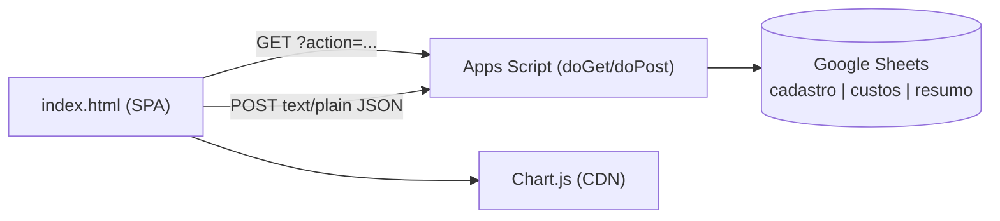

# Carta Traço — Leitura completa, refatoração e mockups

> Escopo lido integralmente:
> - [index.html](../index.html) — 2.072 linhas / 98 KB (CSS ≈ L22-484, HTML ≈ L487-978, JS ≈ L980-2069)
> - [AppsScript_cartaTraco.gs](../AppsScript_cartaTraco.gs) — 446 linhas (backend Google Apps Script + Google Sheets)
>
> Relatório visual (com mockups navegáveis e o HTML do frontend): [carta-traco-analise.html](./carta-traco-analise.html)

> **Nota de escopo:** o módulo é standalone (`/carta-traco`). Não há referência a "carta traço" em `unificado/` nem em `unificado/usinas/`
> (busca feita). A seção 6 (migração) é uma **proposta** baseada na estrutura de pastas de `unificado/usinas`
> (`reporting_service/app.py`, `migrations/*.sql`); esses arquivos **não foram lidos em detalhe**.

---

## 1. Visão geral

PWA de página única (SPA sem framework) para cadastrar **cartas traço** (receita de concreto, kg/m³), manter **custos de materiais**
por unidade e calcular o **MCC** (Composição de Custo de Material).



### Telas (páginas internas, troca por `.page.active`)
| Página | id | Função |
|---|---|---|
| Home | `page-home` | 4 cards de navegação |
| Cadastro | `page-cadastro` | Formulário da carta + grade de 11 materiais + indicadores + MCC |
| Consulta | `page-consulta` | Filtro por unidade, lista de cartas, modal de detalhe (editar/imprimir) |
| Materiais | `page-materiais` | Cadastro de custo, lista, consulta de fornecedores, importação em massa |
| Resumo | `page-resumo` | Tabela do aba `resumo` (MCC consolidado) |

### API (Apps Script)
| Método | action | Função |
|---|---|---|
| GET | `getCartas` (`unidade`, `mostrarInativas`) | Linhas planas da aba `cadastro` |
| GET | `getCustos` (`unidade`) | Histórico de custos (mais recente primeiro) |
| GET | `getResumo` | Aba `resumo` |
| POST | `salvarCarta` | 1 linha por material; inativa versões anteriores; recalcula resumo |
| POST | `salvarCusto` / `salvarCustoBatch` | Append de custo(s) |

### Modelo de dados atual (Sheets, estilo EAV/linha-por-material)
- `cadastro`: ID, Nome, Revisão, Unidade, Status, Vigência, Cadastro, Fornecedor, Produto, Quantidade, Un. Medida, M.E., Obs., Tipo Frete
  (cabeçalho da carta **repetido** em cada linha de material)
- `custos`: ID, Data, Unidade, Fornecedor, Material, Un. Medida, Valor, ICMS %, Frete, Valor Líquido, Produto Fornecedor, Tipo Frete (somente append = histórico)
- `resumo`: recalculado inteiro a cada `salvarCarta`

### Regras de negócio identificadas
- Valor líquido = `valor × (1 − ICMS/100) + frete` (calculado no **cliente**, [L1760-1765](../index.html#L1760-L1765)).
- Conversão para kg ([L1244-1254](../index.html#L1244-L1254)): `ton÷1000`, `litro×M.E.`, `m³÷(M.E.×1000)`, `saco÷50`.
- Indicadores ([L1117-1164](../index.html#L1117-L1164)): peso, volume (Σ kg/M.E.), A/C, tx. argamassa (massa e volume), % aditivos s/ cimento, distribuição areias/britas.
- Editar = pré-preenche o formulário com **revisão + 1** e status Ativa; salvar inativa a anterior (mesmo nome+unidade).

---

## 2. Achados (priorizados)

### 🔴 Críticos
| # | Onde | Problema | Impacto |
|---|---|---|---|
| C1 | [index.html L1872](../index.html#L1872) | `document.getElementById('fornecedores-list')` **não existe** no HTML. `renderCustosList` lança `TypeError` depois de montar a tabela; o `catch` de `carregarCustos` ([L1837-1839](../index.html#L1837-L1839)) sobrescreve a lista com **"Erro ao carregar."** | A lista de "Materiais Cadastrados" não aparece quando há dados |
| C2 | Apps Script L2-L16 / L18 | Web App "Qualquer pessoa", sem token; `SCRIPT_URL` pública no front; `SPREADSHEET_ID` no código | Qualquer pessoa com a URL **lê e grava** custos e cartas |
| C3 | [L1476-1477](../index.html#L1476-L1477) | `onclick='abrirDetalhe(JSON…replace(/'/g,"&#39;"))'`: o navegador decodifica `&#39;` → `'` antes de executar o JS | XSS armazenado: nome de carta com `');…//` executa código |
| C4 | `atualizarResumo` L337-426 vs front L1244-1290 | Resumo no servidor faz `quantidade × valorLíquido` **sem converter unidade** e casa `material|unidade` (ignora fornecedor e usa o último registro). Front converte e casa por fornecedor | **MCC do Resumo ≠ MCC da Consulta/Cadastro** (ex.: material em ton ou saco) |

### 🟠 Altos
| # | Onde | Problema |
|---|---|---|
| A1 | `inativarVersaoAnterior` L214-228 | Inativa **toda** carta ativa com mesmo nome+unidade, sem comparar revisão: salvar Rev. 1 depois da Rev. 3 desativa a Rev. 3 |
| A2 | `salvarCarta` L170-212 | Sem `LockService`: duas gravações simultâneas intercalam linhas e corrompem `resumo` |
| A3 | `inativarVersaoAnterior` | `setValue` por célula em loop (lento, estoura quota com planilha grande) |
| A4 | [L1061](../index.html#L1061) `getToday()` | `toISOString()` é UTC; após ~21h (BRT) a vigência/cadastro sai com **data de amanhã** |
| A5 | [L825](../index.html#L825) | `custo-material` é `<input type="text">` e o JS ([L1741-1754](../index.html#L1741-L1754)) tenta popular como `<select>` (sem efeito). Texto livre ≠ nome exato exigido em `c.material.toLowerCase() === mat.produto.toLowerCase()` ([L1278](../index.html#L1278)) → custo **R$ 0,00** silencioso |
| A6 | `getCartas` L129-168 | Retorna tudo (sem paginação); agrupamento por `nome|unidade|revisao` no cliente; schema repetitivo |
| A7 | Servidor confia no `valorLiquido` enviado pelo cliente | Cálculo financeiro não validado no backend |

### 🟡 Médios
- **Duplicação**: tabela MCC montada 3× ([L1316](../index.html#L1316), [L1578](../index.html#L1578), [L1706](../index.html#L1706)); bloco de indicadores 3× (form/modal/impressão); lista de unidades repetida 5× no HTML; `getCustos` repetido (a cada mudança de unidade, cálculo e abertura de detalhe) sem cache.
- **Regra técnica a validar com o laboratório**: `aglomerante` é calculado e nunca usado ([L1134](../index.html#L1134)); A/C usa só cimento (ignora adição); tx. argamassa em massa considera só areia/(areia+brita) (sem finos de cimento/adição). Não há alerta de fechamento do volume (Σ ≈ 1000 dm³).
- **Editar**: se o fornecedor da carta não existe na lista de custos da unidade, o `<select>` fica vazio e o fornecedor se perde ([L1648](../index.html#L1648)); `tipoFrete` nunca é enviado em `salvarCarta`.
- **Sem edição/exclusão** de custo; sem trilha de auditoria (quem alterou).
- **PWA/segurança de cliente**: `maximum-scale=1, user-scalable=no` (acessibilidade), Chart.js por CDN sem SRI e sem uso offline, meta anti-cache em vez de estratégia de SW.
- **A11y**: cards clicáveis sem teclado, modal sem foco/ESC, grade de materiais com `label` sem `for`.
- **Toast**: `setTimeout` sem `clearTimeout` (toasts consecutivos somem antes).
- **Monólito**: 2.072 linhas em 1 arquivo, estado global com `var`, handlers inline.

---

## 3. Modelo de refatoração A — Correções rápidas (1 dia, sem mudar arquitetura)

```diff
 // index.html — C1: declarar o datalist (ou remover o bloco)
+<datalist id="fornecedores-list"></datalist>
 <input type="text" id="custo-fornecedor" list="fornecedores-list" ...>
```

```js
// A4 — data local (não UTC)
function getToday() {
  const d = new Date();
  const p = n => String(n).padStart(2, '0');
  return `${d.getFullYear()}-${p(d.getMonth() + 1)}-${p(d.getDate())}`;
}
```

```js
// C3 — sem JSON em onclick: guardar no Map e usar data-key + delegação
const cartasIndex = new Map();
function renderCartasList(cartas) {
  const grupos = agruparCartas(cartas);
  cartasIndex.clear();
  container.innerHTML = grupos.map(g => {
    cartasIndex.set(g.key, g);
    return `<div class="carta-card ${g.status === 'Inativa' ? 'inativa' : ''}" data-key="${escapeAttr(g.key)}" tabindex="0" role="button">…</div>`;
  }).join('');
}
container.addEventListener('click', e => {
  const el = e.target.closest('.carta-card'); if (el) abrirDetalhe(cartasIndex.get(el.dataset.key));
});
```

```js
// A5 — material do custo vira <select> (fonte única: catálogo)
// <select id="custo-material" required></select>  (o JS de initCustos já popula)
```

```js
// Apps Script — A1/A2/A3: lock + inativar só revisões menores, em lote
function salvarCarta(payload) {
  const lock = LockService.getScriptLock();
  lock.waitLock(20000);
  try {
    // ...validar payload...
    if (status === 'Ativa') inativarRevisoesMenores(sheet, nome, unidade, revisao);
    const rows = materiais.map(m => [cartaId, nome, revisao, unidade, status, vigencia,
      dataCadastro, m.fornecedor, m.produto, m.quantidade, m.unidade, m.massaEspecifica || 0, observacao, tipoFrete]);
    sheet.getRange(sheet.getLastRow() + 1, 1, rows.length, 14).setValues(rows);
    atualizarResumo();
    return { success: true, id: cartaId };
  } finally { lock.releaseLock(); }
}

function inativarRevisoesMenores(sheet, nome, unidade, revisaoNova) {
  const r = sheet.getDataRange();
  const v = r.getValues();
  let mudou = false;
  for (let i = 1; i < v.length; i++) {
    if (v[i][1] === nome && v[i][3] === unidade && v[i][4] === 'Ativa' && Number(v[i][2]) < revisaoNova) {
      v[i][4] = 'Inativa'; mudou = true;
    }
  }
  if (mudou) r.setValues(v);   // 1 escrita
}
```

---

## 4. Modelo B — Modularização do frontend (sem build obrigatório, ES Modules)

```
carta-traco/
  index.html              # só estrutura + <script type="module" src="src/main.js">
  src/
    main.js               # bootstrap + roteador
    config.js             # API_URL, UNIDADES, CATALOGO_MATERIAIS
    api/client.js         # apiGet/apiPost + cache + timeout + token
    domain/               # PURO, testável
      indicadores.js      # calcularIndicadores(materiais)
      mcc.js              # calcularMCC(materiais, custos)
      conversao.js        # converterCustoParaKg
      cartas.js           # agruparCartas, proximaRevisao
    ui/
      toast.js  modal.js  table.js  indicadores-view.js  mcc-view.js  chart.js
    pages/
      cadastro.js  consulta.js  materiais.js  resumo.js  importacao.js
    print/carta-print.js  # reutiliza mcc-view + indicadores-view
  styles/ tokens.css  base.css  components.css  print.css
  tests/ domain.test.js
```

```js
// src/domain/mcc.js — única fonte da regra (hoje duplicada em 2 lugares + servidor)
import { converterCustoParaKg } from './conversao.js';

export function calcularMCC(materiais, custos, unidade) {
  const itens = materiais.map(m => {
    const custo = custos.find(c =>
      c.unidade === unidade &&
      c.material.toLowerCase() === m.produto.toLowerCase() &&
      (m.fornecedor === '-' || c.fornecedor === m.fornecedor));
    const unit = custo ? converterCustoParaKg(+custo.valorLiquido, custo.unidadeMedida, m.massaEspecifica) : 0;
    return { ...m, fornecedor: custo?.fornecedor ?? '-', custoUnitario: unit,
             custoTotal: m.quantidade * unit, semCusto: !custo };
  });
  const total = itens.reduce((s, i) => s + i.custoTotal, 0);
  return { itens, total, pendencias: itens.filter(i => i.semCusto) };
}
```

```js
// src/domain/indicadores.js — + fechamento de volume (novo)
export function calcularIndicadores(mats) {
  const soma = (f) => mats.filter(f).reduce((s, m) => s + m.quantidade, 0);
  const vol  = (f) => mats.filter(f).reduce((s, m) => s + m.quantidade / m.massaEspecifica, 0);
  const cimento = soma(m => m.produto.startsWith('Cimento'));
  const agua = soma(m => m.grupo === 'agua');
  const volume = vol(() => true);
  return {
    pesoTotal: soma(() => true), volume,
    fechamentoLitros: 1000 - volume,           // alerta se |x| > tolerância definida pelo lab
    relacaoAC: cimento ? agua / cimento : 0,
    // …demais indicadores iguais ao legado…
  };
}
```

```js
// tests/domain.test.js (node --test)
import test from 'node:test'; import assert from 'node:assert';
import { converterCustoParaKg } from '../src/domain/conversao.js';
test('ton → kg', () => assert.equal(converterCustoParaKg(900, 'ton', 1), 0.9));
test('saco → kg', () => assert.equal(converterCustoParaKg(50, 'saco', 1), 1));
```

Ganhos: 1 implementação de MCC/tabela/indicadores (view reaproveitada em tela, modal e impressão), cache de `getCustos` por unidade, testes unitários, ~-40% de código.

---

## 5. Modelo C — Backend Apps Script reestruturado

**Esquema normalizado** (cabeçalho × itens) e resumo calculado **com a mesma regra do front**:

| Aba | Colunas |
|---|---|
| `cartas` | `carta_id, nome, revisao, unidade, status, vigencia, criado_em, criado_por, observacao` |
| `carta_itens` | `carta_id, material, fornecedor, quantidade_kg, massa_especifica` |
| `custos` | `custo_id, vigente_desde, unidade, fornecedor, material, un_medida, valor, icms, frete, tipo_frete, produto_fornecedor, criado_por` (valor líquido **calculado no servidor**) |
| `config` | unidades, catálogo de materiais, fator de saco |

Mudanças-chave:
1. **Token** (`PropertiesService`): `if (e.parameter.token !== props.getProperty('API_TOKEN')) return jsonResponse({error:'unauthorized'})`; mover `SPREADSHEET_ID` para propriedades do script. Para uso interno, publicar como "Somente usuários do domínio".
2. **`getCartas` com itens agrupados** (`{carta, itens[]}`), paginação por `limit/offset`.
3. **Validação** no servidor (revisão única por nome+unidade, quantidades ≥ 0, valor líquido recalculado).
4. **Resumo** reaproveitando `converterCustoParaKg` (portar a função para o `.gs`) → elimina C4.
5. Ações novas: `atualizarCusto`, `desativarCusto`, `getCartaPorId`, `getCustosVigentes` (já filtrados pelo mais recente por unidade+fornecedor+material → reduz payload).

---

## 6. Modelo D — Migração para o stack do hub (proposta)

Hoje o hub (`unificado/`) usa serviços próprios com PostgreSQL e migrações (ex.: `usinas/migrations/001..004`). Proposta: levar Carta Traço para lá, usando o SSO do hub e abandonando o Sheets.

```sql
CREATE TABLE ct_carta (
  id            BIGSERIAL PRIMARY KEY,
  nome          TEXT NOT NULL,
  revisao       INT  NOT NULL,
  unidade       TEXT NOT NULL,
  status        TEXT NOT NULL CHECK (status IN ('Ativa','Inativa')),
  vigencia      DATE NOT NULL,
  observacao    TEXT,
  criado_por    TEXT NOT NULL,
  criado_em     TIMESTAMPTZ NOT NULL DEFAULT now(),
  UNIQUE (nome, unidade, revisao)
);
CREATE UNIQUE INDEX ux_ct_carta_ativa ON ct_carta (nome, unidade) WHERE status = 'Ativa';

CREATE TABLE ct_carta_item (
  carta_id   BIGINT REFERENCES ct_carta(id) ON DELETE CASCADE,
  material   TEXT NOT NULL,
  fornecedor TEXT,
  qtd_kg     NUMERIC(10,3) NOT NULL CHECK (qtd_kg >= 0),
  massa_esp  NUMERIC(5,3)  NOT NULL,
  PRIMARY KEY (carta_id, material)
);

CREATE TABLE ct_custo (
  id            BIGSERIAL PRIMARY KEY,
  unidade       TEXT NOT NULL,
  fornecedor    TEXT NOT NULL,
  material      TEXT NOT NULL,
  un_medida     TEXT NOT NULL,
  valor         NUMERIC(12,4) NOT NULL,
  icms_pct      NUMERIC(5,2)  NOT NULL DEFAULT 0,
  frete         NUMERIC(12,4) NOT NULL DEFAULT 0,
  tipo_frete    TEXT CHECK (tipo_frete IN ('CIF','FOB')),
  valor_liquido NUMERIC(12,4) GENERATED ALWAYS AS (valor * (1 - icms_pct/100) + frete) STORED,
  vigente_desde DATE NOT NULL DEFAULT current_date
);
CREATE VIEW ct_custo_vigente AS
  SELECT DISTINCT ON (unidade, fornecedor, material) *
  FROM ct_custo ORDER BY unidade, fornecedor, material, vigente_desde DESC, id DESC;
```

Ganhos: unicidade de carta ativa **garantida pelo banco** (resolve A1/A2), valor líquido gerado (A7), MCC por view/endpoint único (C4), auditoria, permissões do SSO (C2).
Plano de migração: (1) exportar abas → CSV; (2) script de carga com reconciliação (somar MCC antes/depois); (3) rodar em paralelo lendo do Sheets até validar; (4) desligar o Apps Script.

---

## 7. Mockups

> Versões renderizadas e navegáveis em [carta-traco-analise.html](./carta-traco-analise.html#mockups).

### M1 — Home com KPIs e alertas
```
┌─────────────────────────────────────────────────────────────┐
│ ← Hub   CARTAS TRAÇO                    [Unidade ▾ Todas]   │
├─────────────────────────────────────────────────────────────┤
│ ┌──────────┐ ┌──────────┐ ┌──────────┐ ┌──────────────────┐ │
│ │ 42 ativas│ │ MCC médio│ │ 7 sem    │ │ Últ. reajuste    │ │
│ │          │ │ R$ 312,40│ │ custo ⚠  │ │ cimento: 12/10   │ │
│ └──────────┘ └──────────┘ └──────────┘ └──────────────────┘ │
│  [+ Nova carta]  [Consultar]  [Materiais]  [Resumo]          │
│  Pendências: "FCK 40 – Campinas: Aditivo 2 sem custo"        │
└─────────────────────────────────────────────────────────────┘
```

### M2 — Editor de carta (split: formulário | indicadores ao vivo)
```
┌───────────────────────────────┬─────────────────────────────┐
│ Nome [FCK 25]  Rev [3]        │  INDICADORES (ao vivo)      │
│ Unidade [Campinas ▾] Vig [..] │  Peso 2.380 kg/m³           │
├───────────────────────────────┤  A/C 0,45     Arg. 52,1 %   │
│ Material   Fornec.  kg   M.E. │  Fechamento: -3,2 L  ✔      │
│ Cimento CPV [ ▾ ]  380  3,15  │  ─────────────────────────  │
│ Areia Fina  [ ▾ ]  420  2,63  │  MCC  R$ 318,92             │
│ Brita 1     [ ▾ ]  980  2,75  │  ◔ gráfico de custo         │
│ …                             │  ⚠ Aditivo 2 sem custo      │
│ [Salvar Rev. 3]  [Limpar]     │  [Comparar com Rev. 2]      │
└───────────────────────────────┴─────────────────────────────┘
```

### M3 — Consulta com comparação de revisões
```
Filtros: [Unidade ▾] [Status ▾] [Busca nome…]          42 cartas
┌───────────────┬─────┬─────────┬───────────┬──────────┬───────┐
│ Carta         │ Rev │ Unidade │ Vigência  │ MCC      │ Status│
│ FCK 25        │ 3   │ Campinas│ 12/10/26  │ 318,92   │ ● Ativa
│ FCK 30        │ 5   │ Campinas│ 01/10/26  │ 341,10   │ ● Ativa
└───────────────┴─────┴─────────┴───────────┴──────────┴───────┘
 ▸ Drawer lateral: indicadores, MCC, histórico de revisões (Δ MCC +2,1 %)
```

### M4 — Materiais com histórico de preço
```
Material [Cimento CP V ▾]   Unidade [Todas ▾]      [+ Novo custo] [Importar]
 Fornecedor      Líquido/ton   Tipo   Vigente desde   Tendência
 Votorantim      R$ 612,00     CIF    12/10/26        ▁▂▃▅▇  +4,1 %
 CSN             R$ 598,30     FOB    01/09/26        ▃▃▄▄▅  +1,2 %
```

---

## 8. Roadmap sugerido

| Fase | Entrega | Esforço | Risco |
|---|---|---|---|
| 0 | Modelo A: C1, A4, C3, A5 + lock/inativação (A1-A3) | 1 dia | Baixo |
| 1 | Token no Apps Script + paridade MCC servidor↔front (C2, C4) | 2 dias | Baixo |
| 2 | Modularização do front (Modelo B) + testes de domínio | 3-4 dias | Médio |
| 3 | Redesenho UI (mockups M1-M4), a11y, comparação de revisões | 4-5 dias | Médio |
| 4 | Migração para PostgreSQL/SSO (Modelo D) | 1-2 sem | Alto (reconciliação) |

**Decisões pendentes (suas):** (1) manter Google Sheets ou migrar (Modelo D)? (2) confirmar com o laboratório as fórmulas de A/C e taxa de argamassa; (3) tolerância de fechamento de volume.
