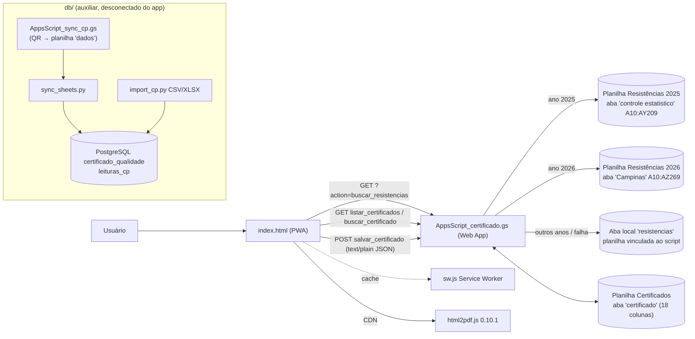
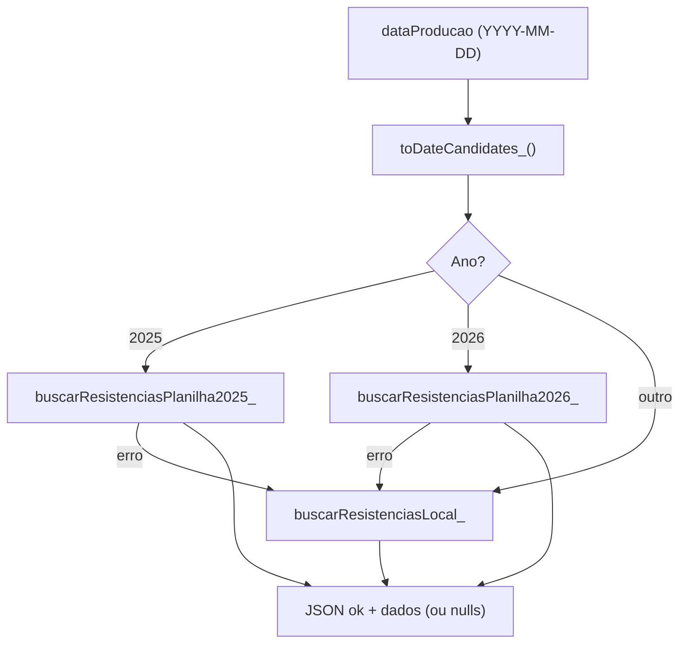

# Mapeamento — Certificado de Qualidade (Postes de Concreto / Concrefer)

PWA estático (HTML+JS puro) que emite certificados de qualidade de postes, busca resistências de compressão em planilhas Google e salva o histórico em outra planilha via Google Apps Script. Há também uma trilha auxiliar PostgreSQL (`db/`) **não conectada** ao app.

---

## 1. Visão geral da arquitetura



### Arquivos

| Arquivo | Papel |
|---|---|
| `index.html` | UI + CSS + toda a lógica JS (1081 linhas) |
| `AppsScript_certificado.gs` | Backend (doGet/doPost) sobre Google Sheets |
| `sw.js` | Service worker (cache do app shell) |
| `manifest.webmanifest`, `pwa-192/512.png` | Instalação PWA |
| `concre.png` | Ícone do cabeçalho da tela |
| `logo-concrefer.png` | Logo dentro do certificado impresso |
| `resistencias_2025.csv.csv` | Export local de 2025 (dupla extensão, não usado pelo app) |
| `.github/workflows/deploy-pages.yml` | Deploy GitHub Pages |
| `db/*` | Trilha PostgreSQL + sync dos CPs por QR |
| `README.md`, `RELATORIO_SITUACAO.md` | Docs existentes |

---

## 2. Layout (front-end)

Container `.wrap` (max 1080px), tema claro, cor de destaque `#1E40AF` (azul) e `#7C3AED` (roxo nas tabelas de resistência). Fonte Segoe UI/system-ui.

### 2.1 Estrutura da tela

```
Header (.header-bar): ícone concre.png + "Certificado de Qualidade" + subtítulo
accentLine (gradiente azul→roxo)
Tabs: [📝 Emitir Certificado] [📋 Histórico]

#secEmitir
 ├─ Card Identificação:  Nº Certificado (readonly, auto) | Data de Emissão
 ├─ Card Cliente:        Cliente | Endereço
 ├─ Card Produto:        Nota Fiscal + tabela dinâmica de postes + [➕ Adicionar Poste]
 │     colunas: Modelo | Altura(m) | Carga Horiz.(daN) | Peso(Kg) | Qtd | Data Prod. | Lote(readonly) | ✕
 ├─ Card Resistências:   pill de status + [🔍 Buscar Resistências]
 │     tabela editável: Data Produção | 3d | 7d | 28d (MPa) | Resultado
 ├─ Card Responsáveis:   Resp. Técnico (fixo/readonly) | Resp. Laboratório
 ├─ Card Observações:    textarea (texto padrão da prensa/calibração)
 ├─ Card Ações:          [✅ Gerar Certificado] / [🖨️ Imprimir] [💾 Salvar] [🗑️ Limpar]
 └─ #certPreview (oculto até gerar) → .cert (documento A4)

#secHistorico
 └─ Card: filtros (Data, Cliente) + [🔄 Atualizar Lista] + lista .cert-item com badge de status
```

### 2.2 Documento do certificado (`#certBody`)

1. **Cabeçalho** (grid 3 col): logo | "Certificado de Qualidade / Concrefer — Postes de Concreto" | Nº (`cNumV`)
2. Título "Postes de Concreto"
3. Tabela info: Cliente (`cCliente`), Data Emissão (`cDataEmissao`), Endereço (`cEndereco`), Nota Fiscal (`cNF`)
4. Tabela produtos (`cProdBody`): 7 colunas
5. Tabela resistências (`cResBody`): Data × 3d/7d/28d + resultado
6. Normas: NBR 8451-1 a 8451-5 (texto fixo)
7. Observações (`cObs`)
8. Rodapé: assinatura Resp. Laboratório (`cFooterLab`) | carimbo "Emissão eletrônica" + data (`cFooterData`) + "Certificado Qualidade v1.0" | assinatura fixa Eng. Marcelo Eduardo I. de Sousa (CREA 5063392251)

### 2.3 Responsividade / impressão
- `@media (max-width:640px)`: grids viram 1 coluna, cabeçalho do certificado empilha.
- `@media print`: esconde tudo exceto `#certPreview`; A4 retrato, margens 10×8mm; `print-color-adjust: exact`; tabela de produtos com larguras fixas (38/10/12/10/6/12/12 %).
- Toast flutuante e spinner para feedback.

---

## 3. Funções do front (`index.html`)

### Config / constantes
| Item | Valor/Função |
|---|---|
| `CONFIG.API_URL` | URL do Web App Apps Script |
| `CONFIG.FCK_PADRAO` | **35 MPa** (critério de conformidade, fixo) |
| `RESP_TEC` | Responsável técnico fixo (nome + CREA) |
| `OBS_PADRAO` | Texto padrão (prensa PC100C Emic, calibração validade 20/03/26) |

### Helpers
| Função | O que faz |
|---|---|
| `el(id)` | `getElementById` |
| `pad2`, `fmtInput(Date)`, `fmtBR('YYYY-MM-DD')`, `addDays(str,n)` | Formatação/aritmética de datas |
| `toast(msg)` | Mensagem temporária |
| `gerarNumeroCert()` | `CQ-AAAAMMDD-HHMMSS` (baseado no horário atual) |
| `sanitizeFilePart`, `buildPdfFileName()` | Nome `Certificado de Qualidade_<data>_<cliente>_<nº>` |

### Fluxo principal
| Função | Lógica |
|---|---|
| `init()` | Preenche data de hoje, gera nº, cria 1 linha de poste |
| Tabs (listener) | Alterna seções; ao abrir Histórico chama `carregarHistorico()` |
| `addProduto()` / `removeProduto(id)` | Adiciona/remove `<tr>` de poste (sempre mantém ≥1 linha) e reconstrói resistências |
| `getProdutos()` | Lê inputs por **índice posicional** (0–6): modelo, altura, carga, peso, qtd, data, lote. Ignora linha sem modelo/altura/carga |
| `autoLoteRow(input)` | Data de produção → lote `LYYYYMMDD` |
| `getUniqueDates()` | Datas de produção únicas e ordenadas |
| `saveResFromTable()` | Lê inputs da tabela de resistência → `RES_MAP[data] = {r3,r7,r28}` |
| `rebuildResTable(skipSave)` | Recria linhas por data a partir de `RES_MAP`; calcula status pelo **28d ≥ fck** |
| `onResInput()` | Salva + reconstrói ao editar valor |
| `buscarResistencias()` | Para cada data: `GET API?action=buscar_resistencias&dataProducao=...`; preenche `RES_MAP`; atualiza pill (ok/bad/loading) |
| `gerarCertificado()` | Valida cliente + ≥1 poste, preenche o documento, monta tabelas, mostra preview |
| `imprimirCertificado()` | Define `document.title` = nome do arquivo e chama `window.print()` |
| `exportarPDF()` | Usa html2pdf.js (A4). **Definida mas sem botão na UI** |
| `salvarCertificado()` | Monta payload e faz `POST` (`Content-Type: text/plain` p/ evitar preflight CORS) |
| `statusGeral()` | Pendente (sem 28d) / Reprovado (algum 28d < fck) / Aprovado |
| `carregarHistorico()`, `filtrarHistorico()`, `renderHist()` | Lista via `listar_certificados`, filtra por data (emissão ou produção) e cliente (client-side) |
| `carregarCert(num)` | `buscar_certificado` → repopula formulário, volta à aba Emitir e chama `gerarCertificado()` |
| `limparFormulario()` | Reseta campos, `RES_MAP`, preview, novo nº |
| Registro SW | `navigator.serviceWorker.register('sw.js')` no `load` |

### Regras de negócio no front
- Conforme se `r28 ≥ 35`; sem 28d → "Aguardando Rompimento".
- Lote deriva da data de produção; resistência é por **data de produção** (vários postes com a mesma data compartilham a linha).
- Resp. técnico é fixo; observação padrão restaurada ao limpar.

---

## 4. Backend — `AppsScript_certificado.gs`

### 4.1 Fontes de dados (o que lê e como)

| Fonte | ID/Config | Leitura | Colunas usadas |
|---|---|---|---|
| **Resistências 2025** | `RES_2025_SPREADSHEET_ID`, gid `2145602861` (fallback nome "controle estatistico") | Linhas 10→fim, 51 colunas (A..AY) | Data = **A**; r3 = **AC** (idx 28); r7 = **AO** (idx 40); r28 = **AY** (idx 50) |
| **Resistências 2026** | `RES_2026_SPREADSHEET_ID`, gid `2145602861` (fallback nome "Campinas") | Linhas 10→fim, 52 colunas (A..AZ) | Data = **A**; r3 = **AB** (27); r7 = **AN** (39); r28 = **AZ** (51) |
| **Aba local `resistencias`** (fallback) | Planilha vinculada ao script | A2:I | A data, D r3, E data3, F r7, G data7, H r28, I data28 |
| **Certificados** | `CERT_SPREADSHEET_ID`, aba `certificado` | Escrita/leitura 18 colunas | Ver 4.3 |

> Atenção: o gid de 2025 e 2026 é o mesmo número; a busca por gid é tentada primeiro e, se não achar, cai para o nome da aba.

### 4.2 Endpoints

| Método | `action` | Função | Retorno |
|---|---|---|---|
| GET | *(vazio)* | status | `{status:"online", abas, actions}` |
| GET | `buscar_resistencias&dataProducao=` | `buscarResistencias` | `{ok, dados:{r3,r7,r28,d3,d7,d28}, message}` |
| GET | `debug_resistencia&dataProducao=` | `debugResistencia` | Diagnóstico (candidatos de data, 10 amostras, linha encontrada) |
| GET | `listar_certificados` | `listarCertificados` | `{ok, certificados:[{numCert,dataEmissao,cliente,dataProducao,lote,status}]}` (mais recentes primeiro) |
| GET | `buscar_certificado&numCert=` | `buscarCertificado` | `{ok, certificado:{…17 campos…}}` |
| POST | `salvar_certificado` | `salvarCertificado` | `{ok, message, numCert}` — **upsert** por `numCert` |

### 4.3 Colunas da aba `certificado`
1 Nº Certificado · 2 Data Emissão · 3 Cliente · 4 Endereço · 5 Nota Fiscal · 6 Data Produção · 7 Lote · 8 Produtos (JSON) · 9 Resp. Técnico · 10 Resp. Lab · 11-13 Res 3/7/28 · 14-16 Datas Res 3/7/28 · 17 Observações · 18 Status

### 4.4 Lógica de busca de resistência



- **Parse de datas tolerante** (`toDateCandidates_`): aceita `Date`, ISO, `dd/mm/aaaa`, `dd/mm/aa`, com `-`. Para formatos ambíguos gera **candidatos dd/mm e mm/dd**; `hasDateMatch_` compara com a coluna A (valor bruto **e** valor exibido).
- **Números** (`parseNum`/`parseNumPrefer_`): aceita vírgula/ponto pt-BR (`1.234,5`), tenta valor bruto e depois o texto exibido.
- Primeira linha cuja data casar é usada (`break`/`return`).
- Datas de ruptura (`d3/d7/d28`) só existem no fallback local; nas planilhas 2025/2026 são `null`.

### 4.5 Utilitários
`getOrCreateSheet`, `getOrCreateCertificadosSheet_`, `setup()` (cria abas e cabeçalhos formatados azul), `formatDateStr`, `parseNum`, `buildYmd_`, `normalizeYear_`, `jsonOk`.

---

## 5. Contrato de dados Front ⇄ Backend (salvar)

Payload enviado por `salvarCertificado()`:

```json
{
  "action": "salvar_certificado",
  "numCert": "CQ-20261017-215300",
  "dataEmissao": "2026-10-17", "cliente": "", "endereco": "", "notaFiscal": "",
  "dataProducao": "<primeira data>", "lote": "<lote do 1º poste>",
  "produtos": "[{modelo,altura,carga,peso,qtd,data,lote}]",
  "respTecnico": "…", "respLab": "…",
  "res3": 0, "res7": 0, "res28": 0,
  "dataRes3": "+3d", "dataRes7": "+7d", "dataRes28": "+28d",
  "resistencias": "{\"YYYY-MM-DD\":{r3,r7,r28}}",
  "observacoes": "", "status": "Aprovado|Reprovado|Pendente"
}
```

### Lacunas conhecidas no contrato
| # | Problema |
|---|---|
| 1 | `resistencias` (mapa completo por data) é enviado mas **o backend não grava nem devolve** — só persiste res3/7/28 da **primeira data**. Reabrir certificado com várias datas perde dados (o front cai no fallback da 1ª data). |
| 2 | `buscarCertificado` não retorna `resistencias` (front tenta ler `c.resistencias`). |
| 3 | `dataRes3/7/28` são calculadas no front como data + N dias (não são datas reais de ruptura). |
| 4 | `salvarCertificado` não valida campos nem exige autenticação (acesso "qualquer pessoa"). |
| 5 | Texto de `observacoes` e `FCK_PADRAO` fixos no código; calibração de 20/03/26 já vencida. |
| 6 | `exportarPDF()` existe mas não é acionada por nenhum botão. |
| 7 | `renderHist` injeta `numCert` em `onclick` inline sem escape (risco de quebra/XSS). |
| 8 | Dois ids de aba em constantes (`SHEET_CERTIFICADOS` vs `CERT_SHEET_NAME`) com mesmo valor — redundância. |

---

## 6. PWA / Service Worker (`sw.js`)

- Cache `certificado-pwa-v1`; pré-cache: `./`, `index.html`, manifest, 3 PNGs de ícone/logo.
- `install` → `skipWaiting`; `activate` → apaga caches antigos + `clients.claim`.
- `fetch`: ignora não-GET e outras origens (**Apps Script e CDN não passam pelo SW**).
  - Navegação: **network-first** (atualiza cache de `index.html`; offline usa cache).
  - Demais same-origin: **cache-first** com preenchimento dinâmico.
- Sem fila offline de gravações; PDF/print dependem de CDN (html2pdf) e a API exige rede.
- Para forçar atualização: alterar `CACHE_NAME`.
- Meta tags no HTML também pedem `no-cache` ao navegador.

---

## 7. Trilha auxiliar PostgreSQL (`db/`) — *fora do fluxo do app*

| Arquivo | Função |
|---|---|
| `AppsScript_sync_cp.gs` | Outro Web App (planilha `dados`): recebe POST de leituras de CP via QR (`traco_id`, `data_moldagem`, `idade_dias`, `cp`, `mpa`, operador…), calcula status vs. faixa meta (1d 8–14, 3d 16–24, 7d 22–32, 28d 32–42 MPa), expõe `?action=exportar_cp` e `?view=dashboard` |
| `sync_sheets.py` | Lê `exportar_cp` e insere novos registros (dedupe por `qr_raw`) em `leituras_cp` |
| `import_cp.py` | Cria `leituras_cp` (**DROP TABLE CASCADE**), importa CSV 2025 (despivota 1/3/7/28d) e XLSX 2026 |
| `schema.sql` | Tabelas `resistencias` e `certificados` (não usadas pelo app) |
| `import.sql`, `setup.bat` | Importação/instalação local |

Observações: scripts Python têm **senha do banco fixa no código** (deve ser rotacionada/movida para variável de ambiente); caminhos de importação apontam para `Downloads`.

---

## 8. Sequências principais

**Emitir + buscar resistência**
1. Usuário preenche postes e datas → `rebuildResTable()` cria linhas por data.
2. `Buscar Resistências` → 1 GET por data → `RES_MAP` → tabela preenchida (editável).
3. `Gerar Certificado` → preenche `#certBody` → `Imprimir` (print do navegador, nome de arquivo via `document.title`).
4. `Salvar` → POST → upsert na aba `certificado`.

**Reabrir do histórico**
1. Aba Histórico → `listar_certificados` → clique no item → `buscar_certificado`.
2. Repopula campos/produtos; `RES_MAP` reconstruído do JSON (inexistente hoje) ou da 1ª data; volta à aba Emitir e regenera o preview.

---

## 9. Sugestões de melhoria (prioridade)

1. **Persistir `resistencias` (JSON) em nova coluna 19** e devolvê-la em `buscarCertificado`.
2. Autenticação/validação no `doPost` (token simples + validação de campos).
3. Remover credenciais do código (`db/*.py`) e tornar o import não destrutivo.
4. Mover `FCK_PADRAO`, observação e validade de calibração para configuração editável.
5. Adicionar botão para `exportarPDF()` e escapar valores nos `innerHTML`/`onclick`.
6. Decidir o papel do PostgreSQL (análise vs. substituto do Sheets).
