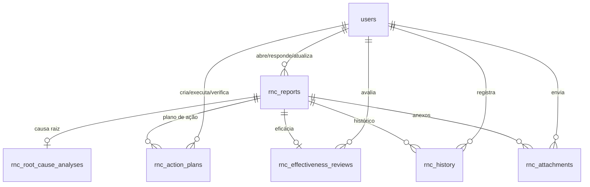
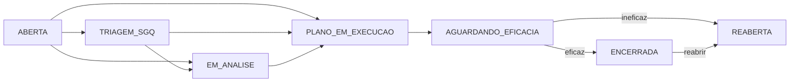

# Esquema de RNC do GED Concretrack

**Fonte de verdade:** esquema PostgreSQL 16.13 em produção no contêiner `ged_postgres` da aplicação `ged.concretrack.com.br`, consultado em 15/10/2026. O comportamento foi conferido em `/opt/ged_concrefer/backend/src/controllers/rncController.js` e `src/routes/rncRoutes.js`. Este documento descreve o estado existente; não executa migração.

## Visão geral

RNC = Registro de Não Conformidade. O módulo possui uma tabela principal e cinco tabelas filhas:

Todas as tabelas ficam no esquema `public`, usam `id uuid` como chave primária com padrão `gen_random_uuid()` e `rnc_id` como FK nas filhas. A exclusão de um registro em `rnc_reports` apaga as linhas filhas por `ON DELETE CASCADE`; referências a `users(id)` não usam cascade. A API atual **não expõe DELETE de RNC**.

### Volume observado

| Tabela | Linhas em 15/10/2026 | Cardinalidade por RNC |
|---|---:|---|
| `rnc_reports` | 3 | Registro principal |
| `rnc_root_cause_analyses` | 0 | 0 ou 1, por UNIQUE(`rnc_id`) |
| `rnc_action_plans` | 0 | 0 a N |
| `rnc_effectiveness_reviews` | 0 | 0 ou 1, por UNIQUE(`rnc_id`) |
| `rnc_history` | 9 | 0 a N |
| `rnc_attachments` | 0 | 0 a N |

## Tipos ENUM reais do banco

| Tipo | Valores permitidos em ordem do PostgreSQL |
|---|---|
| `rnc_status` | `ABERTA`, `TRIAGEM_SGQ`, `EM_ANALISE`, `PLANO_EM_EXECUCAO`, `AGUARDANDO_EFICACIA`, `ENCERRADA`, `CANCELADA`, `REABERTA` |
| `rnc_severity` | `CRITICA`, `ALTA`, `MEDIA`, `BAIXA` |
| `rnc_origin` | `CLIENTE`, `PROCESSO_INTERNO`, `FORNECEDOR`, `AUDITORIA_INTERNA`, `AUDITORIA_EXTERNA`, `INSPECAO`, `SEGURANCA`, `AMBIENTAL`, `RECLAMACAO`, `OUTRO` |
| `rnc_type` | `PRODUTO`, `PROCESSO`, `SISTEMA_GESTAO`, `FORNECEDOR`, `CLIENTE`, `SEGURANCA`, `AMBIENTAL`, `DOCUMENTAL`, `OUTRO` |
| `rnc_root_cause_method` | `5_PORQUES`, `ISHIKAWA_6M`, `PARETO`, `ESTRATIFICACAO`, `FALHA_CLASSIFICADA` |
| `rnc_action_type` | `CONTENCAO`, `CORRETIVA_IMEDIATA`, `CORRETIVA`, `PREVENTIVA` |
| `rnc_action_status` | `PENDENTE`, `EM_ANDAMENTO`, `CONCLUIDA`, `ATRASADA`, `CANCELADA` |
| `rnc_history_type` | `ABERTURA`, `TRIAGEM`, `ATRIBUICAO`, `MUDANCA_STATUS`, `ANALISE_CAUSA`, `PLANO_ACAO`, `ANEXO`, `EFICACIA`, `COMENTARIO`, `ENCERRAMENTO`, `REABERTURA` |
| `document_area` | `LABORATORIO`, `QUALIDADE`, `PRODUCAO`, `ENGENHARIA`, `ADMINISTRATIVO`, `SEGURANCA`, `AEE`, `COM`, `CQC`, `INJ`, `MAN`, `PCP`, `PJT`, `PRO`, `REC`, `RHU`, `SGA`, `SGQ`, `SST`, `VEN` |

`document_area` é compartilhado com o GED de documentos. O arquivo inicial `migrations.sql` contém menos valores de área que o banco vivo; ao restaurar, usar dump do esquema real para manter os valores adicionados posteriormente.

## Tabelas e campos

Legenda: **NN** = `NOT NULL`; **UQ** = restrição `UNIQUE`; campos sem NN aceitam `NULL`. Todos os `timestamp with time zone` são `timestamptz`.

### 1. `rnc_reports` — registro principal

| Campo | Tipo / regra | Significado |
|---|---|---|
| `id` | uuid, PK, NN, padrão `gen_random_uuid()` | Identificador estável |
| `number` | varchar(50), NN, UQ | Número legível, gerado pela API como `RNC-AAAA-NNNN` |
| `title` | varchar(255), NN | Título |
| `status` | `rnc_status`, NN, padrão `ABERTA` | Etapa atual |
| `severity` | `rnc_severity`, NN, padrão `MEDIA` | Gravidade |
| `origin` | `rnc_origin`, NN, padrão `OUTRO` | Origem |
| `rnc_type` | `rnc_type`, NN, padrão `PROCESSO` | Tipo de ocorrência |
| `emitter_area` | `document_area`, NN, padrão `SGQ` | Área emissora |
| `destination_area` | `document_area`, NN, padrão `SGQ` | Área destinatária |
| `occurrence_at` | timestamptz, NN, padrão `now()` | Quando ocorreu |
| `detected_at` | timestamptz, NN, padrão `now()` | Quando foi detectada |
| `requirement_reference` | text | Requisito/norma |
| `description` | text, NN, padrão `''` | Descrição |
| `evidence_description` | text | Evidências narradas |
| `impact_description` | text | Impacto |
| `containment_action` | text | Contenção inicial |
| `source_reference` | text | Referência de origem |
| `product_reference` | text | Produto |
| `process_reference` | text | Processo |
| `lot_reference` | text | Lote |
| `supplier_reference` | text | Fornecedor |
| `customer_reference` | text | Cliente |
| `order_reference` | text | Pedido |
| `responsible_sector_user_id` | uuid, FK → `users.id` | Responsável designado |
| `assigned_by` | uuid, FK → `users.id` | Quem designou |
| `triage_notes` | text | Observações da triagem |
| `conclusion_summary` | text | Conclusão |
| `due_date` | date | Prazo da RNC |
| `closed_at` | timestamptz | Encerramento |
| `closed_by` | uuid, FK → `users.id` | Quem encerrou |
| `reopened_at` | timestamptz | Reabertura |
| `reopened_by` | uuid, FK → `users.id` | Quem reabriu |
| `created_by` | uuid, NN, FK → `users.id` | Autor |
| `updated_by` | uuid, FK → `users.id` | Último editor |
| `created_at` | timestamptz, NN, padrão `now()` | Criação |
| `updated_at` | timestamptz, NN, padrão `now()` | Última atualização |

**Índices:** PK(`id`), UQ(`number`), índices btree em `status`, `emitter_area`, `destination_area`, `responsible_sector_user_id`, `created_by` e `due_date`. Trigger `set_rnc_reports_updated_at` executa `update_updated_at_column()` antes de UPDATE.

### 2. `rnc_root_cause_analyses` — análise de causa

| Campo | Tipo / regra | Significado |
|---|---|---|
| `id` | uuid, PK, NN, padrão `gen_random_uuid()` | Identificador |
| `rnc_id` | uuid, NN, UQ, FK → `rnc_reports.id` com cascade | Uma análise por RNC |
| `method` | `rnc_root_cause_method`, NN, padrão `5_PORQUES` | Método |
| `problem_statement` | text, NN, padrão `''` | Problema |
| `direct_cause` | text | Causa direta |
| `root_cause` | text | Causa raiz |
| `contributing_causes` | text | Causas contribuintes |
| `method_payload` | jsonb, NN, padrão `{}` | Dados específicos do método |
| `validated_by` | uuid, FK → `users.id` | Validador |
| `created_by` | uuid, NN, FK → `users.id` | Autor |
| `created_at` | timestamptz, NN, padrão `now()` | Criação |
| `updated_at` | timestamptz, NN, padrão `now()` | Atualização |

**Restrições:** PK(`id`), UQ(`rnc_id`). Trigger `set_rnc_root_cause_analyses_updated_at` antes de UPDATE. A API faz `INSERT ... ON CONFLICT (rnc_id) DO UPDATE`; exige `method`, `problem_statement` e `root_cause`, mesmo que o banco aceite causa raiz nula. O frontend pode enviar `CINCO_PORQUES` ou `ISHIKAWA`; a API normaliza para `5_PORQUES` e `ISHIKAWA_6M`.

### 3. `rnc_action_plans` — ações 5W2H

| Campo | Tipo / regra | Significado |
|---|---|---|
| `id` | uuid, PK, NN, padrão `gen_random_uuid()` | Identificador |
| `rnc_id` | uuid, NN, FK → `rnc_reports.id` com cascade | RNC |
| `action_type` | `rnc_action_type`, NN, padrão `CORRETIVA` | Tipo |
| `status` | `rnc_action_status`, NN, padrão `PENDENTE` | Situação |
| `action_description` | text, NN, padrão `''` | O que será feito |
| `why` | text | Por quê |
| `where_action` | text | Onde |
| `who_user_id` | uuid, FK → `users.id` | Quem executa |
| `when_due` | date | Quando/prazo |
| `how` | text | Como |
| `how_much` | numeric(12,2) | Custo |
| `evidence` | text | Evidência de execução |
| `completed_at` | timestamptz | Conclusão |
| `verified_by` | uuid, FK → `users.id` | Verificador |
| `verification_notes` | text | Notas da verificação |
| `created_by` | uuid, NN, FK → `users.id` | Autor |
| `created_at` | timestamptz, NN, padrão `now()` | Criação |
| `updated_at` | timestamptz, NN, padrão `now()` | Atualização |

**Índices:** PK(`id`), btree em `rnc_id`, `status` e `who_user_id`. Trigger `set_rnc_action_plans_updated_at` antes de UPDATE. A API exige `action_description` ao criar. Quando todas as ações estiverem com status `CONCLUIDA`, a RNC é colocada em `AGUARDANDO_EFICACIA` (exceto se já estiver `ENCERRADA`).

### 4. `rnc_effectiveness_reviews` — avaliação de eficácia

| Campo | Tipo / regra | Significado |
|---|---|---|
| `id` | uuid, PK, NN, padrão `gen_random_uuid()` | Identificador |
| `rnc_id` | uuid, NN, UQ, FK → `rnc_reports.id` com cascade | Uma avaliação vigente por RNC |
| `effectiveness_result` | boolean, NN | Eficaz ou não |
| `reviewed_by` | uuid, NN, FK → `users.id` | Avaliador |
| `reviewed_at` | timestamptz, NN, padrão `now()` | Data |
| `notes` | text | Observações |
| `follow_up_required` | boolean, NN, padrão `false` | Requer acompanhamento |

**Restrições:** PK(`id`), UQ(`rnc_id`). A API sobrescreve a avaliação existente por `ON CONFLICT (rnc_id) DO UPDATE`. Resultado `true` põe a RNC em `ENCERRADA`; `false` põe em `REABERTA`. O histórico registra a avaliação, mas a tabela mantém apenas o estado mais recente.

### 5. `rnc_history` — trilha de eventos

| Campo | Tipo / regra | Significado |
|---|---|---|
| `id` | uuid, PK, NN, padrão `gen_random_uuid()` | Identificador |
| `rnc_id` | uuid, NN, FK → `rnc_reports.id` com cascade | RNC |
| `event_type` | `rnc_history_type`, NN, padrão `COMENTARIO` | Tipo de evento |
| `description` | text, NN, padrão `''` | Texto |
| `metadata` | jsonb, NN, padrão `{}` | Dados estruturados do evento |
| `created_by` | uuid, FK → `users.id` | Autor, pode ser nulo |
| `created_at` | timestamptz, NN, padrão `now()` | Data |

**Índices:** PK(`id`), btree em `rnc_id`. A API grava eventos de abertura, triagem, status, causa, ação, eficácia, comentário, anexo, encerramento e reabertura. Não há API de edição/exclusão de histórico.

### 6. `rnc_attachments` — metadados de arquivos

| Campo | Tipo / regra | Significado |
|---|---|---|
| `id` | uuid, PK, NN, padrão `gen_random_uuid()` | Identificador |
| `rnc_id` | uuid, NN, FK → `rnc_reports.id` com cascade | RNC |
| `file_name` | varchar(500), NN | Nome armazenado |
| `original_name` | varchar(500), NN | Nome enviado |
| `mime_type` | varchar(100), NN | Tipo MIME |
| `file_size` | bigint | Tamanho em bytes |
| `storage_path` | text | URL/caminho público relativo |
| `uploaded_by` | uuid, NN, FK → `users.id` | Autor |
| `created_at` | timestamptz, NN, padrão `now()` | Envio |

**Índices:** PK(`id`), btree em `rnc_id`. O arquivo não fica no PostgreSQL: a API grava em `/opt/ged_concrefer/backend/uploads/rnc/<rnc_id>/` e registra `/uploads/rnc/<rnc_id>/<arquivo>` em `storage_path`. Limite por anexo: **25 MB**. MIME aceitos: PDF, PNG, JPEG, WebP, TXT, DOC/DOCX e XLS/XLSX. O backend serve `/uploads` como arquivos estáticos sem autenticação; isso precisa ser considerado na consolidação.

## Relacionamentos e integridade

| Origem | Destino | Regra |
|---|---|---|
| `rnc_reports.{created_by,updated_by,responsible_sector_user_id,assigned_by,closed_by,reopened_by}` | `users.id` | FK; apenas `created_by` é NN |
| `rnc_root_cause_analyses.rnc_id` | `rnc_reports.id` | FK, cascade, UQ |
| `rnc_root_cause_analyses.{created_by,validated_by}` | `users.id` | FK; `created_by` NN |
| `rnc_action_plans.rnc_id` | `rnc_reports.id` | FK, cascade |
| `rnc_action_plans.{created_by,who_user_id,verified_by}` | `users.id` | FK; `created_by` NN |
| `rnc_effectiveness_reviews.rnc_id` | `rnc_reports.id` | FK, cascade, UQ |
| `rnc_effectiveness_reviews.reviewed_by` | `users.id` | FK, NN |
| `rnc_history.rnc_id`, `rnc_attachments.rnc_id` | `rnc_reports.id` | FK, cascade |
| `rnc_history.created_by`, `rnc_attachments.uploaded_by` | `users.id` | FK; `uploaded_by` NN |

`rnc_reports` **não possui `company_id`** nem FK para `companies`; o controle de visibilidade é feito no código por usuário, responsabilidade e área. Esse é um ponto de desenho para a integração multissetor/multicompanhia no Unificado.

## Regras de fluxo implementadas na API

- **Abertura:** `POST /api/rnc` exige título, origem, descrição, área emissora e destinatária. Gera `RNC-AAAA-NNNN` calculando `count(*) + 1` de registros criados no ano; grava evento `ABERTURA`.
- **Triagem:** `PATCH /api/rnc/:id/triage` define responsável, prazo, observações e status (padrão `TRIAGEM_SGQ`); somente `ADMIN`, `ADMIN_MASTER` ou `QUALIDADE`.
- **Causa raiz:** `PUT /api/rnc/:id/root-cause` faz upsert da análise única. Se a RNC estiver `ABERTA` ou `TRIAGEM_SGQ`, muda para `EM_ANALISE`.
- **Plano:** `POST /api/rnc/:id/actions` inclui item e pode passar a RNC para `PLANO_EM_EXECUCAO`; `PATCH /api/rnc/:id/actions/:actionId` atualiza execução/verificação. Quando nenhuma ação restar fora de `CONCLUIDA`, passa a `AGUARDANDO_EFICACIA`.
- **Eficácia:** `POST /api/rnc/:id/effectiveness` exige boolean e perfil de gestão; `true` encerra, `false` reabre. `POST /:id/close` e `POST /:id/reopen` também podem ajustar esses estados diretamente, com evento no histórico.
- **Consulta e acesso:** `GET /api/rnc` e `GET /:id` exigem papel `ADMIN`, `ADMIN_MASTER`, `QUALIDADE`, `ENGENHARIA` ou `LABORATORIO`. Gestores (`ADMIN*`/`QUALIDADE`) veem todas; os demais só as criadas por eles, atribuídas a eles ou destinadas à sua `managed_area`. Alterações comuns usam o mesmo escopo via `assertAccess`; triagem, eficácia e encerrar/reabrir usam regra de gestão.

**Limites da regra atual:** o campo `status` em `PATCH /:id/status` aceita qualquer valor do enum, sem matriz de transições; `close` e `reopen` não verificam estágio anterior. O número `count(*) + 1` pode colidir com inserções simultâneas ou exclusões; o UNIQUE em `number` rejeitaria a colisão. As gravações de registro/histórico e de arquivo/metadado são feitas em passos separados, sem transação abrangente. Essas são características do código atual, relevantes para evolução ou migração.

## Superfície HTTP do módulo

| Método | Caminho | Operação |
|---|---|---|
| GET | `/api/rnc/users/options` | Usuários ativos para seleção |
| GET | `/api/rnc` | Lista com filtros `status`, `severity`, áreas, `origin`, busca, `mine`, `assigned_to_me` |
| GET | `/api/rnc/:id` | Registro, causa, ações, anexos, eficácia e histórico |
| POST | `/api/rnc` | Abertura |
| PATCH | `/api/rnc/:id/triage` | Triagem |
| PATCH | `/api/rnc/:id/status` | Alteração de status |
| PUT | `/api/rnc/:id/root-cause` | Inserir/atualizar causa |
| POST | `/api/rnc/:id/actions` | Nova ação |
| PATCH | `/api/rnc/:id/actions/:actionId` | Atualizar ação |
| POST | `/api/rnc/:id/effectiveness` | Avaliar eficácia |
| POST | `/api/rnc/:id/close` | Encerrar |
| POST | `/api/rnc/:id/reopen` | Reabrir |
| POST | `/api/rnc/:id/comments` | Comentário no histórico |
| POST | `/api/rnc/:id/attachments` | Anexo + metadados/histórico |

Todas passam por JWT Bearer no `router.use(authenticate)`; a autorização detalhada está nos controladores, não no roteador.

## Observações para migração

1. Restaurar os **oito enums RNC mais `document_area`**, seis tabelas, `users`, FKs, índices, UNIQUEs, triggers e a função `update_updated_at_column()`. Um `pg_dump` completo do banco é mais seguro que reconstruir a partir do arquivo antigo de migrações.
2. Preservar os UUIDs de RNC, usuários e autores do histórico. Se unificar identidades, criar mapeamento estável antes da importação; reescrever FKs só com correspondência validada.
3. Copiar `backend/uploads/rnc/` junto do banco e checar `storage_path`/arquivos. No snapshot atual há zero anexos, mas a rotina deve cobrir anexos criados até o corte.
4. Definir `company_id`/escopo de acesso se o Unificado receber múltiplas empresas. Hoje uma conta de gestão pode consultar todas as RNCs do banco.
5. Decidir se o fluxo deve passar a impor transições, numeração atômica e transações. Essas melhorias devem ser tratadas como mudanças funcionais, com compatibilidade dos registros anteriores.

## Evidências e limites

- DDL real: `pg_dump --schema-only -t 'public.rnc_*'` no `ged_postgres` em 15/10/2026, mais consulta a `pg_type`/`pg_enum` para valores reais dos enums. A consulta do dump foi somente leitura.
- Contagens: consultas `count(*)` ao mesmo banco; não foram extraídos nomes, textos de RNC, anexos nem dados pessoais.
- Código: `backend/src/controllers/rncController.js`, `backend/src/routes/rncRoutes.js`, `backend/server.js` e `backend/src/db/migrations.sql`. O arquivo de migrações é histórico e pode divergir do banco vivo.
- As contagens refletem um instante de 15/10/2026. Não houve teste autenticado de ponta a ponta nem execução de migração.
