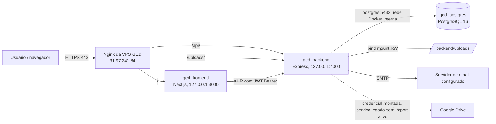
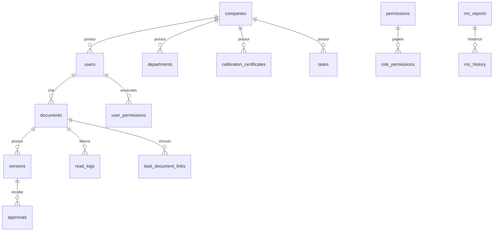

# Mapa técnico do GED — ged.concretrack.com.br

**Levantamento:** 15/10/2026, horário de Brasília. **Escopo:** aplicação GED em produção, seus dados, dependências e encaixe proposto no Unificado. Este documento registra observações de DNS/HTTPS, configuração e processos das duas VPS, código ativo em `/opt/ged_concrefer` e consultas de metadados/contagens no banco. Nenhuma migração ou alteração de produção foi executada.

## 1. Resumo executivo

O GED roda hoje na VPS **31.97.241.84** (`servidortesteConcreTrack`) como uma aplicação própria: Nginx com TLS, frontend Next.js na porta local 3000, API Express na porta local 4000 e PostgreSQL 16 em contêiner sem porta pública. O domínio `ged.concretrack.com.br` resolve para essa VPS. O código e os arquivos enviados estão em `/opt/ged_concrefer`; o banco usa o volume Docker `ged_concrefer_postgres_data`.

O Unificado atual roda na VPS **2.25.163.32** (`srv1725681`), servido pelo Nginx em `concrefer.concretrack.com.br/unificado/`, com arquivos em `/opt/concrefer-unificado/public/unificado`, API própria e PostgreSQL local. **GED ainda não aparece no menu nem tem rota reservada.** A consolidação exige portar o frontend para um prefixo, preservar o banco e os uploads, e decidir como autenticação e permissões do GED serão integradas ao Unificado.

O código de produção do GED **usa armazenamento local**, apesar dos nomes `drive_file_id`/`drive_web_url` no banco e da presença de código/credenciais antigas do Google Drive. As **35 versões** existentes têm caminho local e URL `/uploads/`. A pasta de uploads contém **52 arquivos, 18 MB**. Migrar somente o PostgreSQL deixaria documentos e certificados sem arquivo.

## 2. Arquitetura observada

| Camada | Estado e localização verificados |
|---|---|
| DNS/TLS | A de `ged.concretrack.com.br` → `31.97.241.84`. Porta 80 redireciona para 443. Certificado Let's Encrypt em `/etc/letsencrypt/live/ged.concretrack.com.br/`; HSTS no HTTPS. Resposta da raiz HTTP 200 em 15/10/2026. |
| Nginx | `/etc/nginx/sites-available/ged.concretrack.com.br` (habilitado em `sites-enabled`). `/` → `127.0.0.1:3000`; `/api` e `/uploads/` → `127.0.0.1:4000`. Upload no proxy: `client_max_body_size 50M`; leitura do proxy: 120 s. |
| Diretório | `/opt/ged_concrefer`: `backend/`, `frontend/`, `docker-compose.yml`, `docker-compose.prod.yml`, `.env`, `backups/`. |
| Frontend | Contêiner `ged_frontend`, imagem local `ged_concrefer-frontend`, Node 20 Alpine, Next.js App Router; `frontend/package.json` declara Next `^16.2.4`, React 18 e Axios. Build standalone, porta 3000 somente no loopback. |
| API | Contêiner `ged_backend`, imagem local `ged_concrefer-backend`, Node 20 Alpine, Express 4, porta 4000 somente no loopback. Entrypoint ativo `backend/server.js` (não confundir com `backend/src/services/server.js`, arquivo alternativo/legado). `GET /health` respondeu `{"status":"ok"}`. |
| Banco | Contêiner `ged_postgres`, `postgres:16-alpine`, PostgreSQL 16.13 observado. Banco `ged_concrefer`, usuário `ged_user`, rede `ged_concrefer_default`, volume `ged_concrefer_postgres_data` em `/var/lib/postgresql/data`. Sem publicação de 5432 no host. Banco com cerca de 10 MB lógicos; diretório do volume ocupa 65 MB. |
| Uploads | Bind mount `/opt/ged_concrefer/backend/uploads:/app/uploads`, leitura/gravação pela API. 52 arquivos, 18 MB. Diretórios observados: `em_revisao`, `vigentes`, `obsoletos`, `modelos`, `calibrations/qr`, `tasks`. Código prevê `rnc/` ao anexar arquivos. |
| Outros bancos da VPS | Há PostgreSQL 14 no **host** para outras aplicações. Não é o banco do GED. Não se observou dependência do GED em bancos de PCP, Mapa ou do Unificado. |

O Compose base define os três serviços, healthcheck do Postgres, bind mount dos uploads e montagem somente de leitura de `backend/google-credentials.json`. Os scripts `backend/src/db/migrations.sql` e `seed.sql` são montados em `docker-entrypoint-initdb.d`: **só rodam automaticamente quando o volume do Postgres nasce vazio**. Existem scripts adicionais `migrations/20260710_rbac.sql`, `tasks_migration.sql` e `calibrations_migration.sql`; o esquema vivo deve ser a referência de migração. Os rótulos dos contêineres indicam uso misto dos arquivos Compose em momentos diferentes; antes de recriar, conferir o `docker compose config` efetivo e as políticas de restart. Não inicializar um banco novo com seed por engano durante a restauração.

### Configuração sensível e dependências externas

- `/opt/ged_concrefer/.env` contém chaves de conexão do PostgreSQL, JWT, SMTP, URLs, Drive e porta. Variáveis presentes: `DATABASE_URL`, `POSTGRES_DB`, `POSTGRES_USER`, `POSTGRES_PASSWORD`, `JWT_SECRET`, `JWT_EXPIRES_IN`, `SMTP_HOST`, `SMTP_PORT`, `SMTP_SECURE`, `SMTP_USER`, `SMTP_PASS`, `EMAIL_FROM`, `FILE_BASE_URL`, `NEXT_PUBLIC_API_URL`, `GOOGLE_CREDENTIALS_PATH`, `DRIVE_FOLDER_*`, `NODE_ENV`, `PORT`. Valores/segredos não foram reproduzidos aqui.
- `backend/google-credentials.json` está montado na API, mas os controladores de documentos importam `storageService.js` local; `driveService.js` e `config/googleDrive.js` ficaram no repositório. Conservar a credencial somente até confirmar que não existe outro consumidor e revogar/remover com procedimento próprio.
- Email: Nodemailer via `SMTP_*`. Pedido de aprovação e alerta de vencimento são gerados pela API. `checkExpiringDocuments` executa na inicialização e a cada 24 h, procurando documentos aprovados a vencer nos 30 dias seguintes; após migração, evitar duas APIs ativas emitindo alertas em paralelo.
- Não foi encontrada tarefa de cron/systemd com referência a `ged_concrefer` no host. A pasta `backups/` contém cópias históricas de código e SQL; o SQL comprimido mais recente nela era de **08/09/2026**. Isso **não comprova backup atual ou rotina automática**. Antes da mudança, criar e testar backup atual de banco **e** uploads.

## 3. Como a aplicação funciona

### Fluxos principais

1. O usuário abre o Next.js em `/`, faz login em `POST /api/auth/login` e recebe JWT. O navegador guarda `ged_token` e `ged_user` no `localStorage`; Axios envia `Authorization: Bearer` a cada API e remove o token em 401.
2. A API valida JWT, consulta novamente o usuário no PostgreSQL, verifica `active`, `session_version` e troca obrigatória de senha, depois carrega permissões RBAC. Existem papéis como `ADMIN`, `ADMIN_MASTER`, `QUALIDADE`, `ENGENHARIA`, `LABORATORIO`, `LEITOR`, `OPERACIONAL`, `COLABORADOR`, `SUPERVISOR`, `GERENCIA`, `DIRETORIA`.
3. Documentos: cadastro → upload de versão (até 50 MB; PDF recebe cabeçalho com código/revisão quando possível) → grava em `uploads/em_revisao` → cria aprovações de SGQ e gestor da área → publicação move arquivo para `vigentes`; obsolescência move para `obsoletos`. A API registra versões, auditoria e ciência/leitura. Os arquivos são servidos por `/uploads/`.
4. RNC: abertura, triagem, causa raiz, plano de ação, análise de eficácia, encerramento/reabertura, histórico e anexos. Tarefas: atribuição, participantes, prazo/status, comentários, vínculos a documentos e anexos.
5. Calibrações: certificado/equipamento, PDF/anexo local e QR de verificação; `/api/calibrations/public/:id` e página `/calibrations/verify/:id` são públicas por desenho.

### Telas Next.js identificadas

| Rota | Finalidade |
|---|---|
| `/`, `/login`, `/change-password` | Entrada, autenticação e troca obrigatória de senha |
| `/dashboard` | Painel de documentos/indicadores |
| `/documents`, `/documents/[id]` | Lista, cadastro, detalhe, versões e ciência |
| `/approvals` | Fila e decisões de aprovação |
| `/rnc`, `/rnc/new`, `/rnc/[id]` | Não conformidades |
| `/tasks`, `/tasks/[id]` | Tarefas |
| `/calibrations`, `/calibrations/label/[id]`, `/calibrations/verify/[id]` | Certificados, etiquetas/QR e verificação pública |
| `/users` | Gestão de usuários |

### Superfície da API

Todas as rotas abaixo, exceto login e verificação pública de calibração, passam por autenticação. Operações de escrita sensíveis aplicam permissões/validação nos respectivos módulos; não assumir que o menu equivale à autorização do backend.

| Prefixo | Rotas e operações |
|---|---|
| `/api/auth` | `POST /login`, `GET /me`, `POST /change-password` |
| `/api/users` | `GET /`, `/options`, `/:id`; `POST /`; `PUT /:id`; `PATCH /:id/password`; `DELETE /:id` |
| `/api/documents` | `GET /`, `/stats`, `/stats/area`, `/expiring`, `/:id`, `/:id/versions`; `POST /`, `/:id/upload`, `/:id/publish`, `/:id/obsolete`; `PUT /:id`; `DELETE /:id` |
| `/api/approvals` | `GET /`, `/pending`; `POST /:versionId/approve`, `/:versionId/reject` |
| `/api/read-logs` | `POST /`; `GET /:documentId`, `/:documentId/my-status` |
| `/api/rnc` | `GET /`, `/:id`, `/users/options`; `POST /`, `/:id/actions`, `/:id/effectiveness`, `/:id/close`, `/:id/reopen`, `/:id/comments`, `/:id/attachments`; `PATCH /:id/triage`, `/:id/status`, `/:id/actions/:actionId`; `PUT /:id/root-cause` |
| `/api/tasks` | `GET /`, `/dashboard`, `/:id`, `/users/options`; `POST /`, `/:id/comments`, `/:id/participants`, `/:id/documents`, `/:id/attachments`, `/:id/cancel`; `PUT /:id`; `PATCH /:id/status`, `/:id/responsible`, `/:id/due-date`; `DELETE /:id/participants/:userId`, `/:id/documents/:documentId` |
| `/api/calibrations` | `GET /public/:id`, `/stats`, `/`; `POST /`; `PUT /:id`; `DELETE /:id` |
| Fora de `/api` | `GET /health`; `GET /uploads/*` (arquivos estáticos) |

## 4. Bancos e dados

### Banco acessado de fato

`ged_backend` recebe `DATABASE_URL` do Compose apontando para o serviço `postgres:5432` da rede Docker, e `backend/src/config/database.js` usa o pacote `pg`. O banco `ged_concrefer` tinha aproximadamente **10.071 kB** em 15/10/2026. `pgcrypto` e `plpgsql` estavam instaladas. Há **29 tabelas** de aplicação e a view `rbac_manual_review_users`. As contagens são um instantâneo, não limites de capacidade.

| Grupo | Tabela: linhas em 15/10/2026 | Relações/finalidade |
|---|---|---|
| Organização e identidade | `companies`: 1; `departments`: 14; `users`: 4; `user_departments`: 0 | Empresa, áreas e contas; usuários trazem empresa, departamento, papel e estado da sessão. |
| Permissões | `permissions`: 31; `role_permissions`: 121; `user_permissions`: 33 | RBAC por papel mais exceções individuais. |
| Segurança/auditoria | `login_attempts`: 59; `password_history`: 6; `audit_logs`: 209 | Tentativas, histórico de senhas e rastreabilidade. |
| GED central | `documents`: 32; `versions`: 35; `approvals`: 70; `approval_workflows`: 9; `approval_steps`: 12; `read_logs`: 3 | Documento → versões → aprovação/cadeia → leitura. Há 28 documentos `APROVADO` e 4 `EM_REVISAO`. |
| Não conformidades | `rnc_reports`: 3; `rnc_history`: 9; `rnc_root_cause_analyses`: 0; `rnc_action_plans`: 0; `rnc_effectiveness_reviews`: 0; `rnc_attachments`: 0 | RNC e suas etapas/anexos. |
| Tarefas | `tasks`: 0; `task_history`: 0; `task_comments`: 0; `task_participants`: 0; `task_document_links`: 0; `task_attachments`: 0 | Módulo implantado, ainda sem registros no snapshot. |
| Calibração | `calibration_certificates`: 5 | Certificado/equipamento, vencimento, arquivo e QR. |

**Campos centrais para a migração:** `documents` tem `id`, `company_id`, `department_id`, `code`, `area`, `status`, `current_version_id`, `current_revision`, `valid_until`, `visibility`, `classification`. `versions` liga `document_id` ao arquivo via `drive_file_id`, `drive_folder`, `drive_web_url`, além de revisão e `uploaded_by`. `calibration_certificates` contém `file_url` e `qr_code_url`. `users` contém `email`, `username`, `password_hash`, `role`, `active`, `must_change_password` e `session_version`. Preservar UUIDs/FKs e registros de auditoria na importação.

**Armazenamento real:** nas 35 versões, `drive_file_id` tem formato de caminho local e `drive_web_url` aponta para `/uploads/`; nenhuma das 35 URLs se classificou como Google Drive. A API usa `storageService.js` para gravar/mover arquivos locais. Os nomes “drive” permaneceram por compatibilidade. Há ainda 5 certificados de calibração com anexos/QR no mesmo bind mount. Uma varredura pós-cópia deve comparar referências do banco com arquivos físicos, hashes e URLs acessíveis. Há mais arquivos no disco do que versões no banco porque uploads incluem calibrações/QR e possivelmente arquivos sem referência; não eliminá-los por dedução.

### Dependências de esquema e importação

O diagrama resume as relações de negócio observadas no código/esquema; a restauração deve usar o dump completo do banco (incluindo tipos enum, índices, restrições, sequências, view e extensões), não recriação manual de tabelas a partir deste resumo.

## 5. Encaixe no Unificado e mudança de VPS

### Destino observado

A VPS `srv1725681` (`2.25.163.32`) tem Nginx 1.24, Docker, PostgreSQL no host e serviços do Unificado. Em 15/10/2026: disco raiz **387 GB / 353 GB livres**; RAM **31 GiB / ~27 GiB disponíveis**. Isso sugere espaço para o volume atual do GED, mas **não substitui teste de carga nem reserva para crescimento/backups**. O Nginx de `concrefer.concretrack.com.br` serve `/unificado/` de `/opt/concrefer-unificado/public`, faz proxy de APIs Mapa/PCP para serviços próprios e reserva `/api/` para a API do hub. Não usar `/api/` global para GED.

### Decisão de desenho recomendada

1. **Primeira etapa: transportar GED isolado.** Manter API e banco GED em contêineres próprios na VPS do Unificado, com volume nomeado para o PostgreSQL e bind mount persistente para uploads. Não misturar as 29 tabelas com o PostgreSQL do Mapa/PCP: o ganho inicial é VPS, entrada e operação compartilhadas, com isolamento de esquema e rollback simples.
2. **Entrada via mesmo domínio e prefixo:** reservar `/unificado/ged/` para o frontend, `/unificado/ged/api/` para a API e `/unificado/ged/uploads/` para arquivos. Usar portas loopback ainda livres (definir após auditoria de `ss` no dia da implantação), sem publicar o banco. Atualizar Nginx com regras específicas **antes** da regra genérica `/unificado/`, e usar TLS do domínio do Unificado.
3. **Adaptar o frontend:** o `next.config.js` atual não tem `basePath` nem `assetPrefix`; links internos e redirecionamento de 401 usam `/login`, e Axios constrói `${NEXT_PUBLIC_API_URL}/api`. Adicionar base path `/unificado/ged`, rever links e rotas públicas/QR, ajustar URL de API e **reconstruir a imagem** (variável `NEXT_PUBLIC_*` é incorporada ao build). Não bastará um `proxy_pass` que retire o prefixo.
4. **Autenticação em duas fases:** durante transporte, conservar login/JWT/RBAC próprios do GED e oferecer acesso a partir do menu do Unificado com permissão de tela. Depois, implementar identidade única de maneira explícita: associar contas por identificador estável verificado, mapear 31 permissões e exceções individuais, definir sessão/SSO e trilha de auditoria. Não copiar hash ou equiparar usuários apenas pelo nome/email. O menu não dispensa validação de autorização na API.
5. **Arquivos/URLs:** preservar `uploads` integralmente e escolher entre reescrever as URLs absolutas `drive_web_url` para o novo prefixo, servir um alias duradouro no domínio GED, ou migrar o frontend para construir URLs a partir do identificador de arquivo. `FILE_BASE_URL` também deve ser ajustado. Etiquetas/QR impressos podem conter o domínio antigo: manter redirecionamento/rota de compatibilidade para verificação pública após eventual troca de DNS.
6. **Domínio antigo:** manter `ged.concretrack.com.br` durante coexistência ou redirecioná-lo somente após validar autenticação, anexos, links salvos e QR. O certificado e DNS atuais têm vida operacional própria; planejar expiração/renovação no host de destino.

### Roteiro de implantação e validação

| Fase | Ação concreta | Critério de saída |
|---|---|---|
| 0. Preparação | Congelar versão de código/imagens/Compose; inventariar `.env` por chave e destino seguro; verificar dono/permissões de uploads, resolução DNS e firewall; fechar desenho de conta e URL. | Configuração reproduzível, sem credencial no Git/documentação. |
| 1. Backup | Criar `pg_dump` completo do banco vivo (formato custom), cópia íntegra de `backend/uploads` e cópia criptografada de segredos; registrar SHA-256 e testar restauração numa instância descartável. | Dump restaura 29 tabelas, view e dados; hashes dos 52 arquivos batem. |
| 2. Ambiente isolado | Criar diretório/Compose GED na nova VPS, restaurar banco e uploads, aplicar permissões de arquivo e segredos, escolher portas loopback; iniciar sem DNS público. | `/health`, consultas de contagem e uploads funcionam no host novo. |
| 3. Portabilidade | Ajustar base path Next, URL da API, links de uploads, redirecionamentos, QR e email; configurar Nginx sob `/unificado/ged/`; adicionar item/permissão de menu somente após validação. | Login, navegação direta/reload, JS/CSS, versão de documento, RNC, tarefa e calibração funcionam via HTTPS do Unificado. |
| 4. Ensaio funcional | Testar com papéis reais e contas de teste: acesso permitido/negado, troca/reset de senha, upload PDF, aprovação em dois níveis, ciência, prazo/email, etiqueta/QR, anexos e links existentes. Medir limites de 20/25/50 MB nos respectivos fluxos. | Sem arquivos órfãos novos, erro 401/403 coerente, auditoria preservada. |
| 5. Corte | Definir janela; pausar escrita no GED antigo; gerar dump e cópia incremental final de uploads; restaurar; comparar contagens/hashes; direcionar tráfego e monitorar Nginx/API/DB/SMTP. Manter instância antiga sem escrita. | Uma só origem de escrita e de alertas; registros e arquivos iguais no ponto de corte. |
| 6. Retorno | Se falhar critério crítico, apontar tráfego à instância antiga **antes de aceitar escrita na nova**. Se a nova já recebeu escrita, reconciliar banco e arquivos antes de qualquer retorno. | Evita divergência silenciosa de versões/aprovações. |
| 7. Pós-corte | Backup automático com retenção e teste de restauração, alertas de saúde/uso de disco/erros, documentação operacional, rotação de segredos e desativação da VPS antiga após período de observação. | GED estável no Unificado e recuperação testada. |

### Riscos e decisões abertas

| Prioridade | Evidência / risco | Tratamento antes do corte |
|---|---|---|
| Alta | `/uploads` é servido por `express.static` **antes** da autenticação; arquivos são acessíveis por URL conhecida. `cors({origin:'*'})` na API. | Rever classificação/visibilidade, definir proteção de download por endpoint autenticado ou URLs autorizadas; manter pública só a verificação de calibração que for intencional. Não depender apenas do menu. |
| Alta | Backup encontrado é histórico (08/09/2026); não foi observada agenda automática. | Instituir backup atual e ensaio de restauração antes de mover/encerrar VPS. |
| Alta | Frontend usa caminhos de raiz e token GED no `localStorage`; Next não tem `basePath`. | Alterar/testar build e autenticação no prefixo; evitar colisão com `/api/` e `/login` do Unificado. |
| Alta | 35 versões têm URLs de uploads no domínio/rota atuais; certificados e QR podem circular fora do sistema. | Plano de URL estável, redirecionamento/alias e teste de QR físico. |
| Média | Serviço local de storage move arquivo e atualiza banco em passos separados; email é tentativa posterior. | Validar consistência banco ↔ arquivo no ensaio; monitorar falhas de I/O e envio. |
| Média | Inicialização em volume vazio executa `seed.sql`; fontes/README antigas descrevem Drive e versões diferentes. | Restaurar dump real no volume correto e usar código/Compose de produção como referência. |
| Média | Identidades/RBAC GED são independentes das contas Unificado. | Aprovar mapeamento por usuário e autorização; registrar quem acessa o GED no menu e quem pode operar na API. |

## 6. Evidências e limites deste levantamento

| Evidência | Fonte consultada |
|---|---|
| DNS e serviço HTTPS | Consulta DNS e `curl -I https://ged.concretrack.com.br/` em 15/10/2026. |
| Reverse proxy GED | `/etc/nginx/sites-available/ged.concretrack.com.br` na VPS `vps-rh`. |
| Contêineres, portas, volumes e configuração | `docker ps`, `docker inspect`, `/opt/ged_concrefer/docker-compose*.yml`, `df`, `du`, `find`; variáveis do `.env` foram listadas **somente pelo nome**. |
| Código executável | `backend/server.js`, `backend/src/{routes,controllers,services,middlewares,config,db}`, `frontend/src`, `frontend/next.config.js`, `package.json` e Dockerfiles da instalação GED. |
| Esquema/dados | Consultas somente de metadados e `count(*)` ao `ged_postgres`, sem listar pessoas, senhas, documentos ou conteúdo. |
| Destino | `vps-staging`: `/etc/nginx/sites-available/concrefer.concretrack.com.br`, `/opt/concrefer-unificado/public/unificado`, processos/portas, recursos do host; `unificado/shell/menu.config.js` do workspace. |

**Limites:** não houve teste autenticado de ponta a ponta com usuário final, medição de carga, teste de restauração ou confirmação do provedor de SMTP/rotina de backup externa. DNS, contagens e capacidade podem mudar após o snapshot. O plano de consolidação acima é **proposta**, não descrição de algo já implantado. Antes de executar, revalidar o estado vivo de ambas as VPS e reconciliar alterações de código feitas desde 15/10/2026.
