# Correção do layout do Suprimentos dentro da casca — homologação

**Data:** 25/10/2026. **Ambiente:** `https://concrefer.concretrack.com.br:18446`. **Escopo da publicação:** somente homologação da VPS nova. Produção e VPS antiga não foram alteradas; não houve `git push`.

## Reprodução autenticada

O Playwright abriu `/unificado/?view=suprimentos/<tela>/` pela casca, com o iframe real, usando SOLICITANTE (`e2e-suprimentos-sol`), APROVADOR nível 1 (`e2e-suprimentos-aprov1`), ALMOXARIFE (`e2e-suprimentos-almox`) e `ricardo.teste` (sessão IAM de homologação assinada no servidor). Para cada perfil, percorreu painel, solicitações, detalhe com `?id=`, nova solicitação, fornecedores e cadastros. Telas sem concessão foram verificadas como acesso negado na casca; as demais abriram no iframe.

As senhas das contas de ensaio foram lidas do arquivo protegido da E7 em `Downloads`, fora do repositório. A sessão IAM efêmera de `ricardo.teste` também ficou fora do Git e foi removida após a auditoria; para repetir a matriz completa, é necessário gerar outra sessão válida da homologação.

| Largura × altura física | 100% | 125% | Menu |
|---|---|---|---|
| 1366×768, 1440×900, 1920×1080 | Sim | Sim | Aberto e recolhido |
| 820×1180, 1180×820 | Sim | Sim | Aberto e recolhido |
| 390×844, 360×780 | Sim | Sim | Aberto e recolhido |

O teste de 125% reduziu a área de layout CSS para largura/1,25 e usou escala de dispositivo 1,25, preservando a dimensão física da captura. O PWA independente foi verificado em 390×844 e 360×780, nos dois zooms. São **672 estados de casca + 4 de PWA** por fase, com capturas individuais e medições em `capturas/layout-fix/antes/diagnostico-full-*.jsonl` e `capturas/layout-fix/depois/diagnostico-final-*.jsonl`. O script [check_layout_shell.py](../../../tests/suprimentos/check_layout_shell.py) lista `scrollWidth > clientWidth + 1` e caixas que ultrapassam o pai, tanto na casca quanto no iframe, além de erros de console e recursos 404.

### Causas encontradas

1. O CSS do Suprimentos **carregava corretamente** dentro do iframe. O URL relativo `../frontend/app.css` resolvia para `/unificado/suprimentos/frontend/app.css`; a casca acrescentava `embedded.css` sem vazamento de estilos entre documentos. O defeito de largura não era MIME desse CSS.
2. No detalhe, a grade `.split` passava a `1fr` abaixo de 1000 px, mas seu item mantinha uma largura intrínseca de 800 px por causa da tabela. Em 820 px físicos, o iframe tinha 736 px e o cartão era cortado; o mesmo ocorria no celular. Em “Nova solicitação”, `.item-builder` tinha duas colunas, mas `.field` conservava `min-width:170px` dentro de um cartão de cerca de 294 px. `overflow-x:hidden` em `html,body` escondia a rolagem do documento e mascarava o corte.
3. A casca de `:18446` referenciava `home-header-compact.css/js`, `module-pages.js` e os ícones PedeRH/FaleAqui que faltavam no diretório público. Os dois scripts e os dois ícones produziam 404; o CSS do cabeçalho recebia HTML em vez de CSS, causando erro de MIME no console. Os arquivos do cabeçalho e os ícones foram copiados da instalação principal da **mesma VPS nova** para a homologação; `module-pages.js` veio da árvore local, que contém a descrição do Suprimentos.
4. O cache de service worker da casca era `1.0.59`. Não foi possível atribuir a ele o corte geométrico reproduzido em contexto limpo; a versão foi elevada para **1.0.60** para que clientes já instalados recarreguem o CSS e os recursos corrigidos. O cache do SW próprio do PWA também foi renovado.

### Correção

As sete páginas HTML receberam `data-modulo="suprimentos"`. Os seletores dos CSS desktop/tablet e PWA passaram a ser restritos a essa raiz. A grade do detalhe usa `minmax(0,1fr)` no breakpoint; os cartões e filhos têm `min-width:0`; o construtor de itens móvel usa colunas `minmax(0,1fr)` e campos sem largura mínima rígida. Descrições longas quebram linha. As tabelas largas mantêm rolagem horizontal **dentro** do cartão. O `overflow-x:hidden` do documento foi removido, permitindo que o teste detecte qualquer novo corte em vez de escondê-lo.

O servidor de homologação recebeu os quatro recursos ausentes, com os mesmos modos dos demais arquivos públicos. `VERSION`, `APP_VERSION` e a chave do cache da casca estão em `1.0.60`; os links de CSS desktop usam `?v=1.0.60`. Nenhum CSS de PCP, Laboratório ou outro módulo foi alterado.

## Comparação visual pela casca

| Contexto | Antes | Depois |
|---|---|---|
| Detalhe, tablet 820×1180 | 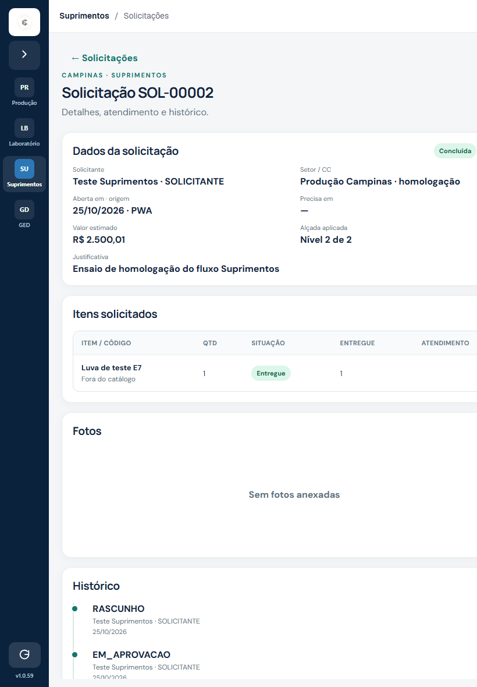 | 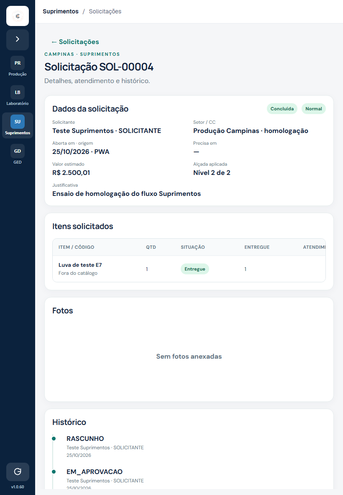 |
| Nova solicitação, celular 360×780 | 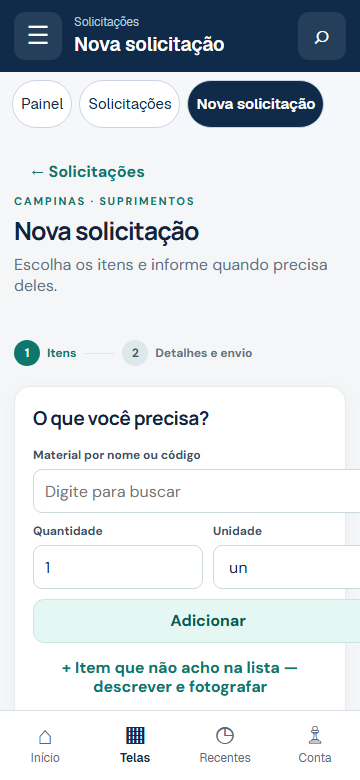 | 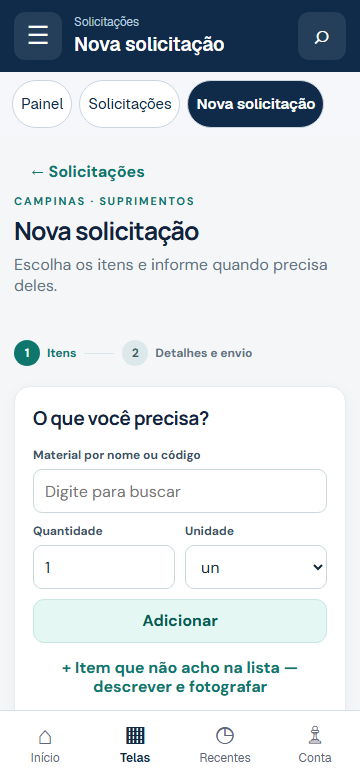 |
| Painel, PC 1366×768 | 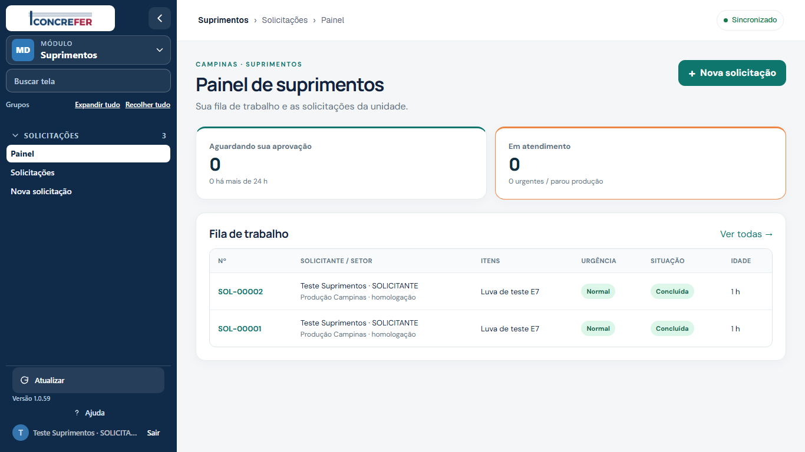 | 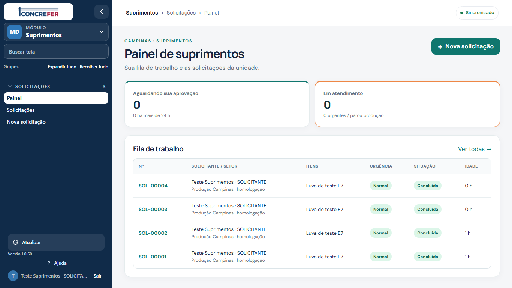 |
| Solicitações, tablet 1180×820 | 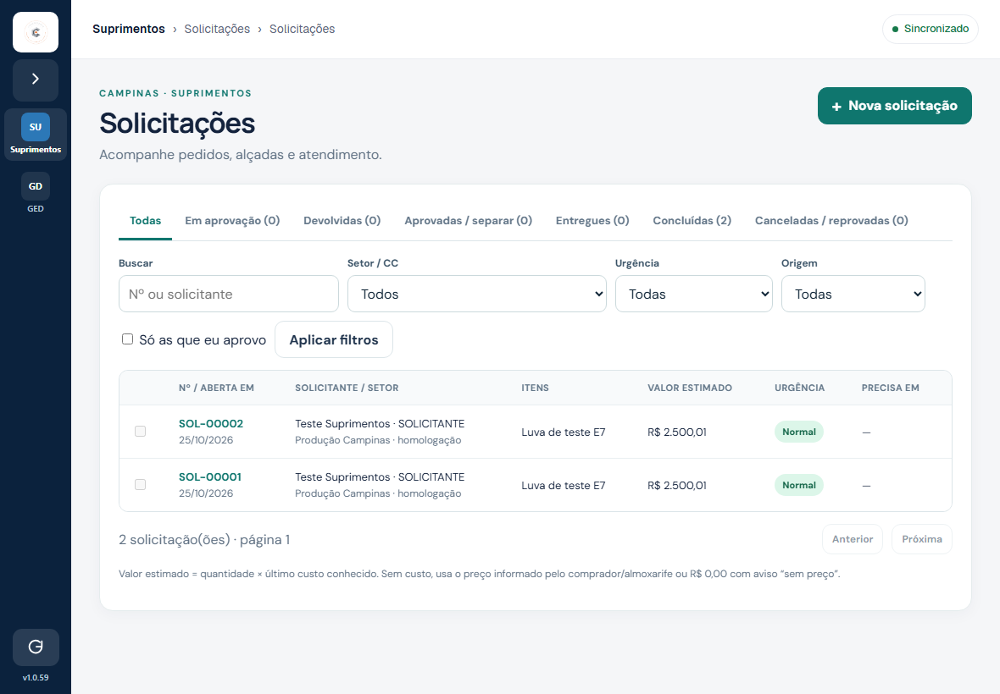 | 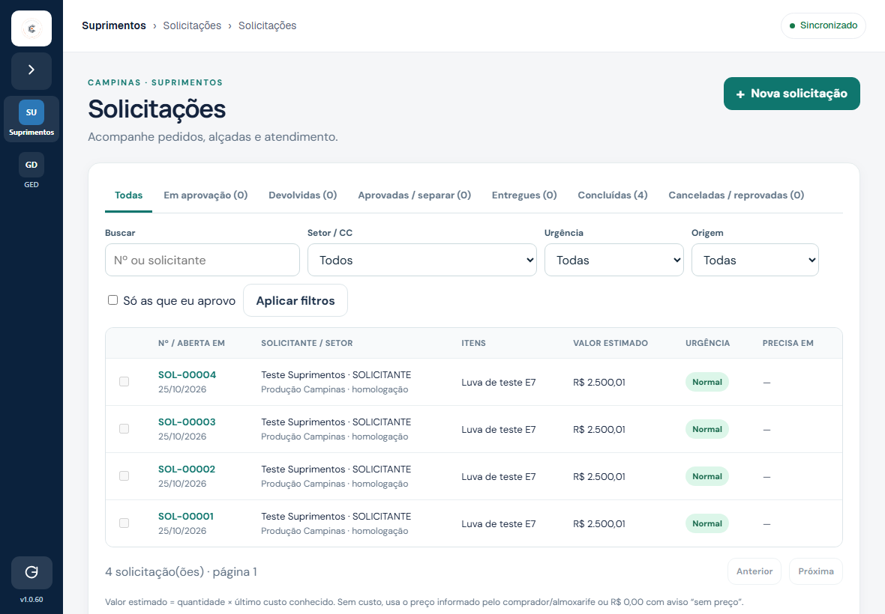 |
| PWA, celular 390×844 | 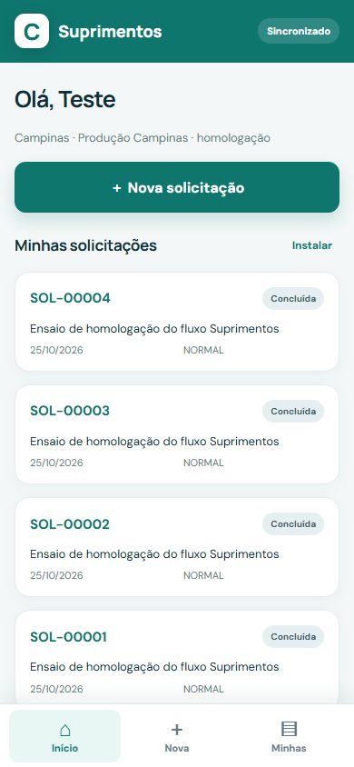 |  |
| PCP Mão de Obra, PC | 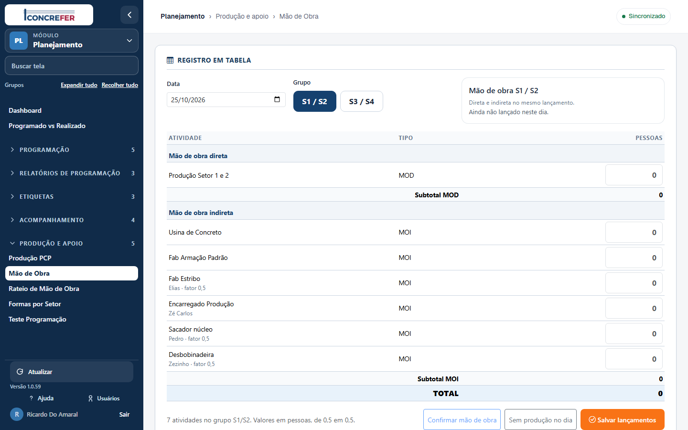 |  |
| PCP Mão de Obra, tablet |  | 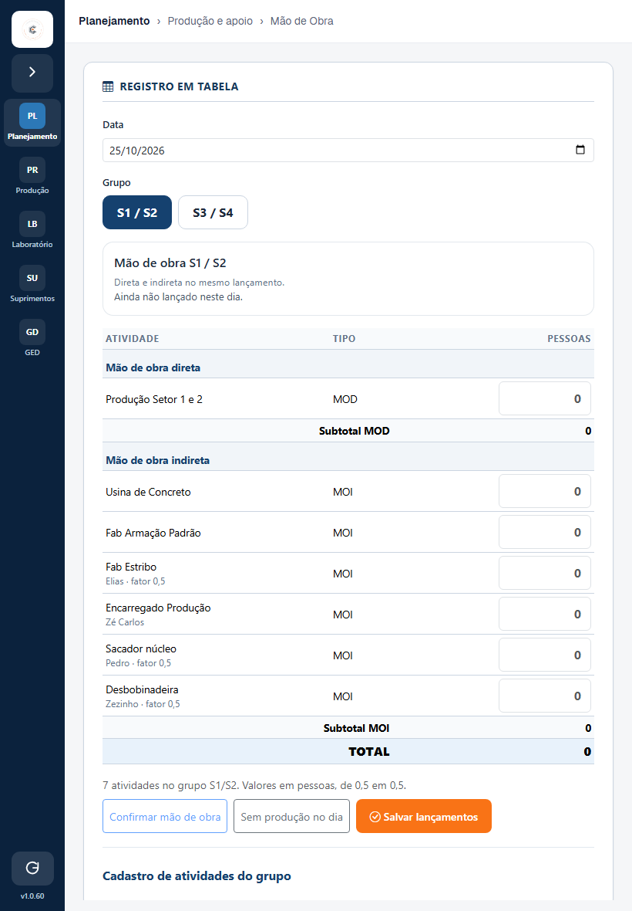 |
| Laboratório, PC |  | 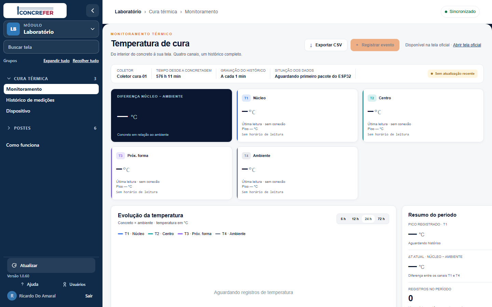 |
| Laboratório, tablet | 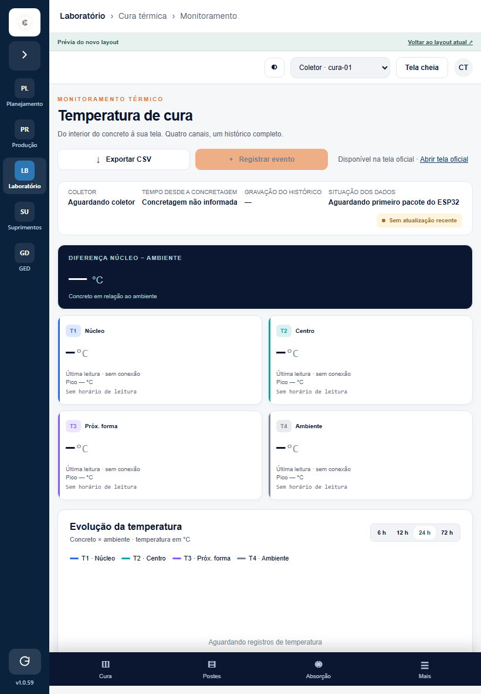 |  |

As quatro capturas do PWA foram refeitas após o carregamento da interface. Para reconstruir o “antes” depois da instalação, [check_layout_pwa.py](../../../tests/suprimentos/check_layout_pwa.py) injeta **apenas** o CSS do commit E7 no navegador; o servidor e o JavaScript continuam os da homologação. As medições dessa comparação estão em `capturas/layout-fix/{antes,depois}/diagnostico-pwa-loaded.json`.

Uma tentativa suplementar de captura do PWA recebeu HTTP 503 transitório no login de teste enquanto a matriz paralela ainda rodava. O serviço de Suprimentos permaneceu ativo; a repetição após a matriz concluiu **4/4** sem erro. A matriz principal não teve falhas de autenticação.

## Critério de aceite e regressão

| Gate | Resultado |
|---|---|
| Matriz autenticada pela casca | **676/676 estados únicos** antes e depois, sem falhas de execução: 672 pela casca e 4 do PWA. Os **224 estados de acesso negado por papel** foram iguais nas duas fases; as outras telas abriram no iframe. Foram salvos 680 PNGs por fase, incluindo a regressão visual. |
| Largura do documento e do iframe | **48 cortes do `body` do iframe antes → 0 depois**; 0 rolagem horizontal do documento da casca e do iframe depois. O detector registrou 422 ocorrências na casca e 673 no iframe depois, todas classificadas como rolagem interna intencional de `.table-scroll`/abas, truncamento do nome no menu ou painel de navegação sobreposto. **0 elemento fora de um contêiner controlado.** O CSS anterior mascarava o corte com `overflow-x:hidden`, por isso a contagem de rolagem do documento sozinho era 0 também no “antes”. |
| CSS/JS/fontes/ícones e console | **2.688 respostas 404 antes → 0 depois; 5.148 erros de console antes → 0 depois.** O PWA carregado teve 4/4 estados sem 404, erro ou rolagem horizontal. [Auditoria PWA antes](capturas/layout-fix/antes/diagnostico-pwa-loaded.json) · [depois](capturas/layout-fix/depois/diagnostico-pwa-loaded.json). |
| E1–E7 local | **21 passed** com PostgreSQL descartável em loopback e `SUPRIMENTOS_TEST_ADMIN_URL`. [Saída final](capturas/layout-fix/depois/pytest-e1-e7.txt). Uma execução inicial sem a variável pulou os testes de banco; outra usou o papel PostgreSQL errado e falhou na preparação. Ambas foram corrigidas como infraestrutura de teste antes do resultado verde. |
| Navegação e PWA | [check_e7_browser.py](../../../tests/suprimentos/check_e7_browser.py) passou em PC, tablet e celular, incluindo controles do SW e operação offline do PWA. |
| Smoke HTTPS | **43/43** após a instalação final, gerando a solicitação sintética `SOL-00004`. [Resultado](capturas/layout-fix/depois/smoke-43.json). |
| Permissões das cinco contas | Snapshot JSON **idêntico byte a byte** antes e depois (SHA-256 `9e9ef348729652a25123076bb3568935137566fe1b51a96e48e9c47f2f613381`). [Antes](capturas/layout-fix/antes/screen-access.json) · [Depois](capturas/layout-fix/depois/screen-access.json). |
| PCP e Laboratório | PCP 1440×900 diferiu apenas no texto `Versão 1.0.59` → `1.0.60` (0,007% dos pixels). O Laboratório manteve a geometria; o monitor atualizou dados entre capturas (0,54% de pixels distintos no PC). [Script de regressão](../../../tests/suprimentos/check_layout_regression.py). |

## Publicação e retorno

Antes de alterar `:18446`, foi salvo o backup `/opt/concrefer-unificado/homolog-next/backups/suprimentos-s1-20261025T184925Z/` com arquivos, modos, hashes e dump de concessões. [fix-layout-homolog.sh](../../../unificado/suprimentos/deploy/fix-layout-homolog.sh) instala apenas os arquivos citados; `nginx -t` passou antes do reload; health e os recursos públicos responderam. Os novos arquivos públicos ficaram `0644 root:root`, sem modos `777` ou `666`; o serviço `suprimentos-homolog.service` permaneceu ativo. O retorno foi executado deliberadamente: `VERSION` voltou a `1.0.59`, os recursos acrescentados foram removidos e o serviço continuou ativo. A reinstalação final voltou a `1.0.60` e passou no smoke `43/43`. O script também aciona o retorno automático em falha, sem excluir o banco do Suprimentos. A produção não foi publicada.

**Arquivos de código alterados:**

- `unificado/suprimentos/frontend/app.css`, `pwa/app.css`, `pwa/sw.js`;
- `unificado/suprimentos/{painel,solicitacoes,solicitacao,nova,fornecedores,cadastros,pwa}/index.html`;
- `unificado/suprimentos/deploy/fix-layout-homolog.sh`;
- `unificado/shell/home-header-compact.css`, `home-header-compact.js`, `unificado/assets/img/pederh-icon.png` e `faleaqui-icon.png`, que repõem recursos já referenciados pela casca da homologação;
- `tests/suprimentos/check_layout_shell.py`, `check_layout_pwa.py` e `check_layout_regression.py`;
- `docs/porting/suprimentos/09-correcao-layout.md`, `progresso.md` e as capturas/snapshots em `capturas/layout-fix/`.

O arquivo `unificado/shell/module-pages.js` já estava versionado e foi apenas instalado em `:18446`. A atualização de `VERSION`, `APP_VERSION` e da chave do cache foi aplicada **na casca da homologação** pelo script de deploy, cuja base local ainda contém outras alterações de trabalho fora do escopo deste commit. Não foi feito merge delas nem publicação em produção.
