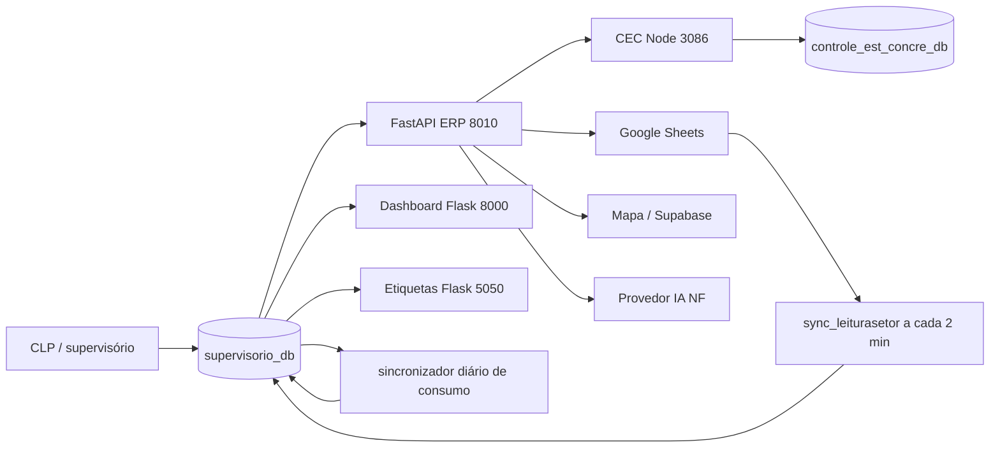

# Integrações e serviços vizinhos

## Fluxos de dados observados

As setas CLP → banco vêm do papel das tabelas de supervisório, mas o processo exato de escrita não foi localizado no código Python do ERP; confirmar protocolo, proprietário e esquema com o fornecedor da automação antes de escolher CDC/polling. O diagrama não autoriza qualquer comando à usina. **A origem continua oficial:** o Unificado lê o espelho atualizado a cada minuto; somente o sincronizador escreve nele. Edição humana aprovada usa [write-through](execucao/write-through-evidencia.md) na VPS antiga.

## Contratos concretos

| Integração | Entrada/saída | Código ou configuração | Tratamento proposto |
|---|---|---|---|
| Supervisório / CLP | massadas, receitas, leituras; posições `silo/agregado/água/aditivo` | `tbl_massadas`, `tbl_receitas`, `tbl_leiturasetor`; API lê dados | manter fluxo original; capturar para espelho com checkpoint e chave idempotente |
| Dashboard Usina | lê massadas e PCP; grava paradas e não conformidades no supervisório | `/var/www/dashboard-usina/app/routes_usina.py:208-220,404-416,529,613`; Flask 8000 | integrar telas ao menu; escrita aprovada chama endpoint Dashboard na origem |
| CEC canônico | ERP `/qrcp` faz proxy de POST/GET para API local 3086; worker calcula estatísticas | `api/routers/qrcp.py:11-209`; `/root/Controle_est_concre/src` | integrar telas/consulta ao Unificado via espelho; serviço, worker e banco antigos seguem oficiais |
| Etiquetas CP | consulta `supervisorio_db.tbl_massadas`, produz PDF/QR e web push | `/root/PWA-etiquetas/app.py:97,118-124,157-225,366-374,619-714`; Flask 5050 | integrar geração e impressão consultando espelho, sem mudar a origem das massadas |
| Controle de estoque | movimentos são gerados a partir de massadas e mapa `tbl_est_config_massada` | `api/routers/estoque.py:1408-1503,1961-2050`; cron 00:01 | manter sincronizador e regras na origem; replicar movimentos prontos, sem gerar baixa no espelho |
| Planilhas | leituras de setor, mão de obra do fechamento | `scripts/sync_gsheets_leiturasetor.py`; `api/routers/relatorios.py:35-45` | manter adaptador somente leitura e trilha de proveniência; definir fonte oficial de cada indicador |
| Mapa de produção / Supabase | volumes de postes, setores e outros indicadores do fechamento | `api/routers/relatorios.py:20-45,335-452,1274-1345` | usar API interna do Unificado quando equivalente, com comparação por dia/setor antes de retirar a ponte |
| IA para notas fiscais | requisição HTTP externa para extração; job em `BackgroundTasks` e dicionário em memória | `api/ai_providers.py:12-42`; `api/routers/estoque.py:494-540` | fila persistente, limites de arquivo/tempo, auditoria do resultado e seleção explícita de provedor |
| Relatório PCP | endpoint dispara rotina de geração/publicação | `api/routers/relatorios.py:2017`; cron do agente às 07:00 | manter como integração com Planejamento, sem duplicar catálogo PCP em Usinas |

O código suporta por nome `openai`, `gemini`, `groq`, `huggingface` e `ollama` para NF; o arquivo de ambiente do ERP contém `AI_PROVIDER` e variáveis Gemini. Não foram documentados valores ou tokens. Foram localizados também nomes de variáveis `FECHAMENTO_BRIDGE_TOKEN`, `MAPA_USINA_INTEGRATION_KEY`, `CONTROLE_ESTATISTICO_API_URL`, `GOOGLE_SERVICE_ACCOUNT_FILE` e equivalentes. Uma chave de serviço aparece como literal no código de relatório; tratar isso como débito de segurança na execução, sem reproduzi-la aqui.

## Onde cada app grava

- **ERP:** `supervisorio_db` em cadastros, PCP, estoque, traços e usuários. A rota de CEC não grava no mesmo banco: encaminha ao serviço 3086.
- **Dashboard:** lê `supervisorio_db.tbl_massadas` e `tbl_pcpsetor`; grava `tbl_paradas_apontadas` e `tbl_nao_conformidades_apontadas`. Também consulta referências de PCP/Mapa por API.
- **CEC:** grava `controle_est_concre_db.rompimentos`, `rompimentos_atuais`, `rompimentos_eventos`, `fila_recalculo`, `rompimentos_grupos`, `estatistica_diaria`, `estatistica_mensal`; `faixas_resistencia` é configuração. O worker usa `FOR UPDATE SKIP LOCKED` na fila (`src/services/analytics_service.js:264-307`).
- **Etiquetas:** lê massadas; assinaturas de push ficam em arquivo local do serviço. A geração PDF pode ser absorvida; a entrega a impressora, se existente fora do navegador, requer levantamento em campo.
- **PCP correlato:** `pcp_concrefer`, `pcpconcrefer_db`, `pcp_armaduras` têm esquemas e contagens próprios; são dependências de Planejamento. A proposta é referenciá-los via contratos do Unificado, evitando cópia operacional indiscriminada para `usinas`.

## Riscos de integração

1. O job de NF atual guarda estado em memória; reinício perde status. Adicionar persistência antes de trocar a API oficial.
2. A tabela de eventos CEC é grande e recebe atualização contínua; carga inicial exige paginação/checkpoint e validação de janela, sem bloquear produção.
3. Estoque é derivado de massadas e movimentos manuais. Sem chave de idempotência e precedência clara, uma segunda sincronização duplica consumo.
4. O fechamento combina fontes com horários e competências distintos. Guardar origem, horário de coleta, versão da fórmula e eventuais ajustes manuais.
5. Não foram encontrados, nos arquivos inspecionados, contratos de e-mail/WhatsApp para o núcleo do ERP; validar com responsáveis antes de marcar essas integrações como ausentes. Push web existe no serviço de etiquetas.

O inventário estruturado de domínios externos e **nomes** de variáveis está em [integracoes-inventario.json](integracoes-inventario.json). Nenhum segredo consta nesse arquivo.
