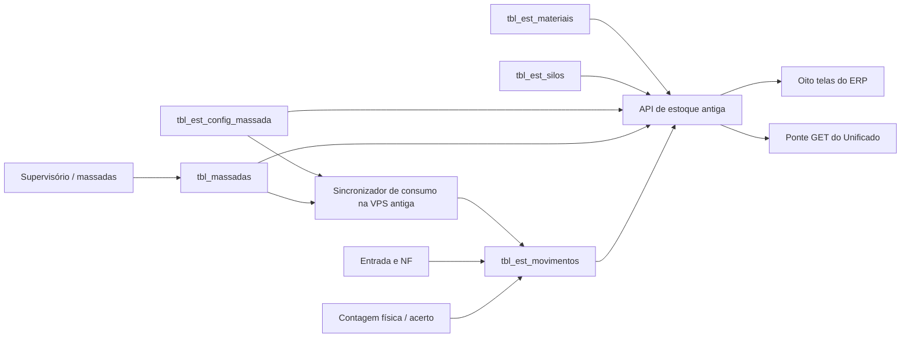

# Controle de Estoque — inventário completo de Campinas

**Levantamento:** 25/10/2026. **Origem oficial:** ERP ConcreTrack em
`/var/www/concretrack-erp` na VPS antiga, banco
`supervisorio_db.public`. **Situação no Unificado:** consultas parciais por
ponte de leitura; o fluxo operacional de estoque ainda pertence ao ERP antigo.

## Como ler este documento

Este inventário combina o HTML e a API **em produção na origem** com o código
publicado do Unificado. As oito imagens abaixo foram capturadas em 1440 px a
partir das páginas reais do ERP. Para abrir a navegação sem uma conta de
aplicação, apenas `GET /auth/me` recebeu uma resposta simulada de administrador;
as APIs de estoque continuaram reais e recusaram a sessão. **As imagens mostram
estrutura, campos e ações, não valores de estoque nem um teste funcional de
gravação.** Mensagens “401”, “carregando”, “nenhum material” e indicadores vazios
nas capturas são consequência disso. Nenhum movimento foi criado, editado,
excluído ou sincronizado neste levantamento.

O código consultado em 25/10 estava em
`/var/www/concretrack-erp/api/routers/estoque.py` (SHA-256
`d99ee150f6e69efc9361623db411710b3443c2849548f0770d238467395fef59`).
As capturas são reproduzíveis por
[`capture_estoque_layout.py`](../../../../scripts/porting/capture_estoque_layout.py).

## Situação atual

| Capacidade | ERP antigo | Unificado na VPS nova |
|---|---|---|
| Entrada de materiais e nota fiscal | Cadastro, edição e exclusão; leitura de NF por IA; rateio de cimento entre silos | Somente consulta de entradas pela ponte antiga |
| Saldo e silos | Saldo calculado com movimentos e contagem física | Consultas GET pela ponte antiga |
| Relatório, consumo e previsão | Produção, movimentos, gráficos, cimento e plano de cargas | Consultas GET genéricas; ainda dependem da API e do login antigos |
| Mapeamento das caixas | Cadastro do vínculo de posições do misturador com materiais | Consulta GET; salvar não disponível |
| Acerto de inventário | Contagem física, diferença e histórico | Histórico GET; novo acerto não disponível |
| Sincronização de consumo | Rotina diária na origem e comando manual | Não executada pelo Unificado |

Em **Usinas → Controle de estoque**, o Unificado usa
[`native-areas.js`](../../../../unificado/usinas/native-areas.js) e o proxy
[`usinas_legacy_read.py`](../../../../unificado/mapa/api/usinas_legacy_read.py).
O proxy permite apenas GETs declarados, exige `usinasInicio` e mantém o login
antigo em cookie separado. Diferentemente de relatórios e custos, **estoque
ainda não foi transferido integralmente para o espelho da VPS nova**. As tabelas
`tbl_est_materiais`, `tbl_est_movimentos` e `tbl_est_config_massada` já estão
espelhadas para relatórios, mas a tabela de silos e as regras completas de
estoque não estão no serviço novo.

## Mapa visual das oito telas

| Tela na origem | Finalidade | Leitura | Ação que grava |
|---|---|---|---|
| [`/estoque/`](https://dautomacao.com/concretrack/estoque/) | Início, indicadores e navegação | Saldo e movimentos | — |
| [`/estoque/entrada/`](https://dautomacao.com/concretrack/estoque/entrada/) | Recebimento de material e NF | Materiais, silos e últimas entradas | Criar, editar ou excluir entrada; ratear silos |
| [`/estoque/saldo/`](https://dautomacao.com/concretrack/estoque/saldo/) | Saldo por material e histórico | Saldo, níveis e movimentos | Sincronizar consumo de produção |
| [`/estoque/relatorio/`](https://dautomacao.com/concretrack/estoque/relatorio/) | Consumo da produção e movimentos | Produção e totais por período | — |
| [`/estoque/consumo/`](https://dautomacao.com/concretrack/estoque/consumo/) | Consumo, curvas e ressuprimento | Análise de massadas e estoque | Sincronizar consumo |
| [`/estoque/consumo-cimento/`](https://dautomacao.com/concretrack/estoque/consumo-cimento/) | Silos, autonomia e projeção | Análise de cimento | Link para registrar entrada |
| [`/estoque/mapeamento-agregados/`](https://dautomacao.com/concretrack/estoque/mapeamento-agregados/) | Vincular caixa/posição a material | Configuração e materiais | Salvar mapeamento |
| [`/estoque/acerto/`](https://dautomacao.com/concretrack/estoque/acerto/) | Contagem física e histórico | Saldo, silos e acertos | Registrar ou excluir acerto |

### 1. Início

Apresenta materiais cadastrados, entradas nos últimos 30 dias, materiais com
saldo positivo e consumos nos últimos 30 dias. Os cartões levam a Entrada,
Saldo, Relatório, Consumo de Agregados, Consumo de Cimento, Mapeamento das Caixas
e Acerto. Os indicadores vêm de `GET /estoque/saldo` e
`GET /estoque/movimentos?limit=500`.

### 2. Entrada de materiais

Fluxo: escolher material; anexar foto ou PDF da NF (interface anuncia até 12 MB);
conferir data física, fornecedor e referência; informar quantidade e unidade;
selecionar silo quando aplicável ou ratear entre silos; conferir valor da nota,
ICMS, frete unitário, ICMS do frete e observação; salvar. Abaixo há a lista das
últimas entradas, com possibilidade de edição e exclusão. A extração por IA
preenche campos para conferência humana; não registra a entrada sozinha.

APIs: `GET /estoque/materiais`, `/estoque/silos/nivel`,
`/estoque/movimentos?tipo=entrada`, `/estoque/nota-fiscal/provider` e
`/estoque/nota-fiscal/ler/status/{job_id}`; `POST /estoque/nota-fiscal/ler/iniciar`,
`POST /estoque/movimentos` ou `/estoque/movimentos/rateados`,
`PATCH /estoque/movimentos/{id}` e `DELETE /estoque/movimentos/{id}`.

### 3. Saldo

Filtra por categoria, atualiza saldos e mostra a movimentação do material
selecionado. Também oferece **Sincronizar Produção**, que chama
`POST /estoque/sync-consumo-producao`. O saldo é calculado a partir de
`tbl_est_materiais`, `tbl_est_movimentos` e do mapeamento atual dos silos.
Esse botão altera movimentos; não deve ser ligado a uma réplica de leitura.

### 4. Relatório de consumo

Filtros de data inicial, data final e produto. A aba **Consumo da Produção**
agrega massadas (`GET /estoque/consumo-producao`) e mostra volume, massadas,
material mapeado, posição do misturador e detalhamento por produto. A aba
**Movimentos do Estoque** usa `GET /estoque/relatorio` para entradas, consumos e
acertos por material. Oferece impressão; a captura sem API autenticada mostra
valores `NaN`, que não representam dados reais.

### 5. Consumo de agregados e previsão

Filtros de período, grupo e material. O painel contém consumo mensal e diário,
curva ABC, resumo por material, projeção futura e planejamento de ressuprimento
de cimento. `GET /estoque/consumo-agregados/analise` cruza massadas,
mapeamento, movimentos e silos; o botão **Sincronizar consumos** chama o POST de
sincronização. A API aceita horizonte de 7 a 180 dias; a interface apresenta
projeção padrão por categoria.

### 6. Consumo de cimento

O painel mostra nível, capacidade operacional, autonomia, alertas por silo,
consumo diário, projeção de saldo para os próximos dez dias úteis e sugestões
de ressuprimento. Consulta `GET /estoque/consumo-agregados/analise` com janela
de 90 dias e horizonte de 30 dias. As sugestões são simulações: só uma entrada
efetivamente registrada altera o saldo. A faixa vermelha na imagem informa
HTTP 401 porque não foi usada sessão de dados.

### 7. Mapeamento das caixas

Configura a *label* operacional, material, atividade e fator de conversão de
cada posição do misturador. Usa `GET /estoque/config-massada`,
`GET /estoque/materiais?apenas_ativos=false` e
`PUT /estoque/config-massada/{id}`. Na captura, os cartões individuais não
aparecem porque a API recusou a sessão; o formulário completo depende dos
mapeamentos retornados. O vínculo é crítico: mudar uma posição pode mudar o
material atribuído ao consumo gerado a partir das massadas.

### 8. Acerto de estoque

Seleciona material e, para cimento, silo; registra contagem física e observação.
O sistema calcula a diferença e grava um movimento do tipo `acerto`. A tela
também lista e permite excluir acertos. APIS: `GET /estoque/saldo`,
`GET /estoque/silos/nivel`, `GET /estoque/movimentos?tipo=acerto`,
`POST /estoque/movimentos` e `DELETE /estoque/movimentos/{id}`. Sem sessão de
dados, os campos por material não foram montados na captura.

## Fluxo de dados e propriedade

O cron da origem executa
`scripts/sync_consumo_producao.py --dias 2` **diariamente às 00:01**.
Ele gera consumos em `tbl_est_movimentos` a partir das massadas. A API também
oferece sincronização manual por período. A origem segue sendo a única dona
desses movimentos; o espelho de relatórios na VPS nova copia o resultado,
sem gerar baixa adicional.

### Tabelas operacionais verificadas na origem

Contagem somente leitura em 25/10/2026:

| Tabela | Linhas | Papel | Colunas principais |
|---|---:|---|---|
| `tbl_est_materiais` | 18 | Catálogo de insumos | código, nome, categoria, unidade, saldo inicial, ativo |
| `tbl_est_movimentos` | 1.111 | Livro de entradas, consumos e acertos | material, tipo, data, quantidade, origem, referência, silo, NF, fornecedor e custos |
| `tbl_est_silos` | 3 | Capacidade e identificação física | nome, capacidade nominal/operacional, unidade, ativo |
| `tbl_est_config_massada` | 15 | Posição do misturador → material | coluna, label, material, ativo, ordem, fator de conversão |
| `tbl_massadas` | 10.875 | Produção usada para consumo | data, volume e campos reais de agregado, silo, aditivo e água |

O movimento contém ainda `valor_nota`, `icms_perc`, `valor_frete`,
`icms_frete` e `valor_unitario_liquido`; por isso a mesma tabela alimenta
custos e saldo. A chave física de rateio é `referencia_id`; movimentos
automáticos usam `origem='producao_massadas'`.

## Regras que precisam ser preservadas

1. **Unidades.** Areia, brita, cimento e adição são controlados em toneladas.
   As leituras `real_agregado*` e `real_silo*` da massada chegam em kg: o fator
   esperado para material em toneladas é `0,001`. As demais unidades precisam
   coincidir ou usar conversão explícita. O backend valida categoria, unidade,
   data e quantidade.
2. **Saldo.** Fora dos silos: `saldo_inicial + entradas - consumos + acertos`.
   Para cimento, o livro é apurado por silo e o nível é atribuído ao material
   atualmente mapeado naquele silo. Déficit de um silo permanece no saldo
   contábil e não diminui o disponível de outro silo. Movimentos com data futura
   não entram no saldo atual.
3. **Contagem física.** Um acerto com observação no formato
   `[Contagem fisica: X]` redefine a base do silo; movimentos posteriores
   somam ou subtraem a partir desse ponto. A API expõe nível contábil e nível
   físico não negativo. O formato textual da observação é parte do contrato
   legado e deve virar dado estruturado antes de substituir essa lógica.
4. **Silos e histórico.** `real_silo1`, `real_silo2` e `real_silo3` correspondem
   aos silos 1, 2 e 3. O silo 1 foi Filler até 29/06/2026 e CP V-ARI a partir
   de 30/06/2026. `ADD-FILL` só usa silo 1; `CIM-CP-V` usa silos 1 ou 2;
   `CIM-CP-II` usa 1, 2 ou 3. Entrada de cimento requer silo.
5. **Entrada e custos.** O custo unitário líquido é calculado como
   `(valor_nota × (1 − ICMS/100) + valor_frete_unitário × quantidade ×
   (1 − ICMS_frete/100)) / quantidade`, arredondado a quatro casas.
   O rateio de uma NF de cimento exige pelo menos dois silos, silos distintos
   e soma das parcelas igual ao total. A edição de entrada rateada é recusada;
   para mudar distribuição, o ERP exige excluir o grupo e registrar de novo.
6. **Consumo automático.** O sincronizador ignora produção anterior a
   **22/04/2026**. Para cada dia e posição ativa, soma a quantidade real,
   aplica fator e grava consumo por material. Ao reprocessar um período, apaga
   antes os movimentos de `origem='producao_massadas'` daquele período e
   insere novamente. Isso evita somar duas baixas, mas muda os IDs dos
   movimentos reprocessados; consumidores não devem usá-los como chave
   permanente de negócio.
7. **Previsão de cimento.** A análise usa média de 30 dias para cimento e de
   7 dias para outros grupos; lead time de 3 dias, segurança de 2 dias e carga
   padrão de 40 t. As capacidades nominais configuradas são 60, 90 e 108 t;
   silos 1 e 2 aplicam alívio de 20%. O plano só sugere uma carga quando há
   espaço operacional na chegada. É uma previsão, não uma compra automática.
8. **Nota fiscal por IA.** A API recebe arquivo em base64 e inicia job de
   leitura. O estado do job é mantido em memória no processo atual; reinício
   pode perder o status. Resultado precisa de conferência antes de salvar
   entrada. O provedor e as credenciais ficam fora deste documento.

## Contrato de API do estoque

Prefixo na origem: `/concretrack/api`. Os papéis citados no inventário de
rotas são `admin`, `gerente`, `administrativo` e `pcp`; conferir a autorização
efetiva com uma sessão real antes de migrar gravações.

| Método | Rota | Uso |
|---|---|
| GET / POST / PATCH | `/estoque/materiais`, `/estoque/materiais/{id}` | Consultar e manter materiais |
| GET | `/estoque/saldo` | Saldo por material e silo mapeado |
| GET / POST / PATCH / DELETE | `/estoque/movimentos`, `/estoque/movimentos/{id}` | Histórico e lançamentos |
| POST | `/estoque/movimentos/rateados` | Entrada de cimento em vários silos |
| GET | `/estoque/silos`, `/estoque/silos/nivel` | Cadastro e nível estimado |
| GET | `/estoque/relatorio` | Entradas, consumos e acertos no período |
| GET / PUT | `/estoque/config-massada`, `/estoque/config-massada/{id}` | Mapeamento de posições |
| GET | `/estoque/consumo-producao` | Produção agregada sem criar movimento |
| GET | `/estoque/consumo-agregados/analise` | Consumo, projeção e plano de cimento |
| POST | `/estoque/sync-consumo-producao` | Reprocessar baixas automáticas |
| GET / POST | `/estoque/nota-fiscal/provider`, `/estoque/nota-fiscal/ler/iniciar` | Provedor e início da extração |
| GET / POST | `/estoque/nota-fiscal/ler/status/{job_id}`, `/estoque/nota-fiscal/ler` | Acompanhar job ou leitura direta |

O proxy atual do Unificado expõe somente os GETs de materiais, saldo,
movimentos, silos, nível, relatório, configuração, consumo da produção e
análise. Ele não disponibiliza a leitura de NF nem as rotas de escrita.

### Capturas complementares em tablet

O levantamento inicial também registrou [início em tablet](../telas/estoque-tablet.png)
e [entrada em tablet](../telas/entrada-tablet.png), ambos com 820 px de largura.
Eles usam a mesma simulação limitada de `auth/me` explicada no começo deste
documento. As oito capturas acima são da versão desktop atual da origem.

## Escopo necessário para concluir a migração

1. **Leitura nativa:** espelhar `tbl_est_silos` e criar serviço de estoque na
   VPS nova que reproduza saldo, níveis, histórico, consumo e previsão a partir
   das tabelas já copiadas. Comparar respostas com a origem em datas fixas,
   incluindo contagem física, déficit e troca histórica do silo 1.
2. **Telas:** reconstruir as oito telas com filtros, gráficos, impressão,
   unidades, estados vazios e alertas. A tela genérica atual de Usinas cobre
   consultas, mas não apresenta o fluxo completo das oito telas antigas.
3. **Escrita:** definir contrato autenticado para entrada, edição, exclusão,
   rateio, acerto e mapeamento. Manter a origem como escritora até existir
   idempotência, auditoria e tratamento de conflito; uma escrita no espelho
   isolado não atualizaria o ERP nem a produção.
4. **Consumo automático:** preservar apenas um gerador de baixas. Migrar o job
   exige checkpoint por período, trilha de reprocessamento e paridade de
   movimentos antes de desligar o cron antigo.
5. **NF por IA:** persistir estado do job, limitar arquivo e tempo, conservar
   anexo e resultado auditáveis e manter confirmação humana dos campos.
6. **Aceite:** validar saldo por material e silo, movimentos por tipo/origem,
   custo unitário, rateio, contagem física, previsão e permissões com um usuário
   real do estoque. Repetir a comparação após ao menos um ciclo diário de
   produção e um recebimento legítimo.

## Referências internas

- [Inventário das telas](../03-frontend-telas.md)
- [Rotas da API](../02-backend-rotas.md)
- [Banco e mapeamento de colunas](../04-banco-de-dados.md)
- [Integrações e cron](../05-integracoes.md)
- [Matriz de paridade](../06-matriz-paridade.md)
- [Plano de migração](../07-plano-migracao.md)
- [Estado do módulo Usinas no Unificado](../../../../unificado/usinas/README.md)
