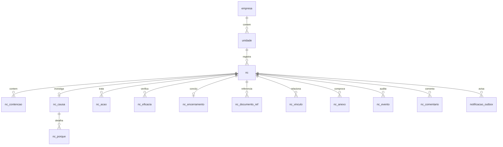

# B1 — Modelo de dados da Qualidade

**Data:** 15/10/2026. **Estado:** modelo e DDL aprovados no gate G-B1. O banco dedicado Qualidade e as migrations aditivas foram aplicados no destino durante o lote 1, após backup e regressão; veja o [relatório consolidado](../porting/lote-1.md). Prevalecem as [decisões de 15/10/2026](../porting/decisoes-2026-10-15.md) sobre o plano v2.

## 1. Identidade observada no código

1. O login da casca é `POST /unified/login` no Flask do Mapa. Com uma conta Mapa ativa, ele cria `mapa_unificado_session`, assinado por `itsdangerous`, `HttpOnly`, `Secure`, `SameSite=Lax`. A conta só PCP recebe token PCP e `unificado_test_session` com escopo `pcp_test_session`, restrito a `/unificado/testar/`; não recebe a sessão Mapa. Fonte: `unificado/mapa/api/app.py`, `unified_login_response` (linha 223).
2. `authenticated_user()` aceita apenas escopos `session` e `legacy_session`, relê `public.usuarios` do Mapa e verifica ativo, primeiro acesso e `updated_at`. Portanto, a conta só PCP não passa na autenticação usada hoje pelo Laboratório. Fonte: `unificado/mapa/api/app.py` (linha 475).
3. Ao abrir o Laboratório, o router chama `POST /unified/laboratorio-bootstrap`. O Flask exige `authenticated_user()`, calcula telas e papel, e emite o cookie `unificado_laboratorio_session` com caminho `/unificado/laboratorio/`. Fonte: `unificado/shell/router.js` (linha 178) e `unificado/mapa/api/app.py` (linha 547).
4. O Nginx chama, via `auth_request`, `/unified/laboratorio-authorize` a cada requisição. O Flask revalida a sessão e a tela/ação; devolve em `X-Lab-Assertion` uma afirmação com ID, nome, papel e expiração em 20 segundos, assinada com HMAC-SHA256. O Nginx remove o `Cookie` antes de encaminhar ao serviço Laboratório. Fontes: `unificado/laboratorio/nginx-laboratorio.conf` e `unificado/mapa/api/app.py` (linha 566).
5. A API Laboratório só aceita a afirmação quando chamada do loopback e com `LAB_UNIFIED_COPY=1`; confere assinatura, expiração e papel. O login local `ct_session` do serviço original existe no código, mas não é o contrato da cópia integrada. Fonte: `unificado/laboratorio/service/server/postes_api.py`, `gateway_user()` (linha 36).

### Contrato aprovado para a Qualidade, seguindo o Laboratório

- A casca chama `POST /unified/qualidade-bootstrap`. O Flask revalida `mapa_unificado_session`, verifica uma tela da Qualidade concedida e emite cookie próprio `unificado_qualidade_session` com caminho `/unificado/qualidade/`, `HttpOnly`, `Secure`, `SameSite=Lax`, duração limitada à sessão base e `Cache-Control: no-store`.
- Nginx protege **todas** as rotas da Qualidade com `auth_request /unificado/qualidade-auth` e `client_max_body_size 25M` nas locations da Qualidade. Sem sessão: 401/redirect de login para páginas; sem tela Qualidade: 403. O proxy passa somente a afirmação curta `X-Qualidade-Assertion` ao serviço loopback e apaga `Cookie` e qualquer cabeçalho `X-Qualidade-Assertion` vindo do cliente.
- O Flask revalida a sessão e apenas verifica acesso a **alguma tela da Qualidade**. Consulta `unificado_auth.user_action_permissions` e `user_quality_areas` e assina com segredo próprio, fora do Git, uma afirmação com ID estável, unidade ativa quando válida, **todas** as ações `qualidade.*` e áreas concedidas ao usuário, flag `superuser` e expiração de 20 segundos. Para o superusuário, inclui implicitamente todas as ações e áreas. O Flask não mapeia nem conhece as rotas da API Qualidade.
- A Qualidade valida HMAC em tempo constante, prazo, emissor e origem loopback, e decide a ação exigida **por endpoint**. A afirmação não transporta senha nem dá acesso direto ao banco Mapa. Cada requisição recebe nova autorização; alteração de grant passa a valer na seguinte. Operações do superusuário geram `nc_evento` como todas as demais.
- A API Qualidade faz sua própria autorização de negócio: `ver_area` exige área atribuída/permitida; `ver_todas` amplia leitura conforme grant; autor/responsável, unidade e estados são conferidos na operação. Tela visível não equivale a permissão para escrever. Sem grant explícito de ação, negar.
- O banco `qualidade` permanece isolado; apenas o Flask existente lê identidade/grants no Mapa e emite a afirmação. O serviço Qualidade não conecta ao banco Mapa, PCP, Laboratório ou hub.

**Conta só PCP:** o vínculo administrativo pelo fluxo existente foi aprovado. A identidade Mapa vinculada nasce **sem tela do Mapa**; login, senha e grants PCP permanecem intactos. O vínculo nunca ocorre automaticamente ao acessar a Qualidade. O ensaio com contas sintéticas confirmou PCP sem vínculo negado, acesso restrito após vínculo, conta só Mapa e pareada negadas por padrão. O fluxo administrativo em `unificado/mapa/api/app.py` cria a identidade shadow; `adopt_pcp_password()` em `unified_auth.py` preserva o hash PCP também no primeiro login e atualiza apenas a identidade Mapa. Evidência e scripts: [lote 1](../porting/lote-1.md).

## 2. Catálogo e permissões observados no código

O `screen_catalog.json` contém linhas de **telas navegáveis** com `id`, `module`, `label`, `path`, `query`, `screen` e `require`. `screen_access.py` carrega **todas** as linhas como `CATALOG`, calcula `allowed_screens()` e mapeia URL para tela. `screen_for_uri()` contém um mapa fechado dos prefixos de módulo para o cabeçalho e `role_allows()` trata Laboratório, Planejamento e, no restante, papéis do Mapa. Fontes: `unificado/mapa/api/screen_access.py` (linhas 9, 27, 52 e 66).

A tela administrativa `users-unificado.js` possui lista fixa de três módulos, mostra cada linha do catálogo como checkbox de tela e envia os IDs selecionados ao Flask. O Flask valida IDs contra `SCREENS_BY_ID` e persiste em `unificado_auth.user_screen_permissions`; fluxos de alteração podem regravar o conjunto. `shell/menu.config.js`, `shell/router.js` e `shell/shell.js` também têm os três módulos codificados. Fontes: `unificado/mapa/operacao/users-unificado.js` (linhas 4, 195–314), `unificado/mapa/api/app.py` (linhas 1200, 1241, 1583–1685), `unificado/shell/*`.

**Conclusão:** adicionar `qualidade.nc.abrir` e demais chaves como se fossem telas no catálogo atual altera a lista de telas autorizadas e o comportamento do editor/menu. Adicionar `module: qualidade` sem adaptar `screen_for_uri()` causa erro no mapa de prefixos para requisições com cabeçalho de tela. Ricardo rejeitou o catálogo tipado e aprovou o catálogo separado de ações descrito abaixo.

### Arquitetura aprovada de catálogo e grants

- **Telas comuns:** `qualidadePainel`, `qualidadeAbertura`, `qualidadeTratativa`, `qualidadeCadastros` no `screen_catalog.json`; adaptar `screen_for_uri()`, `role_allows()` com ramo Qualidade, `menu.config.js`, `router.js`, `shell.js` e a lista de módulos de `users-unificado.js`. As telas continuam em `unificado_auth.user_screen_permissions`.
- **Ações separadas:** as nove chaves `qualidade.nc.abrir`, `ver_todas`, `ver_area`, `triar`, `tratar`, `aprovar_concessao`, `verificar_eficacia`, `encerrar`, `cadastros` em `unificado/mapa/api/action_catalog.json`, com `id`, `module`, `label`, `description`, conforme o [catálogo proposto](B1-action-catalog-proposto.json). Grants em tabela nova `unificado_auth.user_action_permissions(user_id, action_id, granted_by, granted_at)`, FK de usuário com `ON DELETE CASCADE`, endpoint próprio de leitura/gravação. Nenhuma ação marcada por padrão; exceto superusuário, todas exigem concessão explícita, inclusive contas pareadas.

- **Áreas permitidas:** a tela atual de usuários também marca os códigos de área autorizados por usuário. A tabela aditiva `unificado_auth.user_quality_areas(user_id, area_codigo, granted_by, granted_at)` fica no banco de autenticação Mapa; a afirmação HMAC leva todos os códigos concedidos. Os 20 códigos estáveis de `document_area` são espelhados em `quality_area_catalog.json` e correspondem a `qualidade.area.codigo`. Sem área marcada, `ver_area` não amplia a leitura. `user-ricardo` tem todas as áreas implicitamente. A API Qualidade continua sem acessar diretamente o banco Mapa.
- **Editor:** bloco “Qualidade — ações” com caixas próprias, salvo no endpoint novo. Os fluxos atuais de telas não leem nem gravam ações. Nenhum grant de PCP, Mapa ou Laboratório é reescrito.
- **Gate:** migration aditiva da tabela de ações **só após G-B1**. Rodar `tests/unificado`, `tests/auth`, `tests/mapa`, `tests/pcp` e ensaio de navegação do Laboratório antes e depois da mudança; qualquer diferença bloqueia o merge.

As quatro linhas novas seguem o formato **atual** de tela (`id`, `module`, `label`, `path`, `query`, `screen`, `require`), sem `kind`. Proposta de rota da SPA: painel `/unificado/qualidade/`, abertura `/unificado/qualidade/abrir`, tratativa `/unificado/qualidade/nc/:id` e cadastros `/unificado/qualidade/cadastros`; o router deve resolver a rota dinâmica sem criar uma linha de catálogo por NC. `role_allows()` terá ramo Qualidade explícito para identidade Mapa ativa, inclusive a identidade vinculada ao PCP. Em `allowed_screens()`, o padrão do módulo Qualidade será **false** sem linha `allowed=true`, inclusive para conta pareada; superusuário conserva acesso implícito. O editor não habilita nenhuma ação ao marcar uma tela. A API exige simultaneamente acesso ao módulo pela afirmação e a ação apropriada.

Contrato administrativo proposto: `GET /unified/users/:id/actions` devolve as nove ações com estado concedido; `PUT /unified/users/:id/actions` recebe somente IDs presentes no catálogo, substitui **apenas** os grants `qualidade.*` daquele usuário em transação e registra concedente/data. O ator precisa da mesma autorização administrativa da tela de usuários atual e da proteção de origem/CSRF já adotada pelo Flask. Grants de outros módulos e `user_screen_permissions` não são tocados. A remoção física de `public.usuarios` limpa esses grants pela FK em cascata; desativação bloqueia a sessão imediatamente sem apagar a auditoria.

## 3. Limites do serviço e chaves mestres

O serviço `qualidade` será FastAPI + SQLAlchemy 2 + Alembic, em processo systemd próprio e porta loopback a reconferir no dia. Banco PostgreSQL 16 **dedicado** `qualidade`, schema `qualidade`, role de aplicação com grants somente nesse banco. A Qualidade não conecta diretamente aos bancos do Mapa, PCP, Laboratório ou hub. A ponte de identidade é a afirmação HMAC do Flask descrita acima; setor/produto são consultados por contrato HTTP autenticado a definir em B4, e cada NC salva ID PCP **mais snapshot de código e nome**. Lote é texto livre nesta fase; o botão QR fica oculto se B4 não comprovar contrato de lote confiável.

`empresa` e `unidade` são cadastros locais da Qualidade. As unidades são as chaves estáveis `pederneiras`, `ribeirao`, `noroeste` de `hub-api/config/units.yaml`. `unidade_codigo` entra na NC e nas filhas. O cookie Mapa/Laboratório observado não traz uma unidade ativa; se uma sessão futura trouxer unidade válida, ela prevalece. No estado atual, o usuário escolhe a unidade na abertura, com sua última escolha armazenada em `preferencia_usuario`. A API valida a unidade, a empresa e o escopo em cada leitura/escrita; preferência não é concessão de acesso.

O identificador externo novo é UUIDv7 gerado no serviço. Não depender de função UUIDv7 nativa do PostgreSQL 16. IDs legados GED são preservados separadamente em `id_legado`; IDs de usuário GED só são convertidos para ID Unificado por mapa conferido na C1. Enquanto não houver correspondência, o UUID legado permanece no `legado_payload` e o campo normalizado pode ficar nulo.

## 4. Modelo relacional proposto

O [provisionamento](B1-provisionamento-proposto.sql) criou banco e role própria, com regras `pg_hba.conf` para impedir conexão da role em outros bancos, inclusive quando `PUBLIC` concede `CONNECT`. O [DDL do banco Qualidade](B1-ddl-proposto.sql) contém as tabelas, chaves, índices e trigger; a [migration aditiva de ações](B1-ddl-acoes-proposto.sql) pertence **ao banco Mapa**, separadamente. Os artefatos permanecem como registro do modelo aprovado; a execução e os testes constam no [lote 1](../porting/lote-1.md). `empresa_id`, `unidade_codigo` e campos de auditoria constam nas entidades de NC/cadastro. `nc_numero_contador` e `preferencia_usuario` são tabelas técnicas com chaves próprias. FKs internas protegem a existência das entidades; a API também valida que os IDs associados pertencem à mesma empresa/unidade antes da transação. Esse isolamento cruzado será confirmado nos testes integrados B2.

| Entidade | Dados e invariantes principais |
|---|---|
| `nc` | Número, título, descrição, origem, tipo, gravidade, status, áreas, setor/produto PCP com snapshots, lote livre, datas, requisito, evidências, impacto, referências, quantidade/cliente afetado, responsabilidade, prazos, encerramento/reabertura, dados legados. Índices por unidade/status, responsável/status, prazo, área e título `pg_trgm`. |
| `nc_contencao` | Disposição, descrição, quantidade bloqueada e aprovação de concessão. Aprovar concessão requer `qualidade.nc.aprovar_concessao`. |
| `nc_causa` e `nc_porque` | Métodos 5 Porquês, Ishikawa, Pareto, Estratificação e Falha Classificada; payload JSONB íntegro. Até cinco porquês estruturados. |
| `nc_acao` | Tipo e estado, 5W2H completo, executor, prazo, evidência, conclusão e verificação. `ATRASADA` legado preservado em `status_legado`; atraso novo é calculado pelo prazo. |
| `nc_eficacia` | Uma linha por rodada, sem sobrescrever avaliação anterior; resultado, critério, data e verificador. |
| `nc_encerramento` | Conclusão e decisões sobre riscos, documentos e treinamento. Encerramento requer `qualidade.nc.encerrar`. |
| `nc_documento_ref`, `nc_vinculo` | Referências GED por ID/código/revisão e relações entre NCs. Nenhuma FK entre bancos/serviços. |
| `nc_anexo` | Metadados e SHA-256, caminho privado relativo. Máximo 25 MiB por arquivo; PDF, PNG, JPEG, WebP, TXT, DOC/DOCX, XLS/XLSX conforme B2.2. Download só por endpoint autenticado. |
| `nc_evento` | Trilha de todas as operações, inclusive superusuário e importação; trigger impede `UPDATE` e `DELETE`. `IMPORTACAO` contém JSON original das seis tabelas por NC. |
| `nc_comentario` | Texto, menções e autor. |
| `notificacao_outbox` | Atribuição, pedido de aprovação, dois dias antes do prazo e atraso, com chave de deduplicação e tentativas. Timer systemd envia pelo SMTP do mesmo provedor GED, com credenciais próprias fora do Git; falha não reverte a NC. “Minhas pendências” lê as atribuições e prazos no painel. |
| `origem`, `tipo`, `gravidade`, `gravidade_legado_mapa`, `disposicao`, `area` | Cadastros ativos/inativos, códigos estáveis e `codigo_legado` quando aplicável. O mapa de gravidade permite `CRITICA` e `ALTA` apontarem ambas para Maior. `area` recebe os 20 valores reais de `document_area`. |

### Decisões D4, D5, D6, D9 e D11

- **D4:** `gravidade` guarda prazos e regras configuráveis. Semente inicial: Maior — causa em 5 dias e ação corretiva obrigatória; Menor — prazo final 15 dias e corretiva se recorrente; Observação — prazo final 30 dias e correção suficiente. O prazo final de Maior é definido na triagem; o DDL deixa o campo de configuração correspondente nulo para evitar inventar prazo não decidido. A API grava `prazo_etapa` e `prazo_final` na NC conforme essa política.
- **D5:** concessão exige `qualidade.nc.aprovar_concessao`; encerramento exige `qualidade.nc.encerrar`. Toda aprovação/encerramento grava evento. Não inferir autorização apenas de tela ou perfil.
- **D6:** rascunho tem `numero = NULL` e não consome contador. Na transição `RASCUNHO → REGISTRADA`, gerar `NC-AAAA-NNNN` por empresa com contador anual incrementado por `INSERT ... ON CONFLICT DO UPDATE ... RETURNING` **na mesma transação** que muda o estado e grava `nc_evento`. Um índice único parcial cobre `(empresa_id, numero) WHERE numero IS NOT NULL`. A unidade fica em campo próprio. Ao atingir 9999 no ano, rejeitar com erro operacional e decisão explícita de formato; não gerar número fora do padrão. Legado guarda `numero_legado` e é mostrado como `NC-... (RNC-...)`.
- **D9:** catálogo novo tem Maior, Menor, Observação. `CRITICA` e `ALTA` → Maior; `MEDIA` → Menor; `BAIXA` → Observação. `gravidade_legado` guarda o valor original. Para as três RNCs atuais, o complemento confirmou `ALTA` → Maior e `MEDIA` → Menor; recontar na C1.
- **D11:** todos os valores de `rnc_origin` e `rnc_type` do banco vivo entram nos cadastros com `codigo_legado`. Segurança e Ambiental permanecem inativos para **novas** NCs e disponíveis para leitura/importação de legados, até nova decisão.

Sementes obrigatórias, derivadas dos enums **vivos** conferidos na A1:

| Cadastro | Valores/códigos legados a cobrir |
|---|---|
| Origem (10) | `CLIENTE`, `PROCESSO_INTERNO`, `FORNECEDOR`, `AUDITORIA_INTERNA`, `AUDITORIA_EXTERNA`, `INSPECAO`, `SEGURANCA`, `AMBIENTAL`, `RECLAMACAO`, `OUTRO` |
| Tipo (9) | `PRODUTO`, `PROCESSO`, `SISTEMA_GESTAO`, `FORNECEDOR`, `CLIENTE`, `SEGURANCA`, `AMBIENTAL`, `DOCUMENTAL`, `OUTRO` |
| Gravidade legada (4 → 3) | `CRITICA` e `ALTA` → `MAIOR`; `MEDIA` → `MENOR`; `BAIXA` → `OBSERVACAO`, em `gravidade_legado_mapa` |
| Área (20) | `LABORATORIO`, `QUALIDADE`, `PRODUCAO`, `ENGENHARIA`, `ADMINISTRATIVO`, `SEGURANCA`, `AEE`, `COM`, `CQC`, `INJ`, `MAN`, `PCP`, `PJT`, `PRO`, `REC`, `RHU`, `SGA`, `SGQ`, `SST`, `VEN` |

Origem `CLIENTE` e `RECLAMACAO` podem compartilhar rótulo visual, mas são **duas linhas** com códigos legados distintos; o valor exato continua preservado. Segurança e Ambiental dos cadastros de origem/tipo recebem `ativo=false` para abertura nova. A disposição “Não informada (legado)” cobre a contenção textual antiga sem inventar decisão de disposição.

O estado inicial de uma NC nova é `RASCUNHO`; a tela mostra **“Número gerado ao registrar”**. Só autor e superusuário podem ver o rascunho. Descartá-lo faz `RASCUNHO → CANCELADA` com motivo obrigatório “rascunho descartado” e `nc_evento`; nenhuma linha é apagada. `ENCERRAMENTO` significa aguardar aprovação de quem tem `qualidade.nc.encerrar`. As transições completas seguem B2.1 do plano v2. Na migração, `ABERTA` → `REGISTRADA` e `ENCERRADA` → `ENCERRADA`; o valor original fica em `status_legado`. B2 implementa cada transição em endpoint próprio, com transação de dados + `nc_evento` + outbox. A API bloqueia alteração de evento e valida escopo de empresa, unidade e área.

## 5. Cobertura integral do RNC legado

A [tabela de cobertura](B1-cobertura-rnc.md) enumera **89/89 colunas** das seis tabelas `rnc_*` do banco vivo, verificadas contra `information_schema` em 15/10/2026: `rnc_reports` 36, causa 12, ações 18, eficácia 7, histórico 7, anexos 9. Não há lacuna. Cada coluna aponta para campo normalizado ou para o vínculo/JSON original; `id_legado` e o evento `IMPORTACAO` tornam o script de C1 idempotente e auditável. As filhas atualmente vazias continuam cobertas porque podem receber registros antes do corte.

Na C1, a importação deve comparar novamente contagens, IDs, números, status e anexos; vincular cada RNC a unidade conforme D10 e mapear usuários sem perder o UUID GED. Nenhuma migração de dados foi feita na B1.

## 6. Implantação e verificação propostas

Depois de G-B1: provisionar banco/roles separados; aplicar Alembic ao schema Qualidade e uma migration aditiva isolada no banco Mapa para `user_action_permissions`; carregar os nove IDs de ação no `action_catalog.json` e quatro telas no catálogo de telas; ajustar shell, Nginx e editor. A role de execução da Qualidade deve ter grants só no banco/schema Qualidade, sem acesso aos bancos existentes. O endpoint de grants aceita apenas IDs presentes no catálogo de ações, checa administrador e grava concessão/revogação com auditoria. A Qualidade nunca lê essa tabela; recebe todas as ações no HMAC curto.

Antes e depois de alterar catálogo/editor/roteador, executar `tests/unificado`, `tests/auth`, `tests/mapa`, `tests/pcp` e ensaio de navegação do Laboratório. Qualquer diferença bloqueia o merge. B2 acrescenta testes de conta só PCP antes/depois do vínculo, conta só Mapa, conta pareada, negação por padrão, superusuário auditado, ação por endpoint, escopo de área/unidade, transições e outbox. B5 inclui restauração do banco Qualidade e anexos antes de liberar o módulo.

## 7. Gate G-B1

**Para aprovação:** contrato de identidade ajustado, catálogo separado de ações, modelo relacional, DDL **proposto** em dois bancos e cobertura 89/89. Não foram criados banco, schema, tabela ou grant; nenhuma migration foi aplicada. B2 e qualquer DDL aguardam a aprovação G-B1 prevista no plano v2.
