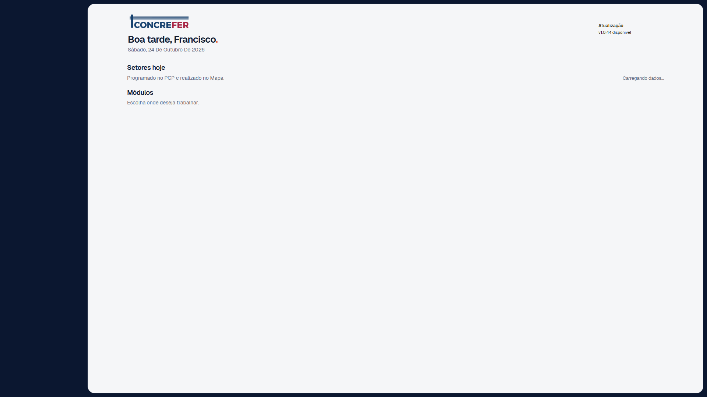
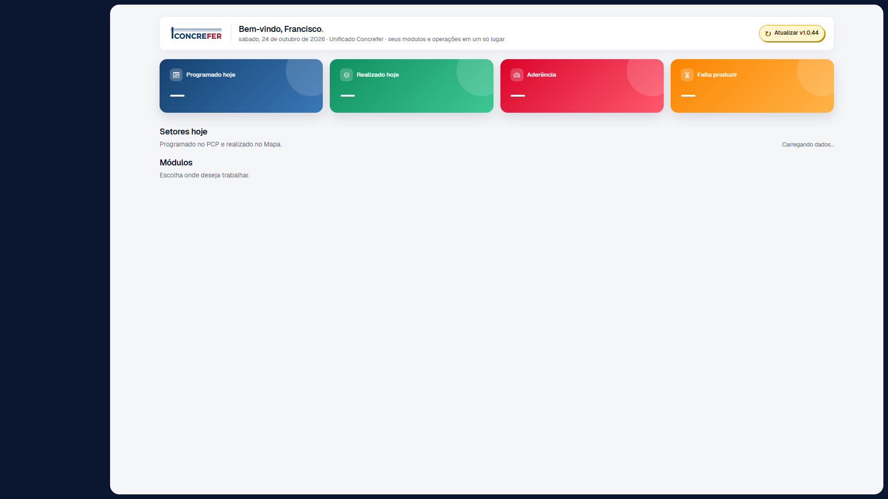
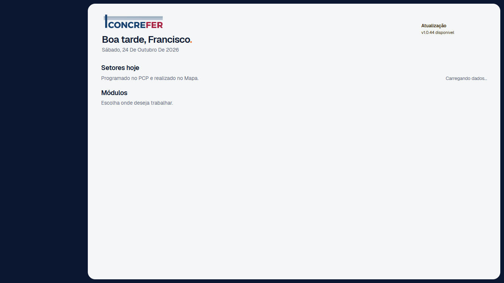
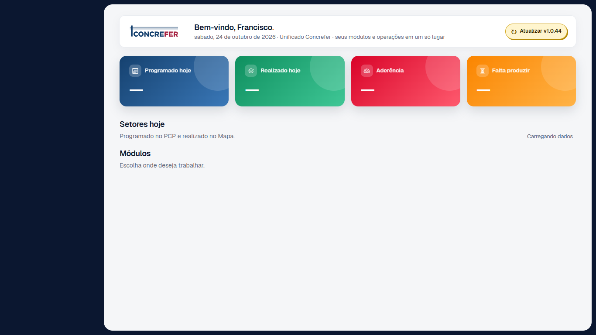
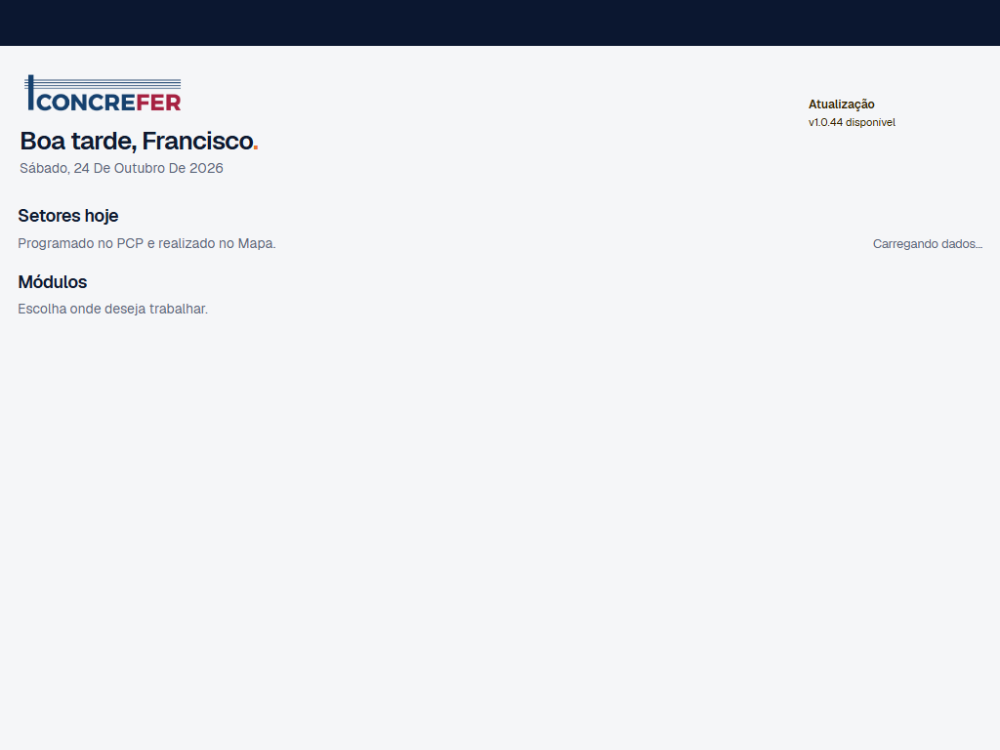
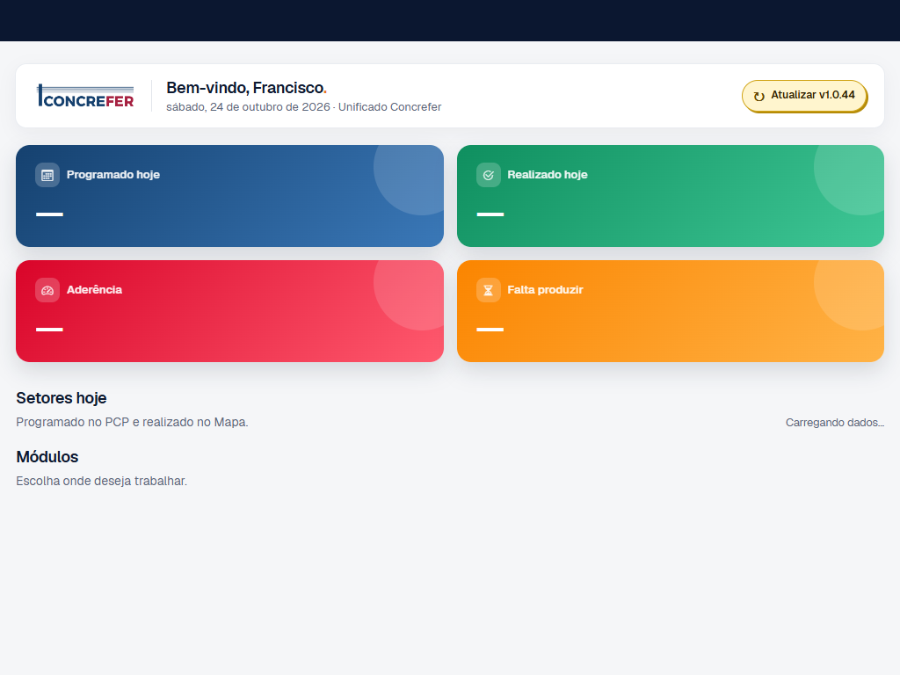

# Home do Unificado — cabeçalho compacto

## Localização e estilos

- Hero: `unificado/index.html`, bloco `.welcome.opening-hero` da Home `/unificado/`.
- CSS de base: `unificado/shell/shell.css` (`.welcome`, `.opening-hero`, `.opening-identity`, `.opening-update`).
- CSS da Home atual: `unificado/shell/home-v2.css` (`body.home-v2 ...` e regras novas de `min-width:768px`).
- Dados e estado: `unificado/shell/home-v2.js` usa as sessões locais criadas pelo login unificado. O nome de exibição do Mapa/IAM tem prioridade; para contas PCP, usa o nome da sessão PCP. Na ausência de nome, tenta login/identificador; sem ambos, mostra `Bem-vindo.`. A data usa `America/Sao_Paulo`.
- O botão mantém `#platform-update` e a ação existente em `unificado/shell/shell.js`. A faixa só o mostra quando a versão consultada está disponível.

## Capturas e medidas

Capturas em Chrome headless com HTML e CSS reais, escala 1× e sessão isolada (`Francisco Augusto`). As chamadas de autenticação e dados operacionais foram isoladas para registrar o layout sem acessar contas reais. Nas capturas anteriores, a saudação e a versão foram preenchidas pela fixture; nas posteriores, o script `home-v2.js` executou. A sidebar e os dados operacionais não fazem parte desta evidência.

| Largura da janela | Antes | Depois | Altura antes → depois |
| --- | --- | --- | --- |
| 1920px |  |  | 131,48px → **72px** |
| 1366px |  |  | 131,48px → **72px** |
| 1024px |  |  | 131,48px → **72px** |

Em 1024px, o trecho final do subtítulo está oculto. O bloco recebe `margin-bottom:20px`. Na Home atual, os KPIs e “Setores hoje” já vêm entre o hero e “Módulos”; a ordem dessas seções não foi alterada.

### Conta sem nome cadastrado

Fixture com `name` ausente e login/ID `francisco`: [captura do fallback](home-cabecalho-compacto/depois-1366-fallback.png). O título exibido é **“Bem-vindo, francisco.”**. Sem nome nem login/ID, a verificação automatizada confirmou **“Bem-vindo.”**.

## Verificações

- `node --check unificado/shell/home-v2.js` e `git diff --check`: passaram.
- Chrome headless: 1920, 1366 e 1024px com altura de 72px; nome e fallback corretos.
- Pílula mostra `Atualizar v1.0.44` na fixture de versão disponível; com botão desabilitado, fica invisível.
- Abaixo de 768px (767px e 390px), o bloco compacto fica oculto e o bloco móvel existente continua visível.
- A ação de atualização segue no mesmo elemento `#platform-update`; não houve mudança nas rotas ou nos modos PWA.

## Arquivos alterados nesta tarefa

- `unificado/index.html`
- `unificado/shell/home-v2.css`
- `unificado/shell/home-v2.js`
- `docs/qualidade/home-cabecalho-compacto.md` e as capturas em `docs/qualidade/home-cabecalho-compacto/`

Estado: pronto para aprovação; sem push e sem deploy nesta tarefa.
