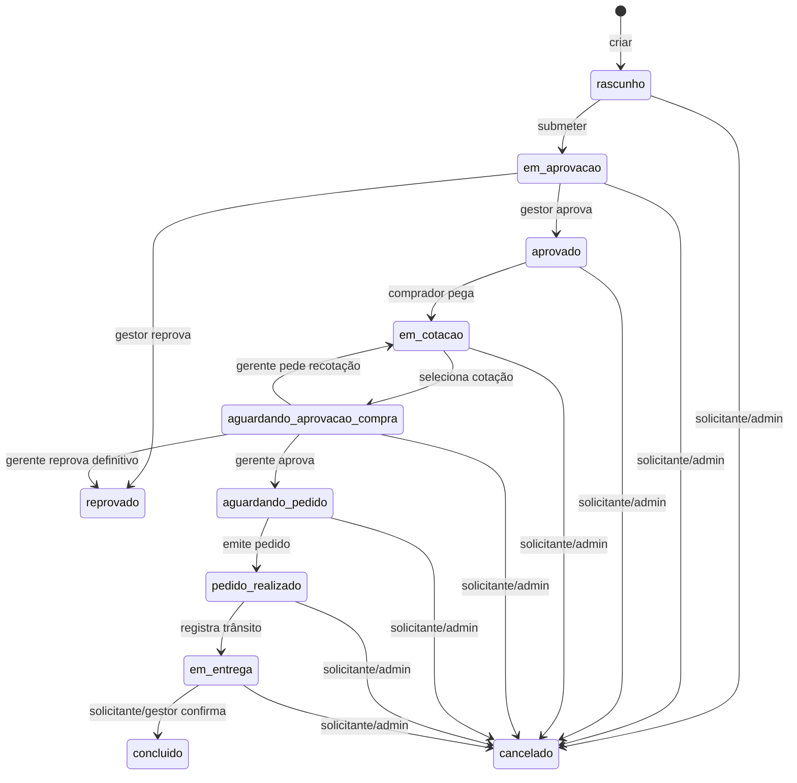
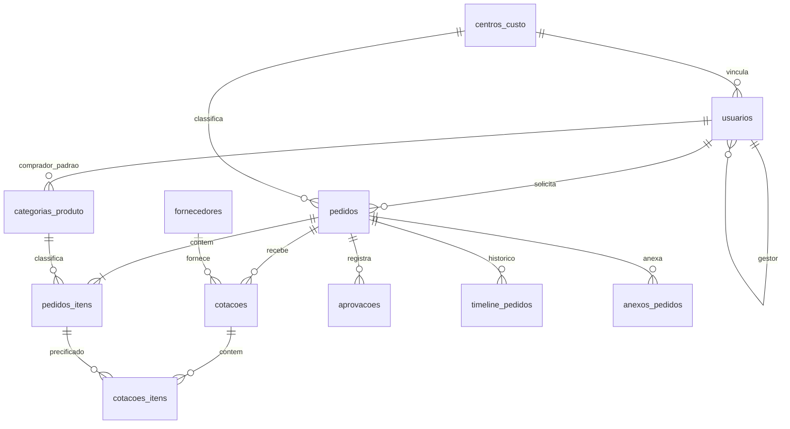

# BuyCompras — leitura da VPS antiga para recriação

**Levantamento:** 25/10/2026 · **Escopo:** aplicação, interface, API, banco, publicação e riscos observados · **Operação:** somente leitura na VPS antiga.

## 1. Identificação e método

O endereço informado, `buycompras.comcretrack.com.br`, não resolveu no DNS consultado. A instalação encontrada na VPS antiga (`vps-rh`) atende em **[compras.concretrack.com.br](https://compras.concretrack.com.br/)**. A grafia `buycompras.concretrack.com.br` também não resolveu. O host correto deve ser confirmado antes do corte para a VPS nova.

Foram lidos os arquivos em `/var/www/BuyCompras`, a configuração NGINX, o processo PM2, as rotas Express, o SQL de criação e metadados e contagens do PostgreSQL de produção (`buycompras_db`). Também foram feitas requisições HTTP públicas e capturas do frontend servido pela instalação antiga. Nenhuma senha, hash, token real, dado pessoal de pedido ou conteúdo de anexo foi copiado para este documento.

**Como ler as imagens:** a captura de login e a do guia são públicas e reais. As telas internas usam os arquivos HTML/CSS/JS efetivamente servidos pela VPS antiga, com respostas de API e sessão **fictícias** injetadas apenas no navegador de captura. Portanto, comprovam a estrutura visual, mas não o conteúdo real do banco nem uma sessão autenticada. A tela de detalhe mostra o erro real de JavaScript observado nesse processo.

## 2. Resumo executivo

- Sistema de solicitação e acompanhamento de compras com dois níveis de aprovação, cotações, fornecedor, recebimento, relatórios e cadastros.
- Frontend estático HTML/CSS/JavaScript, Bootstrap 5.3.3, Bootstrap Icons 1.11.3 e fonte Montserrat; backend Node.js/Express; PostgreSQL local; PWA com manifest e service worker.
- Publicado por NGINX/TLS, proxy reverso para Node em `127.0.0.1:3030`, processo PM2 `buycompras` como `root`.
- Banco real: **14 usuários, 9 centros de custo, 27 categorias, 1 fornecedor, 4 pedidos, 4 itens, 2 cotações, 2 itens de cotação, 1 aprovação, 13 eventos de histórico e 0 anexos** no momento da leitura. Banco com cerca de **9,5 MB** (`9459 kB`).
- O backend e o banco existem, mas há falhas observáveis que impedem tratar a interface atual como especificação perfeita: a página de detalhe contém erro de sintaxe, os relatórios esperam formatos diferentes dos retornados pela API, a interface de ativação de usuário chama rota inexistente e links de CSV/arquivos não enviam o Bearer exigido.

## 3. Infraestrutura e execução atual

```mermaid
flowchart LR
  Browser[Navegador / PWA] --> TLS[NGINX 443 + TLS]
  TLS --> Node[PM2 buycompras / Node 22 / Express 3030]
  Node --> PG[(PostgreSQL buycompras_db)]
  Node --> Files[/var/www/BuyCompras/uploads]
  Node --> Static[/var/www/BuyCompras/frontend]
```

| Peça | Leitura da VPS antiga |
|---|---|
| Domínio ativo | `compras.concretrack.com.br` |
| Virtual host | `/etc/nginx/sites-enabled/buycompras`; HTTP redireciona para HTTPS |
| Proxy | `127.0.0.1:3030`; limite de corpo NGINX `15m` |
| TLS e cabeçalhos | Certificado configurado no NGINX; HSTS, `X-Frame-Options: SAMEORIGIN`, `X-Content-Type-Options: nosniff`, `Referrer-Policy: strict-origin-when-cross-origin` |
| Aplicação | `/var/www/BuyCompras/backend/src/server.js`, escuta só em loopback |
| Gerenciador | PM2 `buycompras`, modo cluster, uma instância, online; reinício observado: 1 |
| Banco | PostgreSQL `buycompras_db`, pool `pg` com máximo de 10 conexões |
| Arquivos | `/var/www/BuyCompras/uploads`; 0 arquivos regulares encontrados e 0 linhas em `anexos_pedidos` |
| Ambiente | `.env` com chaves `DB_HOST`, `DB_PORT`, `DB_NAME`, `DB_USER`, `DB_PASSWORD`, `PORT`, `NODE_ENV`, `UPLOADS_DIR`, `ALLOWED_ORIGINS`; valores omitidos |
| Rotas públicas verificadas | `/api/health` HTTP 200, `/login.html` HTTP 200, `/guia-buycompras.html` HTTP 200 |
| Proteção pública verificada | `/api/pedidos` e `/api/relatorios/exportar-csv` sem autenticação retornam HTTP 401 |

`backend/package.json` declara Node >=18 e usa Express 4.21.2, `pg` 8.13.3, `bcryptjs` 2.4.3, `multer` 1.4.5-lts.2, `helmet` 8.1.0, `cors` 2.8.5, `morgan` 1.10, `dotenv` 16.4.5 e `uuid` 11.1.0. A instância PM2 relata Node **22.22.0**. Não foi encontrada, no código lido, integração ativa com e-mail, ERP, webhook ou gateway de pagamento; URLs externas do frontend são Google Fonts e jsDelivr. Os cron jobs de `root` inspecionados não mencionam BuyCompras. Isso não comprova ausência de automações em outros usuários ou serviços.

O servidor Express entrega o frontend estático com cache de 1 dia, monta todas as APIs em `/api` e devolve `login.html` como fallback para rotas não API. O service worker `buycompras-v2` usa cache primeiro para recursos estáticos e deixa `/api/` na rede; `manifest.json` inicia em `/login.html` e define modo `standalone`.

## 4. Telas e experiência

| Tela / URL | Conteúdo e ações visíveis | Captura |
|---|---|---|
| Login `/login.html` | E-mail, senha, mostrar/ocultar senha, entrar; registra service worker | [01-login.png](capturas/01-login.png) |
| Guia `/guia-buycompras.html` | Apresentação, perfis, fluxo, estados, funcionalidades, matriz de acesso e FAQ | [02-guia.png](capturas/02-guia.png) |
| Dashboard `/index.html` | Cartões por estado, carga por comprador, pedidos recentes, atalho nova solicitação | [03-dashboard.png](capturas/03-dashboard.png) |
| Pedidos `/solicitacoes.html` | Filtros por status, urgência, centro de custo, comprador, texto e datas; tabela, cartões móveis, paginação | [04-pedidos.png](capturas/04-pedidos.png) |
| Nova solicitação `/nova-solicitacao.html` | Dados gerais, itens, anexos, salvar rascunho ou submeter; aceita `?edit=<id>` | [05-nova-solicitacao.png](capturas/05-nova-solicitacao.png) |
| Detalhe `/solicitacao.html?id=<id>` | Planeja progresso, ações, itens, cotações, anexos, histórico e impressão; **não renderiza atualmente por erro de sintaxe** | [06-detalhe.png](capturas/06-detalhe.png) |
| Relatórios `/relatorios.html` | Filtros, resumo, 4 gráficos/painéis, tabela paginada e exportação CSV | [07-relatorios.png](capturas/07-relatorios.png) |
| Usuários `/usuarios.html` | Lista, cadastro/edição em modal, perfis, gestor, centro de custo, ativo | [08-usuarios.png](capturas/08-usuarios.png) |
| Centros de custo `/centros-custo.html` | Lista e modal de código, nome, descrição, ativo | [09-centros-custo.png](capturas/09-centros-custo.png) |
| Categorias `/categorias.html` | Lista, filtro por comprador, aplicação e comprador padrão | [10-categorias.png](capturas/10-categorias.png) |
| Fornecedores `/fornecedores.html` | Lista e modal com nome, CNPJ, contato, e-mail, telefone, ativo | [11-fornecedores.png](capturas/11-fornecedores.png) |
| Perfil `/perfil.html` | Dados pessoais, troca de senha, contadores de atividade | [12-perfil.png](capturas/12-perfil.png) |
| Dashboard móvel | Cartões, pedidos e menu inferior na largura de 390 px | [13-dashboard-mobile.png](capturas/13-dashboard-mobile.png) |
| Solicitação móvel | Formulário e itens em cartões na largura de 390 px | [14-nova-solicitacao-mobile.png](capturas/14-nova-solicitacao-mobile.png) |


### 4.1 Formulários e navegação

A navegação desktop usa menu lateral; no celular, menu inferior. A barra lateral libera **Nova Solicitação** para solicitante, gestor e admin; **Relatórios** para comprador, gerente de suprimentos e admin; **Administração** apenas para admin. O menu inferior mostra o ícone Relatórios a todos, embora a página faça verificação de perfil e redirecione os demais.

Nova solicitação pede título, centro de custo, urgência (`normal`, `urgente`, `critico`), prazo de necessidade, local de aplicação, descrição e observações. Cada item traz descrição, quantidade, unidade, categoria, valor estimado e justificativa. Admite vários itens e anexos PDF, Word, Excel, imagens e TXT de até 10 MB por arquivo. A UI exige centro de custo, mas a API permite `centro_custo_id` nulo; para recriar, escolher uma regra única.

A página de detalhe foi desenhada para imprimir uma solicitação com assinaturas de solicitante, gestor, comprador e gerente de suprimentos. As ações aparecem conforme status e perfil: submeter/editar/excluir, aprovar/reprovar na gestão, pegar solicitação/atribuir comprador, lançar/selecionar cotação, aprovar compra/recotar/reprovar definitivamente, realizar pedido, registrar entrega, confirmar recebimento e cancelar. A página contém modais para confirmação, cotação e atribuição.

## 5. Regras de acesso

| Perfil | Leitura de pedidos | Operações principais |
|---|---|---|
| Solicitante | Seus pedidos | Criar e editar rascunho, submeter, cancelar próprios pedidos não finais, confirmar recebimento próprio |
| Gestor | Seus pedidos e dos subordinados diretos (`usuarios.gestor_id`) | O mesmo ciclo de solicitação; aprovar/reprovar pedidos em aprovação dos subordinados; confirmar recebimento desses pedidos |
| Comprador | Pedidos fora de rascunho | Pegar pedido aprovado, cotar, selecionar cotação, realizar pedido, registrar entrega, atribuir comprador |
| Gerente de suprimentos | Pedidos fora de rascunho | Aprovar compra, pedir recotação ou reprovar definitivamente; atribuir comprador; relatórios |
| Admin | Todos | Ações de todos os fluxos e gestão de usuários, centros de custo e categorias |

Qualquer usuário autenticado consegue listar usuários, centros de custo, categorias e fornecedores pela API. Fornecedores podem ser criados/alterados por comprador, gerente de suprimentos e admin. Criação/alteração de usuário, centro de custo e categoria exige admin. O backend não implementa um filtro por perfil no resumo global de `/api/relatorios/resumo`: qualquer usuário autenticado recebe as contagens gerais.

A interface restringe o botão de nova solicitação a solicitante, gestor e admin, mas `POST /api/pedidos` só aplica `requireAuth`: comprador e gerente de suprimentos também podem criar pedido por chamada direta à API. A nova versão deve aplicar no servidor a política de perfis decidida para o produto.

A senha é armazenada como hash `bcryptjs` (custo 12 no cadastro e troca). O login retorna os dados de usuário e um campo `token`; **o token é o próprio UUID do usuário**. O frontend o guarda em `localStorage` (`buycompras_session`), e cada API consulta `usuarios.id` a partir de `Authorization: Bearer <UUID>`, validando apenas se o usuário está ativo. Não há assinatura, expiração ou sessão revogável identificada. A reconstrução precisa substituir esse modelo.

## 6. Fluxo operacional efetivo



Os estados finais são `concluido`, `reprovado` e `cancelado`. Os rascunhos podem ser excluídos definitivamente pelo autor ou admin. A reprovação da gestão vai para **`reprovado` final no backend**; o guia público afirma que voltaria a rascunho, portanto está desatualizado. A confirmação de recebimento cabe ao solicitante/gestor/admin no backend, enquanto o guia a atribui ao comprador. A UI sugere até 5 cotações; a rota de criação não impõe esse limite. Não foi identificada regra que exija quantidade mínima de cotações ou menor preço para selecionar a vencedora.

O código do pedido é gerado por trigger como `BCMP-AAAAMM-NNNN`, com sequência global `pedido_seq` (não reinicia por mês). Cada mudança principal grava evento em `timeline_pedidos`; aprovações também gravam em `aprovacoes`. Operações de estado usam transação e bloqueio `FOR UPDATE`, evitando disputa simples de atualização simultânea.

## 7. Modelo de dados



| Tabela | Campos de negócio / vínculos | Linhas em produção |
|---|---|---:|
| `centros_custo` | UUID, código único, nome, descrição, ativo, criação | 9 |
| `usuarios` | UUID, nome, e-mail único, `senha_hash`, perfil, centro de custo, gestor, ativo, datas | 14 |
| `categorias_produto` | UUID, nome, aplicação, comprador padrão, descrição, ativo | 27 |
| `fornecedores` | UUID, nome, CNPJ, contato, e-mail, telefone, ativo, datas | 1 |
| `pedidos` | UUID, código, solicitante, centro de custo, comprador, aprovador gestor, status, título, descrição, urgência, local, prazos, número do fornecedor, observações, datas | 4 |
| `pedidos_itens` | UUID, pedido, descrição, quantidade decimal positiva, unidade, categoria, justificativa, valor estimado | 4 |
| `cotacoes` | UUID, pedido, comprador, número sequencial no pedido, fornecedor cadastrado/opcional e nome livre, prazo, pagamento, total, observações, selecionada | 2 |
| `cotacoes_itens` | UUID, cotação, item solicitado, descrição, quantidade, unidade, valor unitário/total, observações | 2 |
| `aprovacoes` | UUID, pedido, aprovador, etapa `gestao`/`suprimentos`, ação, comentário, data | 1 |
| `timeline_pedidos` | UUID, pedido, autor, ação, descrição, data | 13 |
| `anexos_pedidos` | UUID, pedido, nome original, nome armazenado, MIME, bytes, autor, data | 0 |

Os 14 usuários estão ativos: 4 admin, 3 gerentes de suprimentos, 5 compradores e 2 solicitantes; não há gestor cadastrado no retrato atual. Dos 4 pedidos, 3 estavam em `em_aprovacao` e 1 em `em_cotacao`. Os centros de custo cadastrados são `ADM`, `COMP`, `ENG`, `LOG`, `MANUT`, `PROD`, `QUAL`, `RH` e `TI`, todos ativos. As 27 categorias (todas ativas) são agrupadas em `GERAL` (1), `MANUTENÇÃO` (9), `MP` (16) e `SERVIÇO` (1); o código de categoria pode apontar a um comprador padrão. O comprador padrão é apenas exibido no item, não atribui automaticamente o pedido.

O SQL versionado em `backend/src/database/schema.sql` contém **10** valores para `status_pedido` e omite `aprovado`; o ENUM de produção contém **11** valores, inclusive `aprovado`. A recriação precisa derivar a migração inicial do esquema real ou corrigir o SQL antes de executar. `created_at` e `updated_at` usam `timestamptz`; prazos são `date`; valores monetários são `decimal(12,2)`.

### 7.1 Dicionário de campos e restrições relevantes

| Entidade | Campos a preservar na recriação | Regras do SQL lido |
|---|---|---|
| Centro de custo | `id`, `codigo`, `nome`, `descricao`, `ativo`, `created_at` | Código único e obrigatório; nome obrigatório |
| Usuário | `id`, `nome`, `email`, `senha_hash`, `perfil`, `centro_custo_id`, `gestor_id`, `ativo`, `created_at`, `updated_at` | E-mail único; perfil ENUM; gestor é referência à própria tabela |
| Categoria | `id`, `nome`, `aplicacao`, `comprador_padrao_id`, `descricao`, `ativo`, `created_at` | Nome obrigatório; comprador padrão opcional |
| Fornecedor | `id`, `nome`, `cnpj`, `contato_nome`, `email`, `telefone`, `ativo`, `created_at`, `updated_at` | Nome obrigatório; SQL não define unicidade de CNPJ |
| Pedido | `id`, `codigo`, `solicitante_id`, `centro_custo_id`, `comprador_id`, `gestor_aprovador_id`, `status`, `titulo`, `descricao`, `urgencia`, `local_aplicacao`, `prazo_necessidade`, `prazo_estimado_entrega`, `numero_pedido_fornecedor`, três campos de observação, `created_at`, `updated_at` | Código único gerado por trigger; solicitante, título e local obrigatórios |
| Item solicitado | `id`, `pedido_id`, `descricao`, `quantidade`, `unidade`, `categoria_id`, `justificativa`, `valor_estimado`, `created_at` | Quantidade `decimal(10,3) > 0`; item excluído em cascata com pedido |
| Cotação | `id`, `pedido_id`, `comprador_id`, `numero`, `fornecedor_id`, `fornecedor_nome`, `prazo_entrega_dias`, `condicao_pagamento`, `valor_total`, `observacoes`, `selecionada`, datas | `(pedido_id,numero)` único; fornecedor pode ser livre sem cadastro |
| Item cotado | `id`, `cotacao_id`, `item_id`, `descricao`, `quantidade`, `unidade`, `valor_unitario`, `valor_total`, `observacoes` | Vínculo ao item solicitado; excluído com a cotação |
| Aprovação | `id`, `pedido_id`, `aprovador_id`, `etapa`, `acao`, `comentario`, `created_at` | Etapa/ação são texto simples, sem `CHECK` no SQL |
| Histórico | `id`, `pedido_id`, `autor_id`, `acao`, `descricao`, `created_at` | Autor pode ser nulo; registros excluídos com o pedido |
| Anexo | `id`, `pedido_id`, `nome_original`, `nome_arquivo`, `mime_type`, `tamanho_bytes`, `uploaded_by`, `uploaded_at` | Metadados no banco; bytes em arquivo externo ao banco |

Índices específicos cobrem `pedidos` por solicitante, status, centro de custo, comprador e criação; `timeline_pedidos` por pedido/data; itens e cotações por pedido; usuários por gestor e perfil. Há triggers para atualizar `updated_at` em pedidos, usuários, fornecedores e cotações. O esquema usa `pgcrypto` para `gen_random_uuid()`.

### 7.2 Categorias por aplicação

- **MANUTENÇÃO (9):** Acessórios Logística, Diesel e ARLA, Equipamentos Industriais, Gás para Solda, Insumos de Solda, Manutenção Industrial, Manutenção Veicular, Máquinas e Ferramentas, Posto de Combustível.
- **MP (16):** Aditivos e Desmoldantes, Agregados, Aços e Arames, Cabos, Cimento, Conectores e Terminais, Dispositivos de Segurança Elétrica, EPI, Embalagens, Espaçadores Armadura, Fixadores, Insumos para Injeção Plástica, Massas e Reparos, Resinas Injeção Plástica, Tampas de Fibra, Tubos e Acessórios PVC.
- **SERVIÇO (1):** Serviços Terceiros.
- **GERAL (1):** Outros.

## 8. Inventário de API

Todas as rotas abaixo começam por `/api`. `A` = qualquer usuário autenticado; `Adm` = admin; `C` = comprador/admin; `S` = comprador/gerente de suprimentos/admin. As verificações por autor, subordinado e status são adicionais à coluna de perfil.

| Método e caminho | Perfil | Contrato principal |
|---|---|---|
| `GET /health` | público | Estado do serviço e timestamp |
| `POST /auth/login` | público | `{email, senha}` → `{token, usuario}` |
| `GET /auth/me` | A | Usuário da sessão |
| `GET /pedidos` | A | Filtros `status`, `centro_custo_id`, `comprador_id`, `urgencia`, `q`, `data_inicio`, `data_fim`, `page`, `limit`; retorna `{pedidos,total,page,limit}` |
| `GET /pedidos/:id` | A | Pedido, itens, timeline, cotações e anexos, respeitando autor/subordinado |
| `POST /pedidos` | A | Cria rascunho com cabeçalho e `itens[]` |
| `PUT /pedidos/:id` | A | Atualiza rascunho do autor/admin; substitui itens quando informados |
| `POST /pedidos/:id/submeter` | A | `rascunho → em_aprovacao` |
| `POST /pedidos/:id/aprovar-gestao` | gestor/admin | Comentário opcional; `em_aprovacao → aprovado` |
| `POST /pedidos/:id/reprovar-gestao` | gestor/admin | Motivo obrigatório; `em_aprovacao → reprovado` |
| `POST /pedidos/:id/pegar-solicitacao` | C | `aprovado → em_cotacao`, define comprador |
| `PATCH /pedidos/:id/comprador` | S | Define comprador ativo em `aprovado`, `em_cotacao` ou `aguardando_pedido` |
| `POST /pedidos/:id/aprovar-compra` | gerente/admin | Comentário opcional; `aguardando_aprovacao_compra → aguardando_pedido` |
| `POST /pedidos/:id/reprovar-compra` | gerente/admin | `{motivo, definitivo}`; recota ou reprova final |
| `POST /pedidos/:id/realizar-pedido` | C | Número do pedido no fornecedor, prazo e observações; `→ pedido_realizado` |
| `POST /pedidos/:id/registrar-entrega` | C | Observações; `pedido_realizado → em_entrega` |
| `POST /pedidos/:id/confirmar-recebimento` | autor/gestor/admin | Observações; `em_entrega → concluido` |
| `POST /pedidos/:id/cancelar` | autor/admin | Motivo obrigatório; permite estado não final |
| `DELETE /pedidos/:id` | autor/admin | Exclui somente rascunho |
| `GET /pedidos/:pedido_id/cotacoes` | A | Cotações e itens por pedido |
| `POST /pedidos/:pedido_id/cotacoes` | C | Fornecedor, prazo, pagamento, observações, preços de itens; calcula total |
| `POST /pedidos/:pedido_id/cotacoes/:id/selecionar` | C | Marca cotação e avança para aprovação de compra |
| `DELETE /pedidos/:pedido_id/cotacoes/:id` | C | Exclui cotação não selecionada |
| `GET /pedidos/:pedido_id/anexos` | A | Metadados dos anexos |
| `POST /pedidos/:pedido_id/anexos` | A | `multipart/form-data`, campo `arquivo`, 10 MB e lista MIME |
| `GET /files/:nome_arquivo` | A | Entrega arquivo do disco |
| `DELETE /anexos/:id` | autor do upload/admin | Exclui metadados e arquivo |
| `GET /usuarios`, `GET /usuarios/:id` | A | Lista/detalhe de usuários |
| `GET /usuarios/perfil/compradores`, `GET /usuarios/perfil/gestores` | A | Opções para seleção |
| `POST /usuarios`, `PUT /usuarios/:id`, `DELETE /usuarios/:id` | Adm | Criar, editar, desativar usuário |
| `PATCH /usuarios/:id/senha` | próprio/admin | Alterar senha; mínimo 8 caracteres |
| `GET /centros-custo`, `GET /centros-custo/:id` | A | Consulta |
| `POST /centros-custo`, `PUT /centros-custo/:id`, `DELETE /centros-custo/:id` | Adm | Criar, editar, desativar |
| `GET /categorias`, `GET /categorias/:id` | A | Consulta |
| `POST /categorias`, `PUT /categorias/:id`, `DELETE /categorias/:id` | Adm | Criar, editar, desativar |
| `GET /fornecedores`, `GET /fornecedores/:id` | A | Consulta |
| `POST /fornecedores`, `PUT /fornecedores/:id` | S | Criar/editar; não há rota de exclusão |
| `GET /relatorios/resumo` | A | `{por_status, por_urgencia, top_compradores}` globais |
| `GET /relatorios/pedidos` | S | Lista filtrada/paginada |
| `GET /relatorios/por-status`, `/por-centro-custo`, `/por-comprador`, `/tempo-medio` | S | Agregações `{dados: ...}` |
| `GET /relatorios/exportar-csv` | S | CSV separado por `;`, BOM UTF-8, filtros de status e data |

As listas de centros, categorias e fornecedores não filtram `ativo` no backend. A busca de pedidos procura título ou código por `ILIKE`; paginação padrão da API é 30. O relatório lista 50 por padrão. O CSV inclui código, título, status, urgência, local, abertura, prazos, solicitante, centro de custo e comprador; **não inclui valores das cotações**. A função `tempo-medio` calcula média de `updated_at - created_at`, não a duração de cada etapa mostrada na tela.

## 9. Achados que afetam a recriação

| Prioridade | Evidência observada | Consequência / tratamento na nova versão |
|---|---|---|
| Crítica | `frontend/solicitacao.html` usa `await` dentro de `function openAction(action)` não assíncrona (linha 521 da cópia lida); o navegador acusa `await is only valid in async functions`. | O script inline inteiro deixa de executar e o detalhe fica em carregamento. Corrigir antes de usar o detalhe como referência funcional; a captura 06 registra o estado. |
| Crítica | Login emite `token: user.id` e middleware aceita o UUID como Bearer. | Qualquer UUID de usuário conhecido funciona como credencial; substituir por sessão/token assinado, expirável e revogável. O UUID é exposto em respostas normais da API. |
| Alta | `guia-buycompras.html` é público (HTTP 200) e exibe tabela de credenciais iniciais; `seed.js` também contém senhas fixas. | Remover as credenciais do guia e do processo de seed; exigir definição segura de senha e revisar contas afetadas. As senhas não estão reproduzidas aqui. |
| Alta | Página de relatórios espera `total`, `concluidos`, `em_aberto`, `reprovados`, `por_status`, `por_comprador`, `por_cc`, `tempo_medio`; backend devolve outros campos. | Cards mostram `undefined`; gráficos mostram “Sem dados” mesmo com resposta preenchida. Formalizar contrato e corrigir ambos os lados. |
| Alta | `usuarios.html` chama `PATCH /usuarios/:id/ativo`, que não existe; backend oferece `PUT /usuarios/:id` ou `DELETE /usuarios/:id`. | Botão ativar/desativar não cumpre a ação. Implementar rota ou adequar a interface. |
| Alta | `perfil.html` chama `POST /usuarios/:id/alterar-senha` com `senha_nova`; backend oferece `PATCH /usuarios/:id/senha` com `nova_senha`. | Troca de senha pela tela não funciona; ajustar rota, método e nome do campo. |
| Alta | Exportar CSV e abrir anexo usam `<a href>` direto, mas as rotas exigem `Authorization: Bearer ...`, que navegação comum não envia. | Requisições retornam 401 sem outro mecanismo; usar fetch autenticado/Blob ou URL temporária autorizada. |
| Alta | `GET /pedidos/:id/cotacoes` não checa acesso ao pedido; `GET /files/:nome_arquivo` só restringe solicitante dono, não confere relação de gestor nem escopo dos demais perfis. | Ajustar autorização por recurso de forma coerente em toda API. |
| Média | `schema.sql` omite o ENUM `aprovado` presente em produção e usado no código. | Um banco novo criado apenas pelo arquivo não suporta o fluxo. |
| Média | `centros-custo.html` lê `data.centros`, mas a API retorna `centros_custo`; `usuarios.html` repete `ccRes.centros` e filtra gestores por `ativo`, campo omitido da rota de seleção. | Lista de centros e opções de centro/gestor no cadastro de usuário aparecem vazias. |
| Média | `perfil.html` calcula “Minha Atividade” a partir de `solicitante_id`/`comprador_id`, omitidos por `GET /pedidos`. | Contadores pessoais ficam vazios mesmo com pedidos. |
| Média | Guia diz que reprovação do gestor volta a rascunho e que comprador conclui recebimento; backend faz estado final `reprovado` e conclui pelo solicitante/gestor/admin. | Decidir regra de negócio e atualizar guia, UI e testes a partir dela. |
| Média | UI limita a 5 cotações, backend não; status/cancelamento disponíveis no backend podem não aparecer em todas as fases na UI. | Unificar regras de UI e API. |
| Média | `POST /pedidos` aceita qualquer perfil autenticado; a UI restringe a criação a três perfis. | Aplicar a mesma política no backend e na interface. |
| Média | `DELETE /pedidos/:id` apaga linhas relacionadas por cascata, mas não remove arquivos físicos dos anexos; upload grava em disco antes da checagem de acesso. | Planejar limpeza transacional/compensação e prevenção de arquivos órfãos. |
| Média | CORS aceita `*` quando `ALLOWED_ORIGINS` não está definido e CSP do Helmet está desativada. | Definir origens confiáveis e uma política CSP compatível com o novo frontend. |
| Baixa | Menu móvel exibe Relatórios a perfis sem acesso; navegação exibe Fornecedores apenas no bloco admin, apesar de comprador/gerente terem permissão de edição via API. | Ajustar visibilidade ao modelo de papéis escolhido. |

Esses pontos são achados de leitura de código e, quando indicado, de captura/HTTP. Não foi executado login real nem alteração de pedido para testar mutações em produção.

## 10. Plano de recriação a partir deste inventário

1. **Fechar regras divergentes:** endereço final, reprovação da gestão (final ou retorno a rascunho), responsável pelo recebimento, centro de custo obrigatório e teto de cotações.
2. **Recriar esquema real e dados mestres:** preservar UUIDs e relacionamentos se houver migração de histórico; incluir os 11 estados, índices, triggers e sequência de código; validar 9 centros e 27 categorias antes da carga.
3. **Implementar autenticação e autorização:** login com sessão segura, revogação, roles e políticas por pedido/arquivo; remover credenciais iniciais publicadas e evitar autorização por UUID.
4. **Implementar fluxo de compra:** criação/edição, aprovações, cotação por fornecedor e item, pedido, entrega, recebimento, cancelamento, timeline e impressão.
5. **Recriar telas responsivas e PWA:** componentes correspondentes às 12 páginas documentadas, menu por perfil, estados de carregamento/erro, anexos e modais.
6. **Corrigir relatórios desde o contrato:** filtros aplicados igualmente a resumo/gráficos/lista/CSV, cálculos por etapa a partir da timeline e download autenticado.
7. **Validar paridade:** percorrer cada transição com perfis distintos, casos negativos de acesso, anexos, CSV, impressão, navegação desktop/móvel, modo PWA e comparação de contagens após migração.
8. **Preparar corte:** backup consistente do PostgreSQL e uploads no instante de corte, teste de restauração, configuração da nova VPS, TLS/DNS, monitoramento e plano de retorno. Nenhum desses passos foi executado nesta leitura.

## 11. Fontes e limites

**Fontes diretas na VPS antiga:** `/var/www/BuyCompras/backend/src/{app.js,server.js,routes/*,middleware/auth.js,database/{schema.sql,db.js,seed.js}}`, `/var/www/BuyCompras/frontend/*`, `/var/www/BuyCompras/backend/ecosystem.config.cjs`, `/etc/nginx/sites-enabled/buycompras`, PM2, `pg_catalog`/`information_schema` e `COUNT(*)` das 11 tabelas. Os arquivos de código e frontend foram copiados para uma pasta temporária local apenas para análise; `.env`, hashes e conteúdo dos registros não foram copiados.

**Limites desta leitura:** nenhuma sessão legítima de usuário foi fornecida. As telas internas foram renderizadas com dados fictícios; logo, ações autenticadas não foram exercitadas de ponta a ponta em produção. Contagens são um retrato de 25/10/2026 e podem mudar. O guia público representa intenção/documentação e perde prioridade quando contradiz backend e banco. Não houve auditoria completa de serviços de backup, acessos externos ou integrações fora de `/var/www/BuyCompras`.

**Estado da VPS antiga ao final:** somente consultas, cópia de fontes não secretas e acesso HTTP GET; nenhuma alteração de configuração, banco, pedido ou arquivo de produção.
