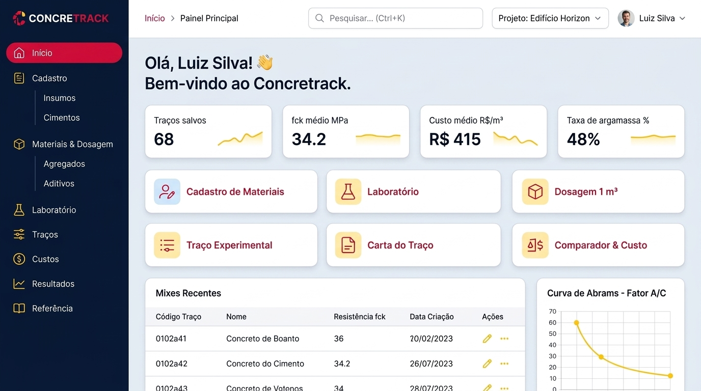
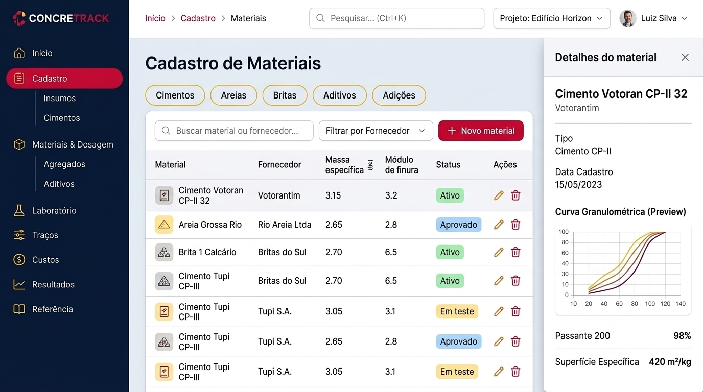
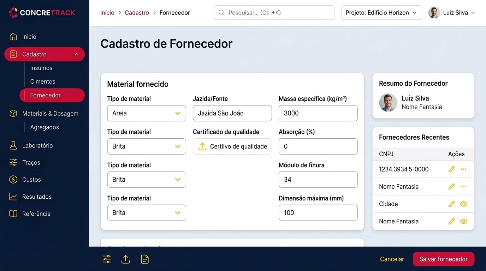
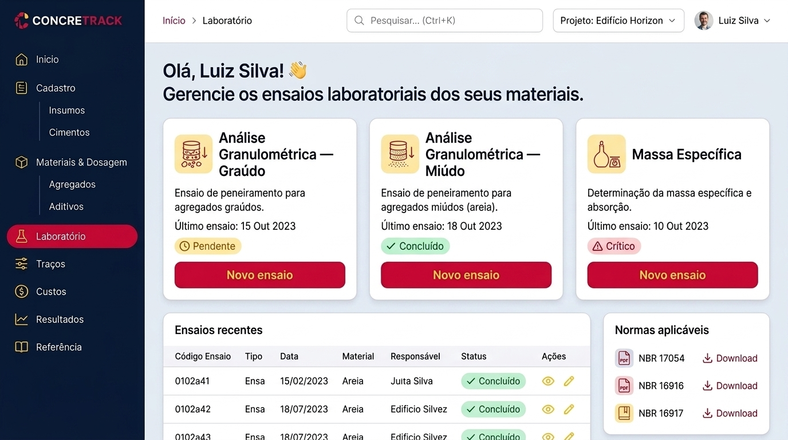
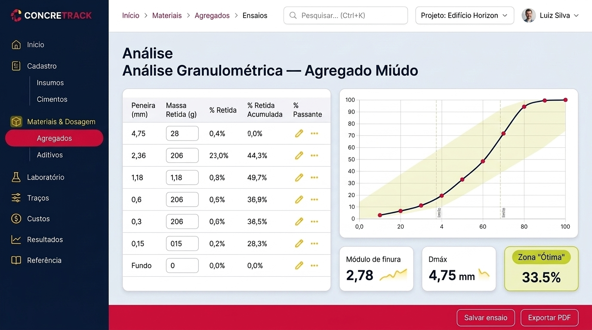
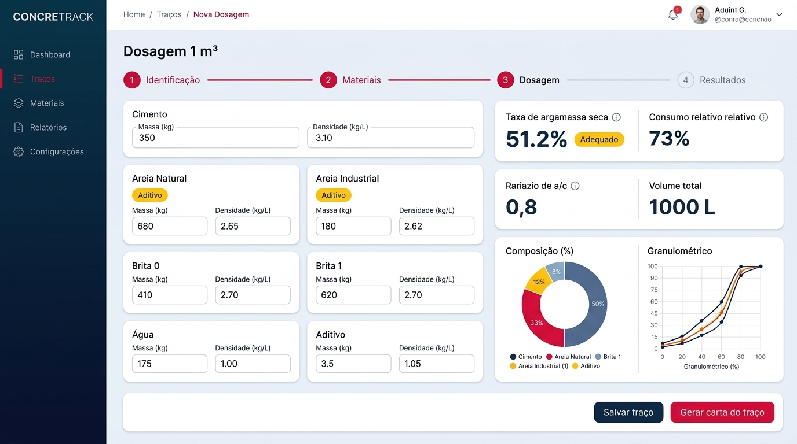
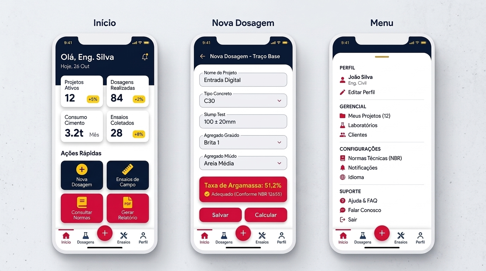

# CONCRETRACK — Redesign de Layout (paleta Red Bull Racing 2026)

Documento do processo de leitura do layout atual, decisões de design e telas propostas.
Imagens em [`telas/`](./telas/).

---

## 1. Leitura do layout atual

**Arquitetura**
- SPA em um único `index.html` (~700 KB) com ~30 seções `.section`, alternadas por `showSection(id)`.
- Cabeçalho fixo (68 px) + sidebar escura fixa (210 px) + área de conteúdo (`max-width: 1480px`).
- Sidebar com 9 grupos: Início, Cadastro, Materiais & Dosagem, Análise Volumétrica, Laboratório, Traços, Custos, Resultados, Referência.
- Telas "hub" (`hub-card`) para Cadastro, Laboratório e Resultados.
- Camada de modernização já existente: `layout-modern.css` e `layout-modern.js` sobrepostos ao CSS legado.

**Problemas identificados**

| Área | Problema |
|---|---|
| Navegação | Fonte muito pequena (0,5–0,68 rem); ícones em emoji; logo da sidebar via `::before` com `position: fixed` (gambiarra) |
| Orientação | Sem breadcrumb, busca global ou seletor de projeto |
| Home | Só atalhos; sem KPIs nem histórico recente |
| Formulários | Longos, sem etapas, sem feedback de resultado enquanto se digita |
| CSS | Muitos `!important` e seletores `[style*=...]` para vencer estilos inline |
| Mobile | Menu como gaveta lateral; sem tab bar |

---

## 2. Como o redesign foi pensado

1. **Manter a lógica, mudar a casca.** IDs, funções de cálculo e fluxo de `showSection` permanecem; o redesign é de HTML/CSS da camada visual.
2. **Orientação constante.** Barra superior com breadcrumb, busca (Ctrl+K), projeto ativo e usuário em todas as telas.
3. **Resultado ao vivo.** Telas de cálculo ganham painel de resultados fixo (sticky) ao lado do formulário, em vez de resultado só no fim.
4. **Formulário em etapas.** Stepper (Identificação → Materiais → Dosagem → Resultados) para quebrar páginas longas.
5. **Barra de ações fixa** no rodapé (Salvar / Gerar carta / Exportar).
6. **Ícones de linha (SVG)** no lugar de emojis.
7. **Hierarquia por cor com função:** vermelho = ação primária; amarelo = destaque/estado; navy = estrutura.
8. **Mobile-first no PWA:** tab bar inferior, FAB e bottom sheet de navegação.

### Evolução das decisões
- Mockup 1: paleta navy + ciano + laranja (base do layout).
- Mockup 2: recolorido com paleta Red Bull Racing 2026.
- **Decisão final:** layout do primeiro mockup (home/dashboard) com a paleta Red Bull Racing 2026; demais telas derivadas dele.

---

## 3. Design system

### Paleta
Os hex abaixo são aproximações da pintura (não há código oficial confirmado).

| Token | Uso | Hex |
|---|---|---|
| `--rb-navy` | Sidebar, headers, texto de título | `#0A1530` – `#0E1F45` |
| `--rb-red` | Botões primários, item ativo, FAB | `#DB0A40` |
| `--rb-yellow` | Ícones da sidebar, badges, gráficos, destaques | `#FFC906` |
| `--rb-bg` | Fundo da página | `#EEF1F7` |
| `--rb-card` | Cards | `#FFFFFF` |

Mapeamento sugerido em `layout-modern.css`:
```css
:root {
  --modern-navy:   #0A1530;
  --modern-navy-2: #0E1F45;
  --modern-blue:   #DB0A40; /* primário (antes azul) */
  --modern-cyan:   #DB0A40; /* ativo / foco */
  --modern-orange: #FFC906; /* destaque */
  --modern-bg:     #EEF1F7;
}
```

### Componentes
- **Tipografia:** Inter. Títulos de página 1,6 rem/700; rótulos 0,75 rem/600.
- **Cards:** raio 16 px, sombra suave, borda `#DBE5EA`.
- **Sidebar:** 252 px, ícones amarelos, item ativo em pílula vermelha, subitens indentados com guia vertical.
- **Chips de status:** verde (concluído/ativo), amarelo (pendente/em teste), vermelho (crítico).
- **Inputs:** label flutuante, raio 9 px, foco com anel vermelho translúcido.
- **Gráficos:** linha navy, pontos vermelhos, faixas/áreas amarelas.

---

## 4. Telas

### 01 — Home / Dashboard

KPIs (traços salvos, fck médio, custo médio, taxa de argamassa), atalhos para os módulos, mixes recentes e curva de Abrams.

### 02 — Cadastro de Materiais

Abas por tipo, tabela filtrável, chips de status e drawer de detalhes com prévia granulométrica.

### 03 — Cadastro de Fornecedor

Formulário em cards, resumo do fornecedor, recentes e barra de ações fixa.

### 04 — Laboratório (hub)

Três ensaios com status e último teste, ensaios recentes e normas aplicáveis.

### 05 — Análise Granulométrica (miúdo)

Tabela de peneiras editável, curva com zona ótima, módulo de finura e Dmáx.

### 06 — Dosagem 1 m³

Stepper, materiais com massa/densidade, painel de resultados fixo (taxa de argamassa com badge), composição e curva.

### 07 — Mobile (PWA)

Início, Nova Dosagem com resultado fixo e menu em bottom sheet. Tab bar com FAB.

> As telas 06 e 07 foram geradas em versão recolorida do mockup original; a sidebar delas é uma versão simplificada. No padrão final, todas as telas usam a sidebar das telas 01–05.

---

## 5. Pendências

**Telas ainda não geradas** (a cota de geração de imagens esgotou; reinicia por volta de 04:36 UTC de 18/10):
- Massa Específica
- Traço Experimental
- Carta do Traço
- Comparador & Custo
- Análise Volumétrica (Abrams & Empacotamento)
- Normas de Concreto

Os prompts estão definidos e a geração pode ser retomada quando a cota voltar.

**Pontos a corrigir ao implementar** (imperfeições das imagens geradas)
- Telas 02 e 03: textos e dados de exemplo inconsistentes (ex.: "Cimento Tupi" repetido, um fornecedor com avatar de pessoa).
- Tela 05: breadcrumb e título duplicado ("Análise / Análise Granulométrica"); a tabela mostra valores que não fecham e o card "Zona Ótima" exibe 33,5%, que não é um dado coerente.
- Tela 06: ícone ativo da sidebar com baixo contraste (vermelho sobre navy) e erros de digitação em rótulos.
- Tela 03: barra inferior mistura ícones sem rótulo; revisar.

## 6. Plano de implementação sugerido
1. Trocar variáveis de cor em `layout-modern.css`.
2. Sidebar: ícones SVG, acordeão, remover `::before/::after` fixos do logo.
3. Barra superior: breadcrumb, busca, projeto, usuário.
4. Home com KPIs (lendo traços salvos do storage atual).
5. Stepper + painel de resultados fixo em Dosagem e Traço Experimental.
6. Tab bar mobile e bottom sheet.
7. Reduzir `!important` e estilos inline, migrando para classes.
